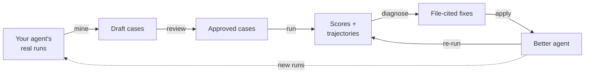

# evalkit

By [InferEdge](https://www.inferedge.com/).

**Make your AI agent better, end to end.**

evalkit is a self-hosted system for improving AI agents. Real traffic goes
in; a better agent comes out, with evals your domain experts signed off on.

> **TL;DR** Mine failures from your agent's real runs and turn them into
> eval cases. Your domain experts review the cases in plain language, so
> "right" means what the business means. Run them, read every trajectory,
> and get file-cited fixes for your prompts, tools and skills. Apply,
> re-run, repeat until green. Your coding agent drives the loop with
> evalkit's skills; evalkit keeps the cases, reviews, runs and history.



## How evalkit improves your agent

1. **Find what goes wrong.** Pull a batch of your agent's app runs from
   production, staging or manual testing. Your coding agent analyzes each
   one, groups the failure patterns and drafts eval cases.
2. **Agree on what right looks like.** Domain experts read each case as a
   question and the facts a right answer must contain, then approve it,
   comment, or send it back with changes. Only approved cases count.
3. **Measure it.** evalkit runs the cases against your agent, keeps the full
   trajectory of every run (messages, reasoning, tool calls, tokens, cost,
   timing) and scores it with LLM-judged rubrics, built-in tool-call checks
   and your own evaluators.
4. **Fix it.** Your coding agent pulls the failed runs, diagnoses each one,
   and proposes fixes that name the prompt, tool description, skill or data
   source to change.
5. **Prove it.** Apply the fixes, re-run, and compare the two experiments
   case by case: what got fixed, what broke. The cases stay as regression
   guards for every change after.

Steps 1, 4 and 5 run as agent skills (`evalkit skills install`) in Claude
Code or another coding agent. Alongside them are skills for writing cases
with a domain expert and connecting your traces.

## Developers and domain experts, one loop

An agent is only as good as the definition of "right" it is tested
against. Developers know the prompts, tools and harness; domain experts
know what a correct answer is. evalkit gives each side its own view of the
same cases.

- **Cases in plain language.** A case is a question plus rubrics, one
  sentence each: "States 17,133 company-operated stores at FY2021
  year-end." An expert can read and judge it without reading code. The
  case-authoring skill interviews the expert in their own terms and writes
  the YAML.
- **Review in the web UI.** Draft → Review requested → Approved, or Changes
  requested with a comment. Threaded comments sit on the case, and each
  case keeps a changelog of every sync and decision. Runs on shared
  datasets use approved cases by default, so a half-written case never
  moves the score.
- **Workspaces.** Each developer has a personal workspace to iterate in
  without touching anyone's results. Shared workspaces such as `dev` and
  `prod` hold the team's datasets, agents and experiments, with `writer`
  and `reviewer` members.
- **Promotion.** Link `dev` to `prod`, and approving a case in `dev` copies
  that exact version into `prod`. Your prod suite only ever holds reviewed
  cases.

## It's that simple

```yaml
# eval/cases/smoke/cases.yaml
cases:
  - id: store-count
    input:
      question: "How many company-operated stores did Starbucks have at FY2021 year-end?"
    evaluators:
      output:
        answer_rubrics:
          rubrics:
            - rubric: "States 17,133 company-operated stores at FY2021 year-end."
              type: factual_retrieval
```

```python
# eval/run.py
from evalkit.sdk import run_experiment, tracing
from myagent import ask

tracing.register(agent="myagent")  # your agent's spans become its trajectory


def task(input: dict) -> str:
    return ask(input["question"])


result = run_experiment(dataset="smoke", agent="myagent", task=task)
print(result.url)  # the scorecard in the web UI
```

## Why evalkit

- **Failures you can read.** Open a low score and see exactly what the agent
  did, step by step.
- **Plug in your traces.** Already emitting OpenTelemetry spans with
  OpenInference or GenAI conventions? evalkit maps them into trajectories.
  Any harness, any model.
- **See your app runs too.** Browse your agent's real runs with their
  latency, tokens, cost and tool calls, not just eval runs.
- **Graders you choose.** Any OpenAI-compatible model as the judge, and your
  own evaluators in Python or over HTTP.
- **Cases are code.** They live in your repository and sync from CI, like
  the rest of your code.

## Run your own evalkit

1. **Try it locally.** [Try locally](docs/user/try-locally.md) starts the
   server on your machine with Docker, judges with your LLM, and runs a
   sample agent through an SDK run with traces.
2. **Deploy it for your team.** The
   [evalkit-deployment skill](skills/evalkit-deployment/SKILL.md) covers the
   server image, Postgres, blob storage, the judge, migrations, users and
   workspaces. [Config and deploy](skills/evalkit-deployment/references/config-and-deploy.md)
   has the config reference and the compose setup.
3. **Connect your agent.**
   - [SDK runs](docs/user/sdk-runs.md) with [Tracing](docs/user/tracing.md)
     and [Mappings](docs/user/mappings.md): the default path.
   - [Harness API](docs/user/harness-api.md): when the server should drive
     your agent.

## Use a team's evalkit

If your team already runs a server, open its `/docs` page: the same pages,
with your server's URL filled in. Start with the
[Quickstart](docs/user/quickstart.md).

On GitHub, `{{origin}}` in the docs stands for your server's URL.

## Reference

- [Concepts](docs/user/concepts.md): the terms
- [Install](docs/user/install.md), [Login](docs/user/login.md),
  [Config](docs/user/config.md), [Workspaces](docs/user/workspaces.md)
- `skills/`: agent skills for authoring cases, eval-driven development,
  connecting traces and day-to-day use. `evalkit skills install` copies them
  into your repository.

## Feedback

- **Bugs, feature requests and feedback:** open an
  [issue](https://github.com/inferedge-ai/evalkit/issues/new/choose).
- **Questions:** ask in
  [Discussions](https://github.com/inferedge-ai/evalkit/discussions).
- **Security vulnerabilities, or anything else:** email
  [tech@inferedge.com](mailto:tech@inferedge.com). Don't post
  vulnerabilities in a public issue.

evalkit doesn't take pull requests, but issues are very welcome: a clear
bug report or idea helps just as much.
