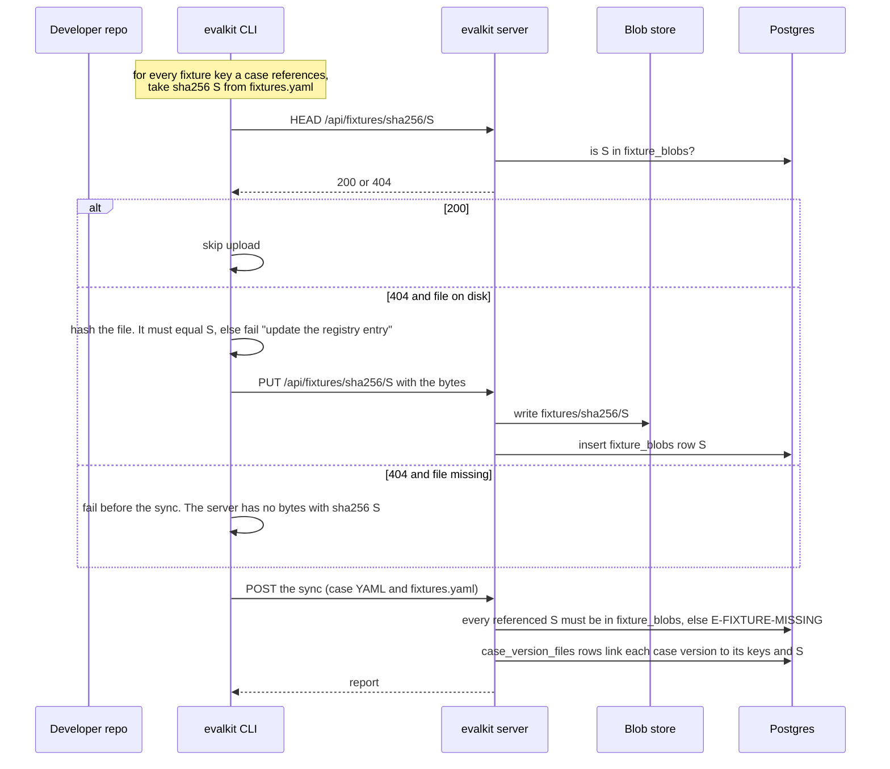

# Fixture handling during a sync

A fixture is an input file a case attaches. The bytes live in the client's
`fixtures` directory and in the blob store under `fixtures/sha256/<sha256>`;
they are never in git. `fixtures.yaml` lists each key with its sha256. Bytes
are stored once per sha256 for the whole deployment, whatever workspace or
dataset uses them. This page shows what happens to one fixture key when
`evalkit sync` (or the sync that `evalkit run` does before a local run) writes
into any workspace.

## Reading the diagram

- The server asks one question about a fixture: does it hold bytes with
  sha256 `S`. The key and the workspace don't matter.
- Upload only happens when the file is on disk and the server doesn't hold
  `S` yet. Once anyone has uploaded the bytes, every later sync into any
  workspace finds them.
- CI runners never have fixture bytes, so every CI sync takes the "file
  missing" branch. A sync from CI succeeds as long as someone has run or
  synced the case before, from any workspace.
- There is no promotion step. A shared copy never changes in place: new bytes
  have a new sha256, so they arrive through a registry change.
