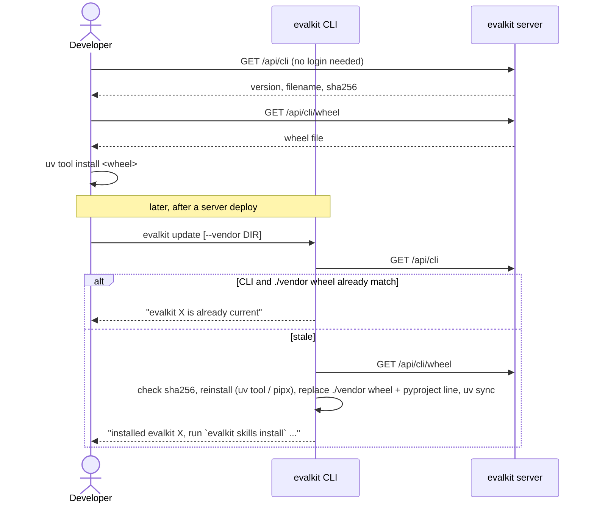
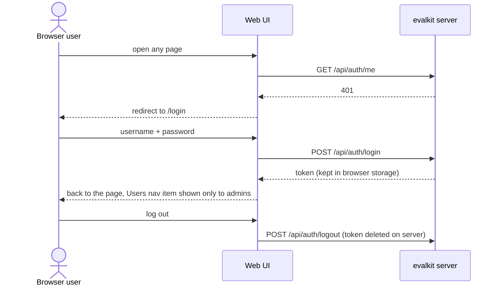

# 01. Install, log in

How a developer gets the CLI from a server, logs in to a server, and keeps the CLI in step with the server.

## Actors

- **Developer**: runs the CLI on a laptop.
- **CLI**: `evalkit` (`src/evalkit/cli/main.py`, `src/evalkit/cli/update.py`, `src/evalkit/client/connection.py`).
- **Browser user**: uses the web UI.
- **evalkit server**: one deployment, e.g. `https://evalkit.example.com`.

The CLI holds one server login (url, token, username) in `~/.evalkit/config.toml` (file mode `0600`). Shared workspaces such as `@dev` and `@prod` live on that one server; they are not separate logins.

In a client repo, `evalkit.yaml` holds the `credentials:` map. The CLI reads keys from env and from a `.env` beside `evalkit.yaml`; real env vars win over `.env`.

## Sequence

### Install and update



### Log in, check

```mermaid
sequenceDiagram
  actor Dev as Developer
  participant CLI as evalkit CLI
  participant S as evalkit server
  Dev->>CLI: evalkit login --url URL [--username --password]
  CLI->>S: POST /api/auth/login {username, password}
  S-->>CLI: token, username, is_admin
  CLI-->>Dev: "logged in as U on URL; saved to ~/.evalkit/config.toml"
  Dev->>CLI: evalkit whoami
  CLI->>S: GET /api/auth/me
  S-->>CLI: username, is_admin, personal_workspace, roles, token_expires_at
  CLI-->>Dev: "U on URL" + "token expires YYYY-MM-DD HH:MM UTC"
```

### Web UI login



## Expected outcomes

- `GET /api/cli` and `/api/cli/wheel` work without a token.
- `login` saves the login, replacing any earlier one (to the same server or another).
- `whoami` prints the user, server and token expiry (or "token does not expire").
- `/api/auth/me` returns `is_admin` (a stored user flag), the user's personal workspace, and `roles`: every shared workspace where the user is a `writer` or `reviewer`, with the roles held there.
- `EVALKIT_SERVER_URL` + `EVALKIT_TOKEN` override the stored login (`whoami` adds "(from EVALKIT_SERVER_URL)"). This is how CI logs in.
- Tokens from `login` expire after `auth.token_ttl_hours` (default 720 hours).
- Within one day of expiry, most commands print a yellow warning: "the token for URL expires in N h; run `evalkit login --url URL` before a long run".
- Every server response carries `X-Evalkit-Version`. The CLI compares it to its own version:
  - same: silent
  - different but compatible: yellow warning "evalkit A differs from server B; run `evalkit update --server URL`"
  - incompatible (major version differs, or on `0.x` the minor version differs): the command stops with "evalkit A cannot talk to server B: run `evalkit update --server URL`"
- `update` verifies the wheel checksum before installing. It reinstalls the CLI only when versions differ and replaces a vendored wheel only when checksums differ.
- The UI shows the Users page link only when `is_admin` is true.
- A page that doesn't exist (a bad link) shows a 404 with a link one level up.

## Error cases

- Wrong username or password: 401 "invalid username or password".
- No stored login and no `EVALKIT_SERVER_URL`: "no server configured — run `evalkit login --url <url>` or set EVALKIT_SERVER_URL".
- Archived user: login gives 401 "user is archived". Archiving also revokes their login tokens.
- Expired token: 401 "token expired". Unknown token: 401 "invalid token".
- An agent token (see flow 12) used on any API other than the collector: 403 "agent tokens may only export traces".
- `update` checksum mismatch: "checksum mismatch: server says …, downloaded …".
- `update` cannot tell how the CLI was installed: it saves the wheel and prints the `uv tool` and `pipx` commands to run.
