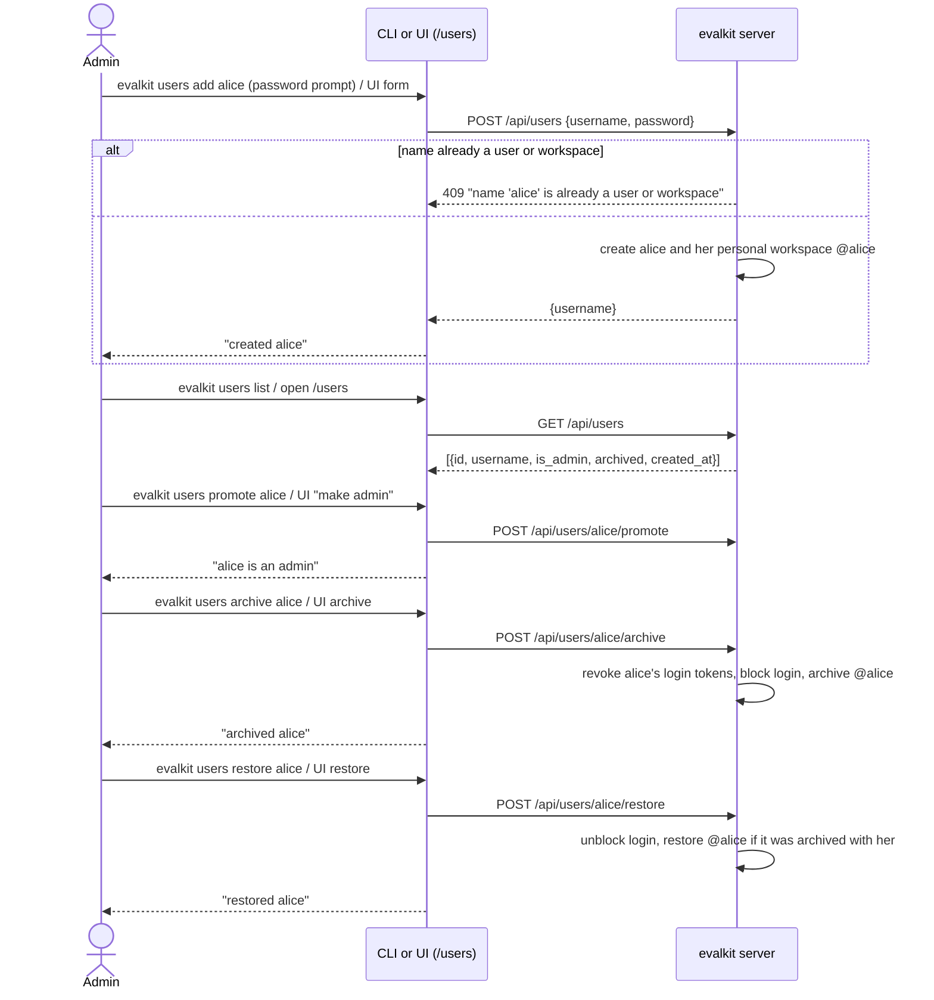

# 02. User admin

How an admin creates, lists, archives and restores users, and grants or removes admin.

## Actors

- **Admin**: any user with the stored admin flag. On first start, when no admin exists, the server creates a user named `admin` from `EVALKIT_ADMIN_PASSWORD`. A server with no admin and no `EVALKIT_ADMIN_PASSWORD` refuses to start.
- **CLI**: `evalkit users …` (`src/evalkit/cli/main.py`).
- **Web UI**: the `/users` page (`ui/src/pages/UsersAdmin.tsx`).
- **evalkit server**: `src/evalkit/api/users.py`, `src/evalkit/db/users.py`.

## Sequence

## Expected outcomes

- Only admins can call `/api/users`. In the UI, the Users nav item appears only for admins.
- A new user can log in at once (flow 01). Their personal workspace, named after the username, is created in the same step.
- `users list` prints `username  ADMIN ARCHIVED  created <timestamp>` per user, with only the flags that apply. The UI marks rows with "admin" and "archived" chips.
- `users promote` / `users demote` (UI "make admin" / "demote") set the admin flag.
- `users set-password alice` sets a new password and signs alice out everywhere.
- Users are never deleted:
  - Archiving revokes their login tokens, blocks login and archives their personal workspace.
  - Agent tokens they minted keep working: they belong to the agent.
  - The username stays reserved.
  - Data they created (datasets, experiments, review events, comments) stays and still shows their username.
- Every user can read every workspace. Only the owner writes a personal workspace; admins cannot write other users' personal workspaces.
- Workspace and member admin is flow 16. Agent, evaluator and trace source admin is flow 17.

## Error cases

- Server start with no admin user and no `EVALKIT_ADMIN_PASSWORD`: the server refuses to start, "no admin user exists and EVALKIT_ADMIN_PASSWORD is not set; set it and start the server again to create the admin user".
- Not admin: 403 "admin only".
- Name already a user or workspace (e.g. `dev`): 409 "name 'X' is already a user or workspace".
- Bad name: 400 "invalid name 'X': use lowercase letters, digits, '.', '_' or '-', starting with a letter or digit".
- Archiving or demoting the last active admin: 409 "cannot remove the last admin".
- Unknown user: 404 "unknown user: X".
