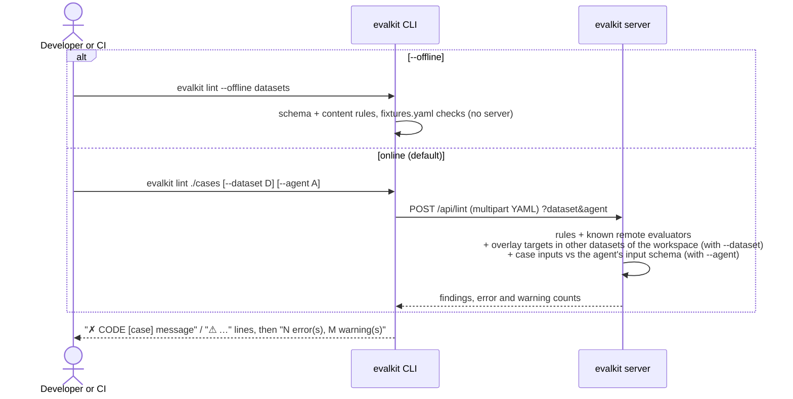
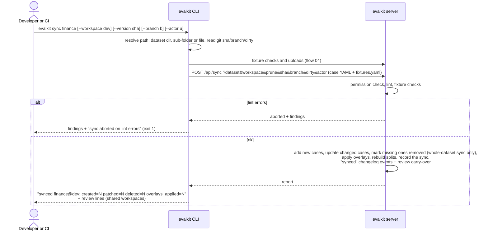
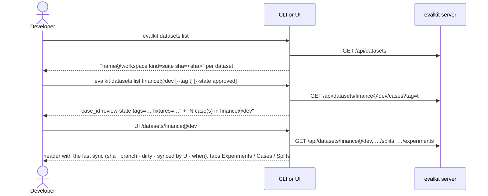

# 03. Lint and sync a suite

How case YAML on disk becomes a dataset on the server, for a developer's personal workspace or, from CI, a shared workspace such as `@dev`.

## Actors

- **Developer**: edits case YAML in a client repo that has an `evalkit.yaml` (`cases:` and `fixtures:` directories).
- **CI**: on merge to the main branch, logs in (`EVALKIT_SERVER_URL` + `EVALKIT_TOKEN`) as a user who may write the shared workspace, and syncs to it, e.g. `--workspace dev`.
- **CLI**: `evalkit lint`, `evalkit sync`, `evalkit datasets list` (`src/evalkit/cli/main.py`, `src/evalkit/client/sync.py`).
- **evalkit server**: `src/evalkit/api/imports.py`, `src/evalkit/api/datasets.py`.

Terms used here:

- A **suite** is a directory of case YAML. Its name is the dataset name.
- A **reference** names a dataset as `name@workspace`. The API and UI always use the full form. The CLI also takes a bare `name`, meaning your personal workspace.
- Fixture handling during sync is in flow 04.

## Sequence

### Lint

### Sync

### See the result

## Expected outcomes

- **Target workspace:**
  - Without `--workspace`, sync goes to the caller's personal workspace, i.e. `finance@<username>`.
  - `--workspace dev` writes `finance@dev`.
- **Who may sync:**
  - A shared workspace: admins and that workspace's `writer` members.
  - A personal workspace: its owner only. Admins cannot write it.
- **What gets pruned:**
  - Syncing a whole dataset directory removes cases no longer on disk (`deleted=N`). Removed cases are marked removed, not deleted, so old experiments keep their pinned case versions.
  - Syncing a sub-folder or one file only adds and updates; it never removes.
- **Idempotent:** re-syncing unchanged YAML reports `created=0 patched=0 deleted=0`.
- **Change detection:**
  - A case counts as `patched` only when its content hash changes. The hash covers input, fixture key/sha256/context, id, tags, expected and evaluators.
- **Case identity:** a case id names the same case everywhere. Each dataset holds its own version of it. A case id is unique within a dataset; the same case may sit in two datasets of one workspace.
- **Tags and splits:**
  - Sub-folder names become tags, and every tag becomes a split, visible under `GET /api/datasets/{ref}/splits` and the UI Splits tab.
- **Overlays:**
  - Overlays (`extends:` items) attach evaluator config to cases of *other* datasets in the same workspace. An overlay applies to its target case in every dataset of the workspace that holds that case.
  - `overlays_applied` counts them.
  - A whole-dataset sync removes overlays this dataset no longer declares.
- **Every sync is recorded:** who, when, branch, sha, dirty and counts.
  - The UI dataset header shows the last sync. Each `synced` changelog event points at its sync.
  - `--actor` (admin only) records someone else as the author.
- **Syncs to suite datasets in a shared workspace also:**
  - add a `synced` changelog event to every case whose content changed;
  - keep cases that were under review in review, at the new content. Printed as "N case(s) updated and still under review: id (reviewer)".
  - return approved cases that changed to Unreviewed. Printed as "N approved case(s) changed and are now unreviewed: …".
- **`run` syncs too:** `evalkit run` syncs your own on-disk dataset before a local or server run (flows 06 and 07). The same report lines print.

## Error cases

- **No write access:** 403 "you cannot sync to @X".
- **Archived workspace:** 409 "workspace X is archived".
- **Promotion target:** 409 "X is the promotion target of Y; sync Y instead".
- **Actor override as a non-admin:** 403 "actor override is admin only".
- **Lint errors:** the sync is aborted and nothing is written.
  - Example: a duplicate case id within the dataset, an overlay whose target no other dataset in the workspace holds, or an unknown remote evaluator.
- **CLI-side path errors:**
  - "X is not on disk; sync needs a directory or file"
  - "no dataset directory 'X' under <cases root>"
  - "X is in your workspace, so it syncs from disk: set `cases:` in evalkit.yaml, or pass the dataset's directory"
  - "no YAML files under X" (lint)
- **`datasets list X --state …`** on a dataset without review: "X has no review state; only suites in shared workspaces do".
- **`lint --offline --agent`:** "--agent needs the server; drop --offline".
