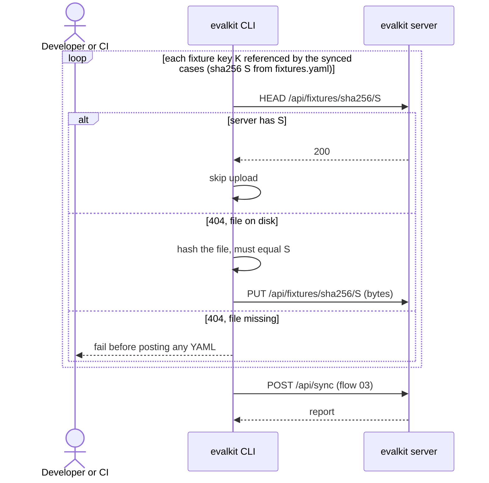
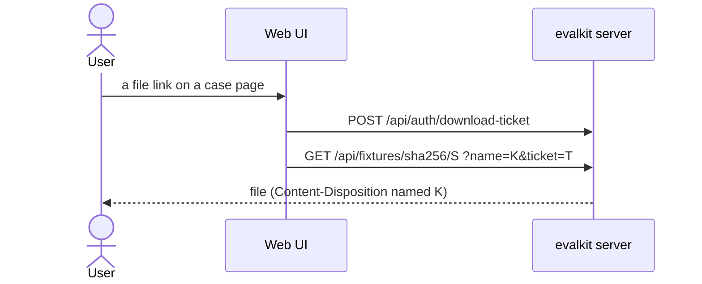

# 04. Fixtures

How fixture files (input files a case attaches) get to the server during a sync, and how they are downloaded. The detailed per-key steps are in `docs/fixtures.md`.

## Actors

- **Developer**: has the fixture bytes in the `fixtures:` directory named in `evalkit.yaml`.
- **CI**: syncs to a shared workspace and usually has no fixture bytes.
- **CLI**: `evalkit sync` / `evalkit run` (`src/evalkit/client/sync.py` `upload_fixtures`).
- **Web UI**: the case page's file links.
- **evalkit server**: `src/evalkit/api/fixtures.py`.

Terms:

- `fixtures.yaml` (the registry) lists each fixture key with its sha256 and context. It lives in git; the bytes never do.
- A fixture key is a flat filename (no `/`).
- Bytes are stored once per content for the whole deployment, at `fixtures/sha256/<sha256>` in the blob store. No workspace owns them.

## Sequence

### During a sync

### Browse and download

## Expected outcomes

- **Uploads:**
  - The CLI uploads only when the server lacks the bytes and the file is on disk.
  - Any logged-in user may upload. Which cases use the bytes is still guarded by sync permissions (flow 03).
- **CI** (no bytes) can sync as long as the server already holds every referenced sha256, e.g. because a developer synced the same cases to their personal workspace first.
- **Two datasets may use the same key for different bytes**, since bytes are stored by content.
- **Each case version** lists the files it uses: key, sha256 and context.
- **The harness** receives `input.files` with `{key, sha256, context, url}`, built when the run starts.
- **Downloads** go by sha256. `name` sets the saved filename.
- **Download tickets** are single-use, last 60 s and only authorise a GET. They let the browser save a file without a bearer header.
- **Fixture list (`GET /api/fixtures?workspace=W`, API only):**
  - Returns the fixtures used by W's current cases (default: the caller's personal workspace). Bytes used by no case don't show.
  - Page size is capped at 200.

## Error cases

- **File on disk doesn't match the registry:** "fixture 'K' on disk has sha256 X but fixtures.yaml says S; update the registry entry".
- **Missing everywhere:** "fixture 'K' is registered but <path> does not exist and the server has no bytes with sha256 S".
- **Uploaded bytes don't match the path:** 400 "bytes hash to X, not S".
- **Bad digest:** 400 "'X' is not a lowercase sha256 digest".
- **Key with `/`, `\`, `.` or `..`:** "fixture key 'K' must be a flat filename".
- **Not found:** 404 "no fixture with sha256 S".
