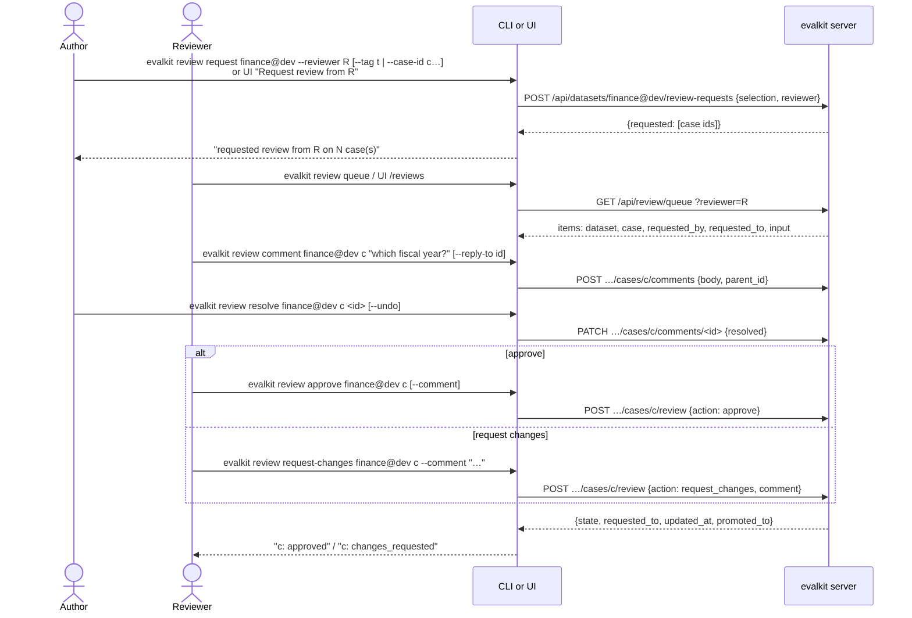
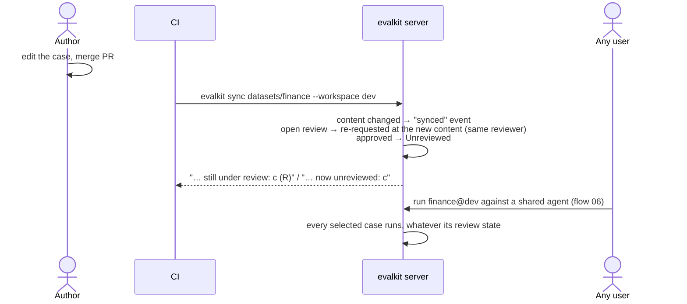
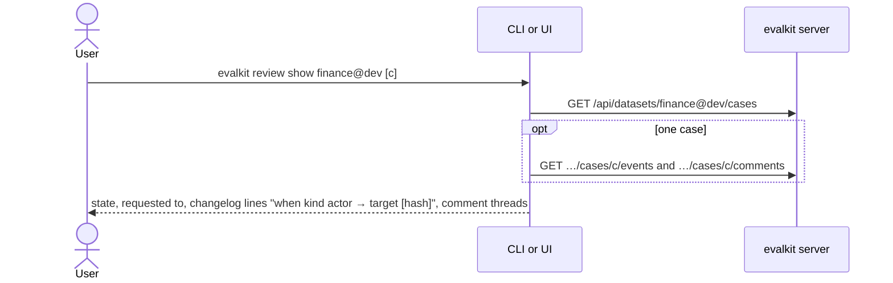

# 05. Case review

How a case in a suite dataset of a shared workspace (e.g. `finance@dev`) moves from Unreviewed to Approved. Review never filters a run; it decides what gets promoted.

## Actors

- **Author**: any logged-in user. They write the case, request review and answer comments.
- **Reviewer**: a member with the `reviewer` role on the dataset's shared workspace. Admins manage members (flow 16).
- **CI**: syncs merged cases to the shared workspace (flow 03).
- **CLI**: `evalkit review …` (`src/evalkit/cli/main.py`).
- **Web UI**:
  - `/datasets/:ref/cases` (cases with review state, "Request review from")
  - `/datasets/:ref/cases/:case` (review panel, changelog, comments)
  - `/reviews` (queue)
- **evalkit server**: `src/evalkit/api/review.py`.

**Review state** is one of Unreviewed, Review requested, Changes requested or Approved.
- It is worked out from the case's current content hash in that dataset and the latest decisive event recorded at that hash (`src/evalkit/core/review.py`). It is never stored.
- A case with no decision at its current content is Unreviewed.

## Sequence

### Request, discuss, decide

### Fix and re-sync, then run

### Read state and history

## Expected outcomes

- **Where review applies:** suite datasets in shared workspaces. Datasets in personal workspaces have none:
  - their state shows as `-`;
  - review endpoints return 409.
- **Review state is per dataset:** the same case id can be Approved in `finance@prod` and Unreviewed in `finance@dev`, because each dataset holds its own version of the case.
- **Request review:**
  - Records a "review requested" event per selected case, at its current content.
  - With no selector it covers every case.
  - The reviewer must hold the `reviewer` role on the dataset's workspace. The UI's "Request review from" list comes from `GET /api/workspaces/{ws}/members?role=reviewer`.
- **The queue:**
  - `review queue` (default: the caller's own queue) lists cases in Review requested, newest first.
  - `--all` lists every case under review. `--changes-requested` lists cases sent back to their authors.
- **Approve / request changes:**
  - Only reviewers of that workspace. A reviewer in `@dev` can't decide in `@prod` unless granted there too. The UI shows the buttons only to reviewers of the dataset's workspace (from `roles` in `/api/auth/me`).
  - "Request changes" needs a comment.
  - A comment given with a decision is also stored as a comment.
  - If the workspace is a promotion source, approving also adds the case to the same-named dataset of the promotion target (`promoted_to`).
- **Comments:**
  - Replies nest one level.
  - The author of a comment, or any reviewer of the workspace, can resolve or unresolve it.
- **Changelog:** lists `synced`, `review_requested`, `approved` and `changes_requested` events, each with actor, target and content hash.
  - Events and comments belong to the dataset, case and version, so renaming a dataset keeps its history.
  - Removed cases keep their history.
  - An archived user still shows by name.
- **When a sync changes a case's content:**
  - Approved → Unreviewed.
  - Review requested or Changes requested → Review requested again at the new content, to the same reviewer (or the last actor).
  - Unchanged content keeps its state.
- **Runs:** every case in the selection runs, whatever its review state, in every workspace. A promotion target may hold cases that are not Approved there (synced before the link); they run too.
- **`datasets list finance@dev --state approved`** filters cases by review state (flow 03).

## Error cases

- Not a reviewer of the workspace: 403 "only reviewers of this workspace decide".
- Requested reviewer lacks the role: 400 "R is not a reviewer of W".
- `request_changes` with no comment: 400 "request_changes needs a comment".
- Not a suite in a shared workspace: 409 "X is not a suite in a shared workspace; review does not apply".
- Promotion target: 409 "X is fed by promotion; review c in Y" (or "request review in Y").
- Unknown dataset or case: 404 "unknown dataset: X" / "unknown case: c".
- Bad reply: 400 "parent comment is not on this case", "replies nest one level only".
- Empty comment: 400 "comment body is empty".
- Resolving someone else's comment as a non-reviewer: 403 "only a reviewer or the author may resolve".
