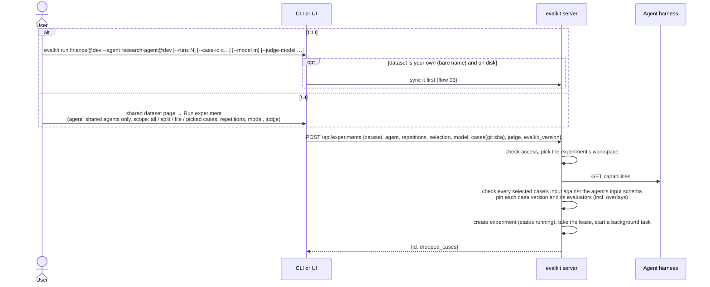
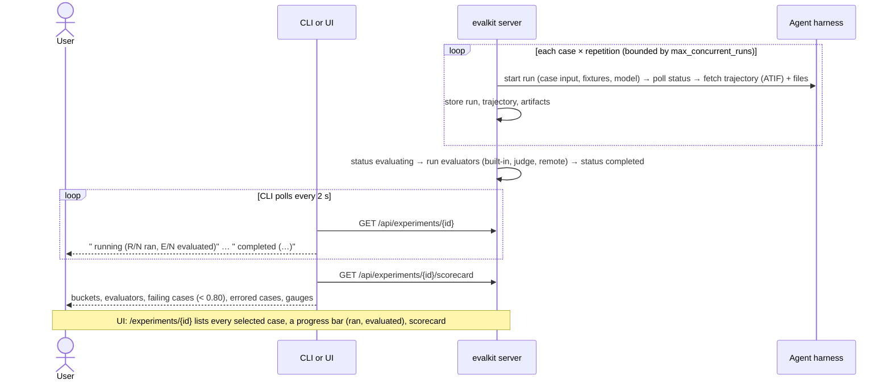
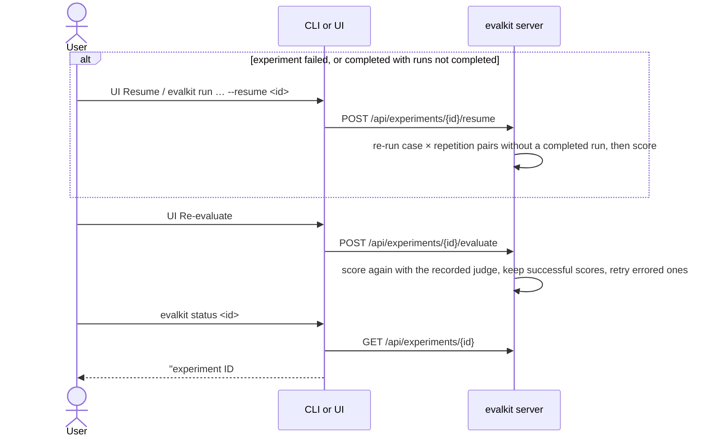

# 06. Server run

How a user runs a dataset against a shared agent: an agent in a shared workspace (e.g. `research-agent@dev`) whose harness is deployed somewhere the server can reach. The server drives the harness, scores the runs and stores everything; the CLI or UI only starts the experiment and watches.

## Actors

- **User**: any logged-in user.
- **CLI**: `evalkit run`, `status`, `summary` (`src/evalkit/cli/main.py` `_run_on_server`).
- **Web UI**:
  - the "Run experiment" launcher on a shared workspace's dataset page (`ui/src/evals/RunLauncher.tsx`)
  - the experiment page (`ui/src/evals/ExperimentPage.tsx`)
- **evalkit server**: `src/evalkit/api/experiments.py`. Its experiment runner is in `src/evalkit/core/runner.py`.
- **Agent harness**: the client's agent behind the Harness API, at the agent's `harness_url`. Admins or writers create the agent with `evalkit agents create` (flow 17); its API key is a stored key, set with `--api-key-env` and kept encrypted in the database.
- **Judge**: the LLM the built-in evaluators call. Chosen per experiment; the default judge an admin set (`evalkit judge-default set`) applies when the run doesn't set one. Its base URL must be a registered LLM provider, whose stored key the server sends.

## Sequence

### Start

### Run, score, watch

### Recover

## Expected outcomes

- **Who drives:** the agent reference decides.
  - An agent in a shared workspace (`research-agent@dev`) → server run.
  - Your own agent → local run (flow 07).
  - In the UI, the launcher lists only shared agents, and the "Run experiment" button appears only on datasets in shared workspaces. Personal dataset pages show the CLI command instead.
- **Datasets:** any dataset can be used, including your own (`finance` = `finance@you`, synced first).
- **Where the experiment lives:**
  - In the dataset's workspace when the dataset and the agent are both shared (`finance@dev` + `research-agent@dev` → `@dev`).
  - Otherwise in the personal workspace of the user who starts it (`evalkit run finance --agent research-agent@dev` → `@you`).
- **Who may start one:** any user may use a shared agent. An experiment that lands in a shared workspace needs a `writer` or `reviewer` role there, or admin. There is no per-agent grant.
- **Who may change one** (resume, re-evaluate): admins and `writer` members of the experiment's workspace, plus its creator. Admins can't change another user's personal experiments.
- **Review state:** never filters a run. Every selected case runs, in personal and shared datasets alike.
- **Selection:**
  - `--case-id` (repeatable), a split tag, a case file or picked cases.
  - The UI shows the run count on the Start button: "Start N runs" = cases × repetitions.
- **Fixture cases** are skipped when the harness accepts neither files nor file URLs. The CLI prints "skipped N case(s) with fixture files; the agent accepts neither files nor file urls: …".
- **`--model`** is passed only if the harness accepts a model override. Otherwise the run uses the harness default and the server logs a warning. The model the harness reports is recorded when none was given.
- **Judge:** CLI `--judge-model`, `--judge-base-url`, `--judge-effort` or the UI's "Judge provider" picker override the default judge. The judge is recorded on the experiment, and Re-evaluate reuses it.
- **Recorded with every experiment:** the case revision (git sha, branch, dirty; UI launches take it from the dataset's last sync) and the agent's `revision` and `branch` from its capabilities response.
- **Pinning:** each case's version and effective evaluators (including overlays) are pinned at start, so later edits don't change old results.
- **Status moves** `running` → `evaluating` → `completed`, or to `failed` with an error.
  - The CLI exits 1 on `failed` and prints "experiment failed: <error>".
- **Lease:** the runner holds a lease and renews it while alive. A server that dies without a clean shutdown leaves the experiment `running` for about a minute; then it becomes `failed` and can be resumed.
- **Server shutdown:** a graceful shutdown marks in-flight experiments `failed` ("interrupted: evalkit server shut down"), so they can be resumed.
- **Experiment page:**
  - Lists every selected case from the start: not run → ran, not evaluated → evaluated.
  - A progress bar counts cases in two segments: ran and evaluated.
  - Shows the agent's revision and the case revision.
  - "Resume" appears when the experiment is `failed`, or `completed` with runs that did not complete. "Re-evaluate" and "Resume" show only for server-driven experiments, to users who may change the experiment. Local runs show the CLI resume command instead.
  - A "Compare with…" picker opens the compare page (flow 10).
- **Resume** runs only the case × repetition pairs that have no completed run, then scores. The latest attempt wins: a resumed pair replaces its failed attempt in the scorecard.
- **Re-evaluate** keeps successful scores and re-runs errored evaluators.
- **Ids and paths:** experiment ids are integers (`/experiments/123`). API paths and UI URLs use `name@workspace`. A missing experiment shows a 404 linking to the experiments list.
- **Results** are visible to every user: experiment lists, scorecard and runs (flow 09).

## Error cases

- **Nothing to run:** 400 "nothing to run in X: no cases match the selection" (or "every selected case needs fixture files and the harness accepts none: …").
- **Case inputs don't match the agent's input schema:** 400, listing each failing case. Nothing runs.
- **No start rights in the shared workspace:** 403 "experiments of D with A belong to @W; only its writers, reviewers and admins may start them".
- **Someone else's personal agent:** CLI "A belongs to U's workspace; only its owner can run it"; API 403 "only the owner of @U can run A".
- **Unknown agent:** 404.
- **Archived agent:** 409 "agent A is archived".
- **Judge not a registered LLM provider:** 400 "<url> is not a registered LLM provider; registered: …".
- **No judge and no default judge:** 400 "no default judge; …".
- **No stored key for the agent, an evaluator or the judge's provider:** the run still starts. The response carries `warnings: […]` (also logged), and the call goes out without a key header. A harness that needs a key then fails, e.g. 502 "could not start experiment: …" when capabilities return 401.
- **Harness unreachable at start:** 502 "could not start experiment: …".
- **Sending capabilities for a shared agent:** 400 "capabilities are fetched by the server for shared agents".
- **Not allowed to change the experiment:** 403 "you cannot change this experiment".
- **Resume or Re-evaluate while a runner holds the lease:** 409 "experiment is S, held by H".
- **Background failure** (harness error, crash in scoring): the experiment becomes `failed` with the error text.
