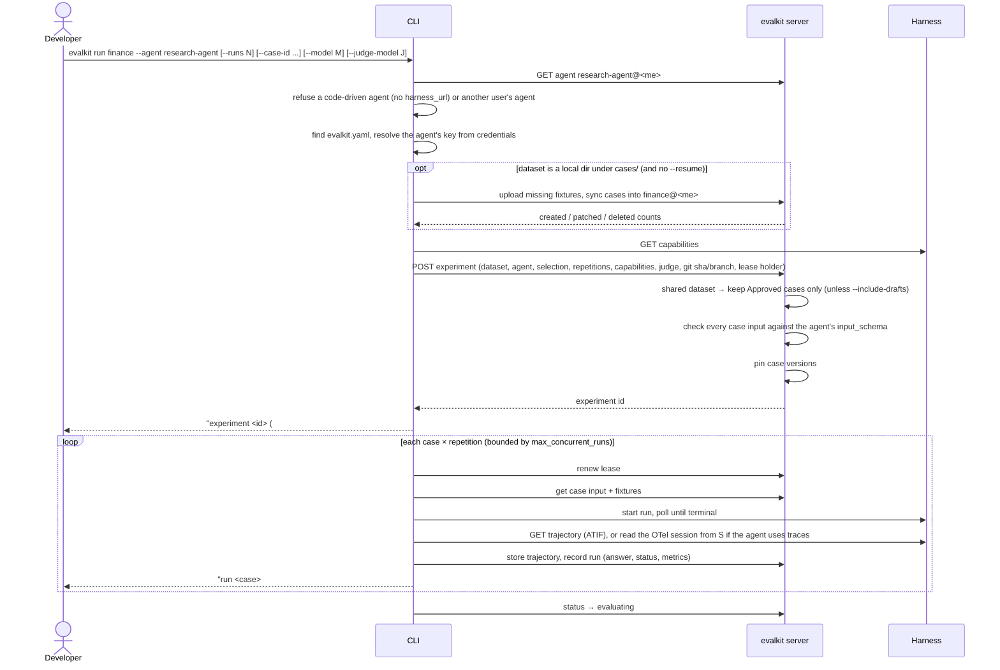
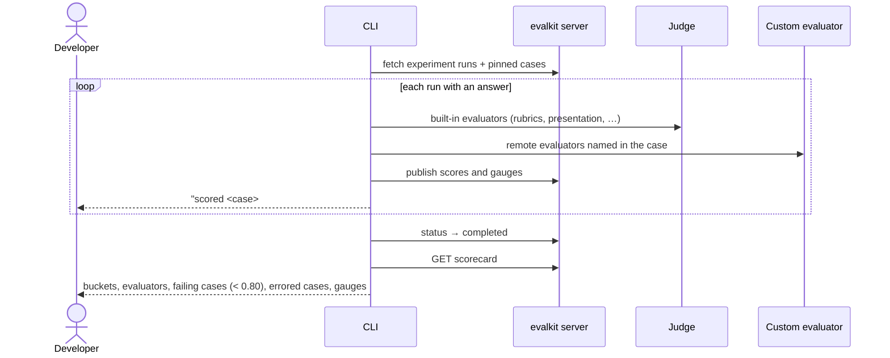
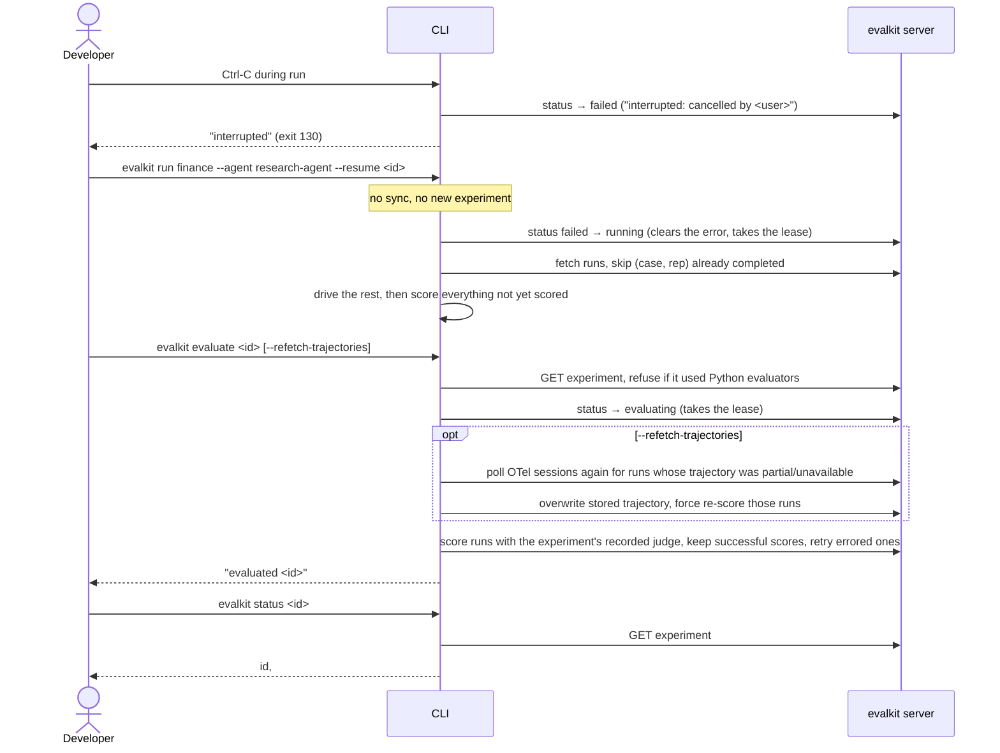

# 07. Local harness run

A developer runs their own agent, served by a harness on their machine, against a dataset. The CLI drives the harness and scores the runs; results land on the evalkit server.

## Actors

- **Developer**: runs `evalkit run`, `evalkit status`, `evalkit evaluate`.
- **CLI**: the `evalkit` command on the developer's machine. It reads `evalkit.yaml` (`cases` / `fixtures` dirs and the `credentials` map; a `.env` beside it is loaded).
- **Harness**: the developer's agent behind the Harness API. The agent lives in the developer's personal workspace (`evalkit agents create research-agent --harness-url http://localhost:8000`); its `harness_url` is often `localhost`.
- **Custom evaluator**: optional, a remote evaluator in the agent's workspace (`evalkit evaluators create`).
- **Judge**: the LLM used by built-in evaluators. Set per experiment with `--judge-*` flags, otherwise the server's `judge_default`.
- **evalkit server**: stores the dataset, experiment, runs, scores and trajectories.

## Sequence

### Start and drive

### Score and summarise

### Interrupt, resume, re-score, status

## Expected outcomes

- `evalkit run <dir-or-name> --agent research-agent` syncs the local cases into `<dataset>@<me>` first, then runs; the experiment appears under that dataset in the UI.
- Progress lines: `experiment <id> (#<n> of <dataset>)`, one `run <case> #<rep> <status>` per run, one `scored …` per run, then the summary table.
- Personal datasets run every case; datasets in shared workspaces (e.g. `finance@dev`) run only Approved cases unless `--include-drafts`.
- `--case-id` limits the selection; `--runs N` gives N repetitions per case.
- `--model` is recorded on the experiment; if the harness doesn't accept a model override the server logs a warning and still runs.
- If the harness accepts neither files nor file URLs, fixture cases are dropped with `skipped <n> case(s) with fixture files; …` and the expected-run count shrinks to match.
- A personal agent's experiment lives in the personal workspace of the user who starts it, even against a shared dataset such as `finance@prod`.
- The experiment's status moves `running` → `evaluating` → `completed`, or `failed`.
- The CLI holds a lease on the experiment while it works and renews it. If the CLI dies, the server marks the experiment `failed` once the lease expires; it can then be resumed.
- Ctrl-C leaves the experiment `failed` with error `interrupted: cancelled by <user>`; `--resume <id>` finishes it without repeating completed runs.
- On resume, the latest attempt per (case, repetition) replaces the failed one in the scorecard.
- The experiment pinned its case versions at start. Syncing again later does not change it, and `--resume` doesn't sync.
- `evalkit evaluate <id>` is safe to repeat: successful scores stay, errored ones are retried.
- `evalkit status <id>` prints the status, `<ran>/<total> ran, <evaluated>/<total> evaluated`, the lease holder while it runs, and the error line when set.
- The UI shows no server-side Resume or Re-evaluate for local runs. It shows the `evalkit run … --resume <id>` command instead.
- Local runs appear in the agent's Runs browser (`/runs?agent=research-agent@<me>`).

## Error cases

- Another user's agent: `<agent> belongs to <ws>'s workspace; only its owner can run it`.
- No `evalkit.yaml` above the current dir: `no evalkit.yaml found above the current directory`.
- Code-driven agent (no `harness_url`): `<agent> is a code-driven agent (no harness_url); run it with evalkit.sdk.run_experiment, or if it serves the Harness API, set its URL: evalkit agents edit <agent> --harness-url URL`.
- Unknown agent: `unknown agent: <ref> — create it with evalkit agents create`.
- Shared dataset with no Approved case in the selection: `no approved cases in <dataset> match the selection; pass --include-drafts to run drafts`; nothing runs.
- Nothing left to run (no case matches, or every case needs fixtures the harness can't take): `nothing to run in <dataset>: …`.
- Case inputs that fail the agent's `input_schema`: `<n> case input(s) fail agent <agent>'s input_schema:` listing every bad case; nothing runs.
- A judge `base_url` with no `credentials` entry: `no credentials.judges entry for <url>`, before the run.
- A `credentials` entry whose env var is unset: `credentials.<kind>s['<ref>'] needs env var <NAME>`, before the run.
- No `credentials.agents` entry for the agent: the CLI sends no key header; a harness that needs one returns 401, which shows as a run error.
- CLI / server version mismatch: refused before any work.
- A second `--resume` or `evaluate` on an experiment whose lease is live: 409.
- Harness run timeout: the run is recorded with status `timeout` and error `run timed out after <n>s`.
- Harness protocol violation: run recorded with `harness protocol violation: …`.
- Trajectory invalid or unreachable: run recorded with `trajectory_status` `invalid` / `unavailable`; scoring continues without it.
- Scoring fails for some runs: `scoring failed for X of Y runs of experiment <id>; first error: …` plus `finish it with: evalkit evaluate <id>`; the experiment is `failed`.
- `evalkit evaluate` on an experiment that used Python evaluators: `experiment <id> used python evaluators <names>; re-score it with evalkit.sdk.evaluate_experiment from the script that defines them`.
- Server-side resume or re-evaluate of a local run: 409 pointing to `evalkit run <dataset> --agent <agent> --resume <id>`.
