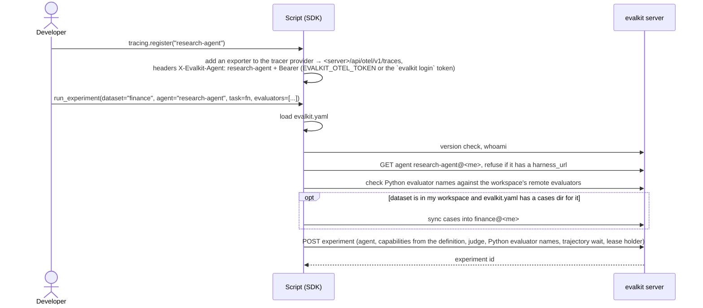
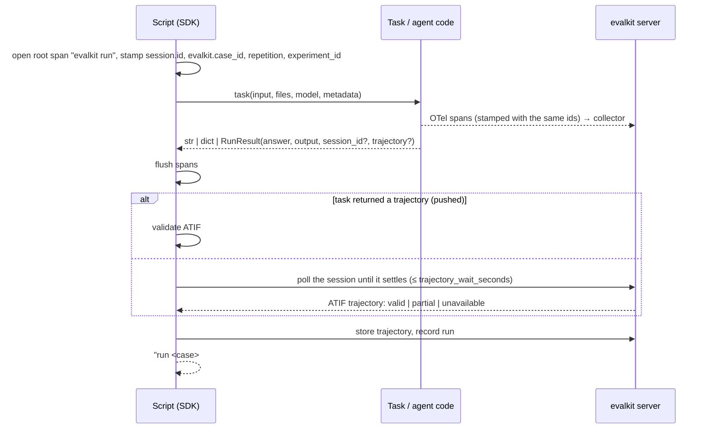
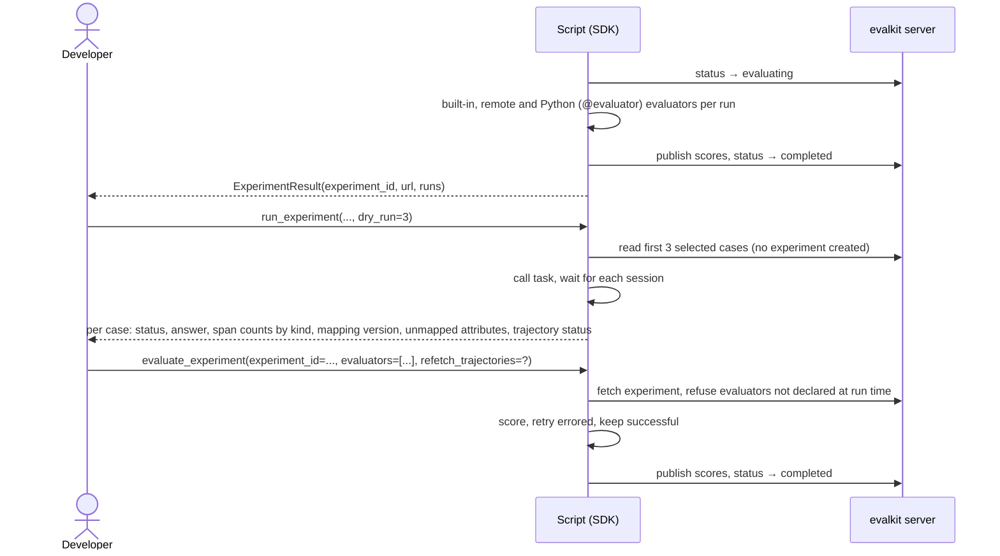

# 08. SDK run with OTel traces

A developer runs a code-driven agent (no Harness API) from their own Python script with `evalkit.sdk.run_experiment`. The agent's OTel spans go to the evalkit collector, which turns them into trajectories.

## Actors

- **Developer**: creates the agent once (`evalkit agents create research-agent --trajectory-source otel --mapping mapping.json`, no `--harness-url`), then writes the script: a task function, optional `@evaluator` functions, `tracing.register(...)`, `run_experiment(...)`.
- **Script (SDK)**: the developer's Python process. It calls the task once per case and repetition, scores, and writes results through the evalkit API. It reads `evalkit.yaml` for `cases`, `fixtures` and the `credentials` map (a `.env` beside it is loaded).
- **Agent code**: whatever the task calls; it emits OTel spans (e.g. via an OpenInference or `gen_ai` instrumentor).
- **evalkit server**: holds the agent, its mapping, the dataset and the experiment. Its collector (`/api/otel/v1/traces`) receives spans; the server serves each session as an ATIF trajectory, built with the agent's mapping.
- **Judge / custom evaluator**: the judge from `judge=Judge(...)` or the server's `judge_default`; remote evaluators from the agent's workspace.

## Sequence

### Set up tracing and start

### One case

### Score, dry run, re-score

## Expected outcomes

- Spans exported during a run carry `session.id`, `evalkit.case_id`, `evalkit.repetition` and `evalkit.experiment_id`; each run is one session.
- The experiment appears in the UI under the dataset; each run shows its trajectory built from spans.
- A code-driven agent is always personal, so the experiment lives in the personal workspace of the user who starts it.
- The task may return a `str` (answer), a `dict` (structured output) or a `RunResult`; a `RunResult` may carry its own `session_id` or a pushed ATIF trajectory.
- `split=` and `case_ids=` narrow the selection; `repetitions`, `concurrency` and `model` behave like the CLI.
- `model=` with a task that has no `model` parameter prints a warning; the model is still recorded.
- `dry_run=N` creates no experiment and writes no runs; it prints a per-case report for wiring checks.
- The status moves `running` → `evaluating` → `completed`, or `failed`. The script holds a lease while it works; a script that dies leaves the experiment `failed` once the lease expires.
- `resume=<id>` skips completed (case, repetition) pairs. The latest attempt per (case, repetition) replaces the failed one in the scorecard.
- `evaluate_experiment` re-scores, including Python evaluators passed again by the script.
- The CLI's `evalkit evaluate` refuses experiments that used Python evaluators.
- `ExperimentResult.url` points at `/experiments/<id>`.
- Runs show in the agent's Runs browser as sessions (`/runs?agent=research-agent@<me>`).

## Error cases

- No `evalkit.yaml` above the working dir: `evalkit.yaml not found above <dir>; it holds your cases, fixtures and credentials`.
- Unknown agent: `unknown agent: <ref> — create it with evalkit agents create`.
- Agent has a `harness_url`: `<agent> has a harness_url, so evalkit drives it through its Harness API: run it with evalkit run <dataset> --agent <agent>`.
- Python evaluator name that clashes with a remote evaluator: `python evaluator(s) <names> are also remote evaluators in @<workspace>`.
- Called inside a running event loop: `RuntimeError`, use `arun_experiment` / `aevaluate_experiment`.
- No tracer provider and the task returned no `session_id`: run error `no tracer provider configured and the task returned no session_id`.
- Two runs return the same `session_id`: the second fails with `session id <id> was already used in experiment <exp>; each run needs its own session id`.
- Task returns another type: run error `task protocol violation: …`.
- Task raises: the run is recorded as failed with the exception text; other runs continue.
- No spans settle in time: `trajectory_status` `unavailable` (or `partial`); scoring goes on without a trajectory.
- OTel extra missing: `evalkit tracing needs the otel extra: uv add 'evalkit[otel]'`.
- Spans for an unknown agent: the collector answers 404 `unknown agent: <ref> — create it with evalkit agents create`.
- A second resume or evaluate on an experiment whose lease is live: 409.
- Scoring fails: the exception carries `experiment <id> is not fully scored; finish it with evalkit.sdk.evaluate_experiment(experiment_id=<id>, evaluators=[...]) passing <names>`. With no Python evaluators it ends ``evalkit.sdk.evaluate_experiment(experiment_id=<id>) or `evalkit evaluate <id>` ``.
- `evaluate_experiment` with an evaluator not declared at run time: `python evaluators <names> were not part of experiment <id> (declared: …)`.
