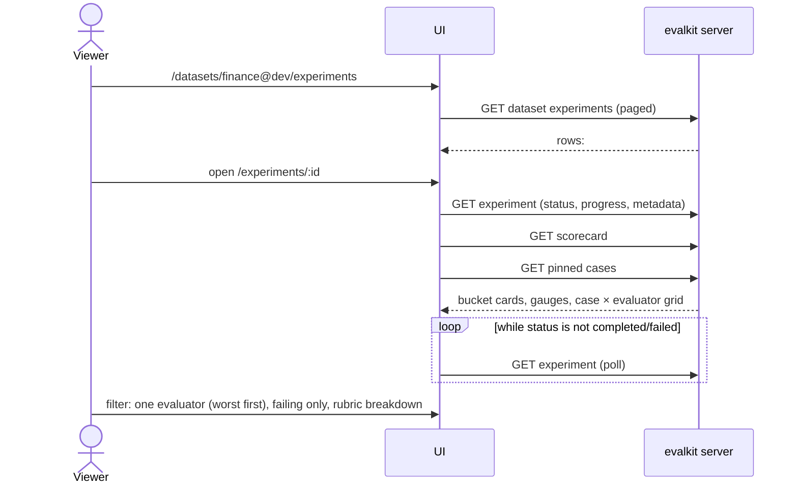
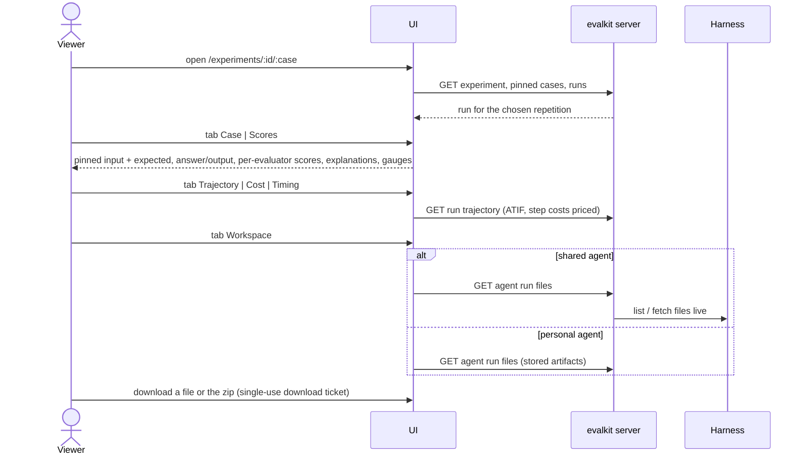
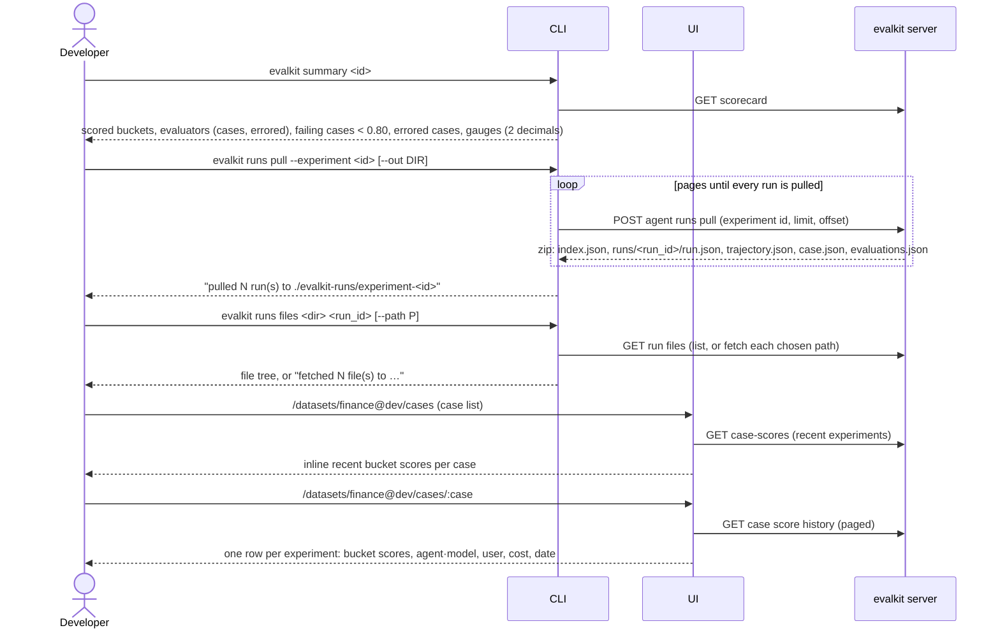

# 09. Browse an experiment, scorecard and pull runs

After an experiment runs, people read its results in the UI or CLI, drill into single runs, see a case's score history, and pull runs to disk for diagnosis.

## Actors

- **Viewer**: anyone logged in, in the browser.
- **Developer**: uses `evalkit summary`, `evalkit status`, `evalkit runs pull`, `evalkit runs files`.
- **UI**: the evalkit web app.
- **CLI**: the `evalkit` command.
- **evalkit server**: serves experiments, runs, scores, trajectories and files.
- **Harness**: only for shared agents' run workspace files, which the server fetches live.

## Sequence

### Find and read an experiment (UI)

### Drill into a run (UI)

### CLI summary, pull, and case score history

## Expected outcomes

- URLs and API paths use full references, e.g. `/datasets/finance@dev/...`. Experiment ids are integers (`/experiments/123`); `#<number>` counts experiments per dataset.
- The dataset's Experiments tab lists every experiment run on it, paged (50), with `#<number>` and bucket means. The bucket means match the experiment scorecard: errored and superseded scores don't count.
- An incomplete experiment shows `runs/expected` in warning colour.
- The experiment page lists every selected case from the start, with its state: not run, ran but not evaluated, evaluated. A progress bar counts cases in two segments: ran and evaluated.
- The page also shows status, the workspace chip, the agent's revision (from the harness's capabilities `revision` / `branch`), the case revision, the evalkit version, bucket cards, gauges and the case grid. The error line shows when the status carries one.
- The workspace chip shows the experiment's own workspace: the dataset's workspace when the dataset and agent are both shared, otherwise the personal workspace of the user who started it.
- Status values: `running`, `evaluating`, `completed`, `failed`. An experiment whose runner stopped renewing its lease flips to `failed`.
- The case grid counts only the latest attempt per (case, repetition). Earlier failed attempts of a resumed experiment add no run errors.
- Each score is stored with its source: `builtin`, `remote` (a remote evaluator) or `code` (a Python evaluator). The scorecard and run pages label a score `builtin`, or `custom:<evaluator>` for the other two.
- Re-evaluate and Resume show only for server-driven experiments, and only to users who may change the experiment. Resume shows when the status is `failed`, or `completed` with failed or timed-out runs; it re-drives every (case, repetition) without a completed run. Local runs show the CLI command (`evalkit run … --resume <id>` or `run_experiment(..., resume=<id>)`) instead.
- A "Compare with…" picker opens the compare page (flow 10).
- A run page opens on the Case tab; Trajectory, Cost and Timing are disabled when the trajectory was not recorded, with the reason as a tooltip.
- The Workspace tab lists files the harness produced and downloads them singly or as a zip.
- The case page always shows the case as pinned to the experiment, not the latest version.
- `evalkit summary` prints the same numbers as the UI scorecard.
- `evalkit runs pull --experiment <id>` pulls every run of the experiment into `./evalkit-runs/experiment-<id>` (or `--out`). Each eval run has its run, raw ATIF trajectory, pinned case and evaluations. Workspace files are not pulled; `evalkit runs files` lists and fetches them.
- Pulling again into the same `--out` adds to it. A pull directory inside a git repo and not ignored gets a warning.
- The case score history shows one point per recent experiment that ran the case: one representative score per bucket and the agent cost.

## Error cases

- A missing dataset, case, experiment or run shows a 404 that links one level up (case → its dataset → datasets list; run → its experiment → experiments list). The CLI prints the HTTP error.
- Run without a stored trajectory: 404 `run has no stored trajectory`; the tabs are disabled.
- Shared agent's harness no longer has the run or file: `not found on the harness: wrong path, or the harness no longer has it`.
- Harness unreachable for live files: `harness error` from the server.
- `runs pull` without an agent or `--experiment`: `pass an agent, or --experiment ID`.
- `runs files` on a directory without `index.json`: `<dir> has no index.json; pull runs into it first`; on a run not in it: `<run_id> is not in <index>; pull it first`.
- A pulled archive member that escapes the output dir: `archive member escapes the output directory: <name>`; nothing is written for it.
- Runs that could not be fetched in full: `<n> run(s) could not be fetched in full; see pull_error in run.json`.
