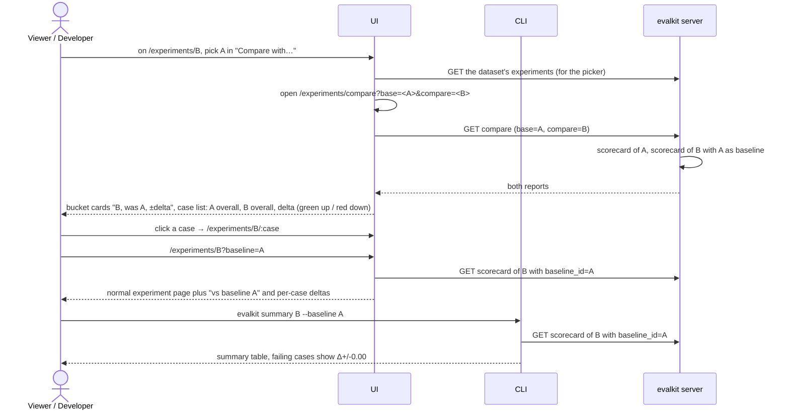

# 10. Compare experiments

Someone compares two experiments to see what got better or worse: bucket deltas and per-case overall deltas.

## Actors

- **Viewer**: in the browser.
- **Developer**: uses `evalkit summary --baseline`.
- **UI**, **CLI**.
- **evalkit server**: builds both scorecards and the deltas.

## Sequence

## Expected outcomes

- Any two experiments can be compared; the pair is chosen at request time and nothing is saved.
- The experiment page's "Compare with…" picker lists the same dataset's other experiments and opens `/experiments/compare?base=<picked>&compare=<this>`. The compare page and `?baseline=` also work from a typed or shared URL.
- Bucket deltas below 0.005 are not shown.
- On resumed experiments only the latest attempt per (case, repetition) counts.
- The case list holds the compared experiment's cases. A case missing from the base (or without an overall score on either side) shows `—` and no delta; cases only in the base are not listed.
- The case list links to the compared experiment's run page.
- `evalkit summary --baseline` adds `Δ` to failing-case lines only.
- Without both ids the compare page says `Pick two experiments to compare: /experiments/compare?base=…&compare=…`.

## Error cases

- Unknown id on either side: a 404 that links to the experiments list.
- Experiments of different datasets: allowed; only case ids present in both get deltas.
