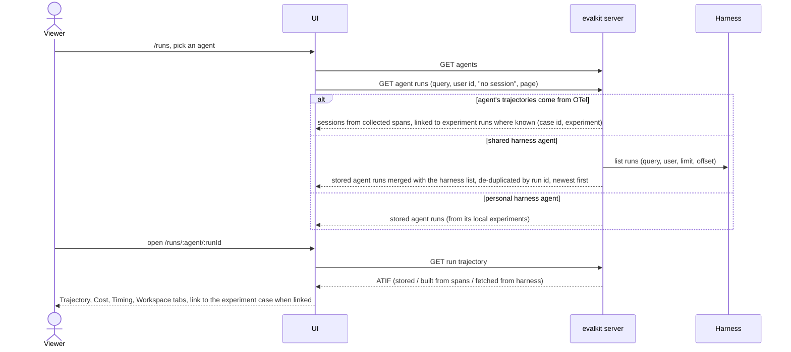

# 12. Agent tokens, the collector, and the Runs browser

A deployed agent that cannot carry a person's login exports OTel spans to evalkit with an agent token. People then browse that agent's sessions and trajectories in the Runs browser, alongside runs from experiments.

## Actors

- **Developer / admin**: creates the agent (`evalkit agents create … --trajectory-source otel --mapping file.json`, see flow 13), then mints, lists and revokes agent tokens.
- **CLI**.
- **Deployed agent**: the client's agent in its own environment, with an OTLP/HTTP exporter pointed at the collector.
- **evalkit server**: the collector (`/api/otel/v1/traces`) stores spans per agent and session; serves sessions as ATIF trajectories; lists runs per agent.
- **Harness**: for shared harness agents, the Runs browser adds the harness's own run list, fetched live.
- **Viewer**: browses `/runs` in the UI.

## Sequence

### Mint a token and export

```mermaid
sequenceDiagram
  actor D as Developer / admin
  participant CLI
  participant S as evalkit server
  participant A as Deployed agent

  D->>CLI: evalkit tokens create --agent research-agent[@dev]
  CLI->>S: POST token
  S->>S: agent must exist and not be archived<br/>shared workspace → admin or writer; personal workspace → its owner
  S-->>CLI: token id + secret (shown once)
  CLI-->>D: "token #lt;id#gt; for #lt;agent#gt; (shown once):" + secret
  D->>A: set EVALKIT_SERVER_URL + EVALKIT_OTEL_TOKEN (or Authorization header)
  loop as the agent works
    A->>S: OTLP/HTTP POST spans (protobuf or JSON, optional gzip)
    S->>S: check size, token, agent named by header / evalkit.agent attribute
    S->>S: session id from the agent's active mapping
    S-->>A: 200
  end
  D->>CLI: evalkit tokens list / revoke #lt;id#gt;
  CLI->>S: GET tokens / DELETE token
  CLI-->>D: "#lt;id#gt; #lt;agent#gt; by #lt;user#gt; last used #lt;time|never#gt;" / "revoked #lt;id#gt;"
```

### Browse runs



## Expected outcomes

- Agent references are always `name@workspace` in API paths and UI URLs (e.g. `research-agent@dev`); the CLI also takes a bare name for your personal workspace.
- `tokens create` prints the secret once; the token never expires and only works on the collector.
- A token exports spans only for the agent it is bound to.
- Non-admins see and revoke only their own tokens; admins see all.
- Archiving a user, or removing them as a writer, leaves the agent tokens they minted working: tokens belong to the agent. Revoke one with `evalkit tokens revoke`.
- Archiving the agent deletes its tokens; a restored agent needs a new one.
- Spans from a token show up as sessions under that agent in `/runs` within seconds; a session's trajectory is readable once it settles.
- An agent without an active mapping still has its spans stored, but without a session id.
- Every run evalkit starts or collects is an agent run that owns its trajectory: server runs, local runs, SDK runs and collected sessions.
- For OTel agents the search box filters by session id prefix, and "no session" lists traces without a session id.
- For harness agents the search box filters by id prefix or title, and the query goes to the harness unchanged.
- If the harness is unreachable, stored runs still show, with the note `harness unreachable — showing the runs evalkit stored.`
- Trajectories come from evalkit's storage when stored, else from the spans or the harness. Files and the workspace zip come from the harness for shared agents.
- Runs that came from an experiment show their case id and link back to the experiment run.
- A revoked token gets 401 on its next export.

## Error cases

- Unknown agent, when minting a token or exporting: 404 `unknown agent: <ref> — create it with evalkit agents create`.
- Minting without write access to the agent's workspace: 403 `you cannot mint tokens for <agent>`.
- Exporting to an archived agent, with a login token: 409 `agent <ref> is archived`. (An agent token stops working at archive: 401.)
- Exporting to an agent in an archived workspace: 409 `workspace <name> is archived`.
- Agent token used on any other API: 403 `agent tokens may only export traces`.
- Batch naming a different agent than the token's: 403 `token is bound to <a>, batch names <b>`.
- User token export without an agent name: 400 `name the agent with the X-Evalkit-Agent header or the evalkit.agent span or resource attribute`.
- User token export for an agent the user cannot write: 403 `you cannot export traces for <agent>`.
- Batch over `otel.max_batch_bytes` (also after gunzip): 413.
- Revoked or unknown token: 401.
- Run the harness no longer has: 404 `not found on the harness: wrong path, or the harness no longer has it`.
- OTel session with no spans: 404 `no spans for this session`.
- A missing agent or run in the UI shows a 404 linking one level up.
- A session whose span attributes exceed `otel.max_session_bytes`: 413 "session S of agent A holds N MiB of span attributes, over this server's otel.max_session_bytes (L MiB); …".
