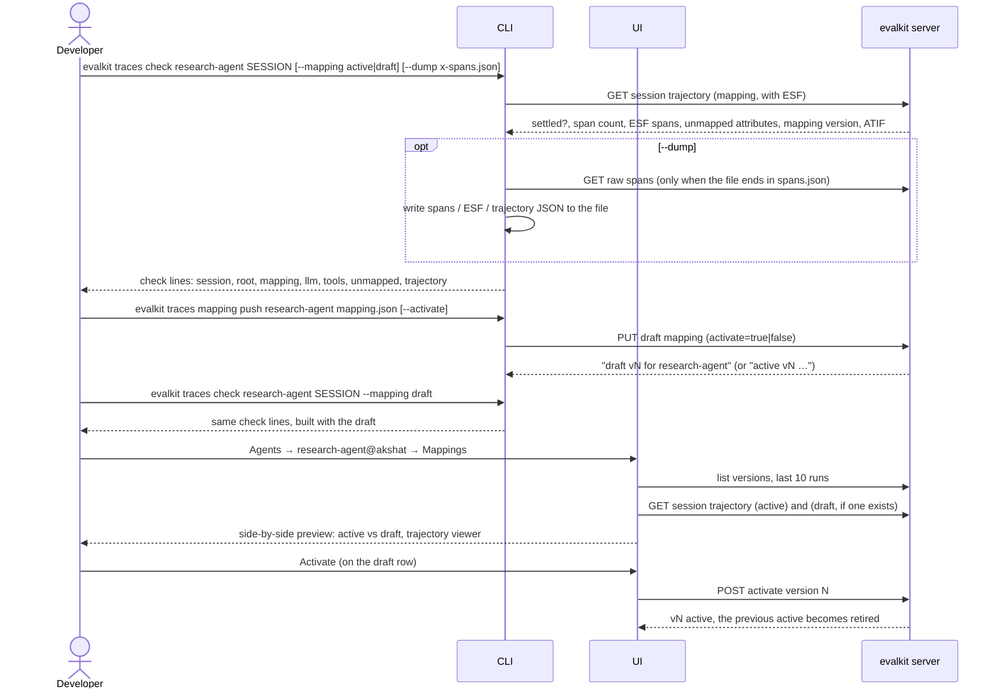

# 13. Trace mappings and checks

A developer checks how one OTel session of their agent turns into a trajectory, and changes the agent's span mapping until it looks right.

## Actors

- **Developer**: can write the agent's workspace: the owner of a personal workspace, or a `writer` or admin on a shared one.
- **CLI**: `evalkit traces check`, `evalkit traces mapping push|list`.
- **UI**: the agent page, Mappings tab.
- **evalkit server**: holds the agent's spans and mapping versions, and builds trajectories on read.

Terms:
- **Session:** the spans of one run.
- **Mapping:** a JSON document that says which span attribute holds each ESF field, plus `answer` and `exclude_spans`. Every OTel agent has its own mapping, created with the agent (`evalkit agents create … --trajectory-source otel --mapping file.json` stores v1 as active). Versions are `draft`, `active` or `retired`. An agent has at most one draft and one active version.
- **Starting points:** the `connect-traces` skill ships `gen_ai.json` and `openinference.json`. They hold the common session id attributes (`session.id`, `gen_ai.conversation.id`, `langfuse.session.id`). evalkit's code has no built-in mapping.
- **Agent references:** the API and UI always use `name@workspace` (`research-agent@dev`). The CLI also takes a bare name, meaning your personal workspace.

## Sequence

## Expected outcomes

- **`traces check`:**
  - Prints one line each for `session`, `root`, `mapping`, `llm`, `tools`, `unmapped` and `trajectory`, marked ✓ or ! or ✗.
  - **`session`:** `<n> spans in <k> traces, settled`, or `not settled yet` while spans are still arriving.
  - **`mapping`:** `vN`, the version used. With no active mapping it warns `no active mapping; the agent's spans are unmapped`.
  - **`llm`:**
    - Shows span count, models and token totals (in, out, cached).
    - Warns about LLM spans with no messages ("is message content capture on?") and about missing token counts.
    - Warns when there are no LLM spans.
  - **`tools`:** counts tool spans matched to tool calls by id, and warns about spans placed in no step.
  - **Exit code:** 1 when the session has no root span; otherwise 0, even with warnings.
- **`--dump`:**
  - The file name picks the content: `…spans.json` gives raw spans, `…esf.json` gives ESF, `…trajectory.json` gives ATIF. Any other name is an error.
  - Parent directories are created.
- **`--mapping draft`** previews the draft, including its `answer` and `exclude_spans`.
- **`mapping push`:**
  - Validates the document, then stores it as a draft with the next version number.
  - An existing draft becomes `retired`.
  - With `--activate`, the version becomes active and the old active one is retired.
- **`mapping list`:** prints `vN  status  by <user>  <created_at>` for every version.
- **UI Mappings tab:**
  - Shown only for agents whose trajectory source is `otel`.
  - Lists the agent's versions and previews active vs draft over recent runs.
  - The Activate button appears only on the draft row.
  - The UI cannot upload a mapping; uploads go through the CLI.
- **Activating a mapping changes:**
  - how trajectories are built on read, immediately, including for sessions already stored
  - which attribute supplies the session id, for spans *received after* activation only

## Error cases

- **Unknown agent:** 404 `unknown agent: <ref> — create it with evalkit agents create`.
- **`--mapping draft` with no draft:** 404 `no draft mapping for <ref>; push one with evalkit traces mapping push`.
- **Mapping document fails validation:** 400 `<field.path>: <message>`.
- **Activating a version that doesn't exist:** 404 `no mapping version N`.
- **Push or activate without write access to the agent's workspace:** 403 `you cannot change <ref>'s mappings or traces`. Shared workspace: admin or `writer`. Personal workspace: the owner only; admins are read-only there.
- **The agent's workspace is archived:** 409 `workspace <name> is archived`.
- **Session over `otel.max_session_bytes`:** 413 naming the size and the limit.
- **Unknown session id:** zero spans; the `root` line fails (✗), exit 1.
