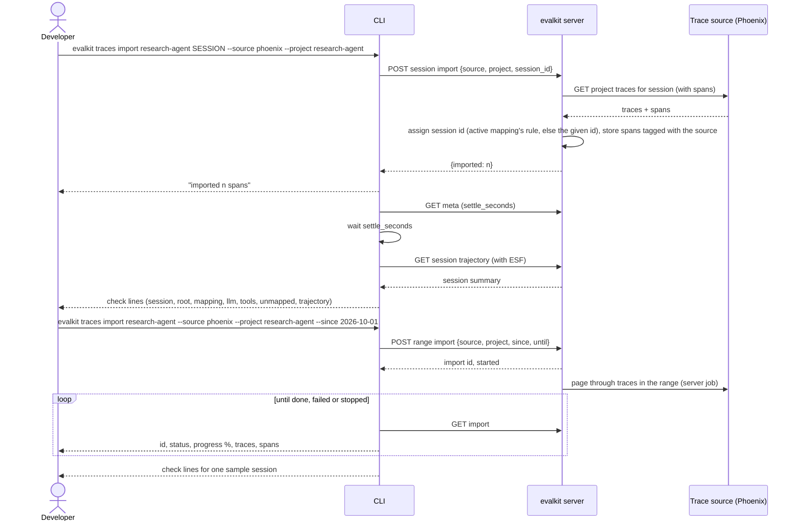

# 14. Import sessions from a trace source

A developer pulls historical sessions from an external trace store into evalkit, then sees how they map to a trajectory.

## Actors

- **Developer**: can write the agent's workspace: the owner of a personal workspace, or a `writer` or admin on a shared one.
- **CLI**: `evalkit traces import`, `evalkit traces imports`.
- **UI**: the agent page, Import tab (same two modes: one session, or a time range).
- **evalkit server**: stores the imported spans as the agent's sessions.
- **Trace source**: a third-party trace store an admin registered (flow 17). The only provider is Arize Phoenix, e.g. a client's own Phoenix project. evalkit reads from it only to import history.

## Sequence

## Expected outcomes

- **Session import:** prints `imported <n> spans`, waits the server's settle time, then prints the same check lines as `evalkit traces check` (flow 13).
- **Range import (`--since`, optional `--until`, default now):**
  - Runs on the server as a job. The CLI follows its progress; Ctrl-C only stops following.
  - When done, prints the check lines for one sample session, or `no sessions were imported`.
  - `evalkit traces imports research-agent` lists the agent's range imports.
  - `evalkit traces imports research-agent ID` follows one; `--stop` stops it; `--continue` resumes a failed or stopped import from where it got to.
- **Re-importing is idempotent.** Spans are keyed by agent, trace id and span id, so nothing is duplicated.
- **Imported spans** belong to the agent and show up anywhere its sessions do (trace checks, the mappings preview). They are tagged with the trace source they came from.
- **The session id of each span** comes from the agent's active mapping rule if the span carries it; otherwise, for a session import, it's the session id given on the command line.
- **`evalkit trace-sources list`** shows the source names, providers and URLs, never keys.

## Error cases

- **Unknown agent:** 404 `unknown agent: <ref> — create it with evalkit agents create`.
- **Agent that takes ATIF trajectories:** 400 `<ref> takes ATIF trajectories; only OTel agents import traces`.
- **Unknown or archived `--source`:** 404 `unknown trace source: <name>`.
- **No write access to the agent's workspace:** 403 `you cannot change <ref>'s mappings or traces`. Admins are read-only on personal workspaces.
- **Range import when the active mapping has no session id rule:** 409 `activate a mapping with session_id before importing a time range; import single sessions to try mappings first`.
- **Both or neither of SESSION_ID and `--since`:** `give either SESSION_ID or --since, not both`. `--until` without `--since` is refused.
- **The trace source is unreachable or rejects the request:** 502 `<source>: <error>`.
- **The source has no spans for that session:** `imported 0 spans`, then the check lines show no root (✗). Unlike `traces check`, the command still exits 0.
