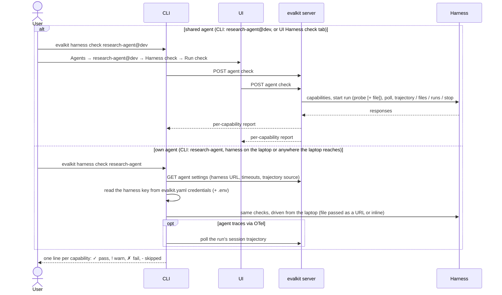

# 15. Harness check

A developer or admin verifies that an agent's harness implements the Harness API, before running experiments against it.

## Actors

- **Developer**: checks their own agent from the laptop.
- **Any logged-in user**: checks a shared agent (`research-agent@dev`) from the CLI or the UI. The server drives it.
- **CLI**: `evalkit harness check`.
- **UI**: the agent page, Harness check tab.
- **evalkit server**: holds agent settings, drives the check for shared agents, and serves sessions and fixture URLs.
- **Harness**: the client's agent behind the Harness API.

## Sequence

## Expected outcomes

- **The report has one entry per capability:**
  - **`capabilities`:** contract version, agent, and the revision or branch if the harness declares them.
  - **`input_schema`:** the probe input (the harness's `check_input`, otherwise `{"question": "Hi. Reply with one word."}`) is checked against the declared or default input schema.
  - **`run`:** a run reaches `completed` and carries an answer or an output.
  - **`files`:** a one-line text file is passed by URL or inline. `skipped` if the harness accepts neither.
  - **`trajectory`:**
    - Fetched from the harness and validated as ATIF; subagent link problems are a warning.
    - `skipped` if `provides.trajectory` is false.
    - For OTel agents it shows `from traces`, plus a **`session`** entry: the polled session is valid (pass), partial (warn) or unavailable (fail).
  - **`workspace`, `run_listing`, `stop`:** exercised only when declared; otherwise `skipped`.
- **The CLI exits 1** if any entry is `fail`.
- **Who may check:** the same rule as starting an experiment against the agent. Any user may check a shared agent; only the owner may check a personal one.
- **The harness API key** comes from the agent's stored key (in the server database) for shared agents, and from `credentials.agents` in `evalkit.yaml` plus a `.env` beside it for your own. With no entry, no key header is sent, and a harness that needs one shows a 401 `fail` on `capabilities`.
- **The UI tab:**
  - Shown only for agents with a `harness_url`, and only to users who may check the agent.
  - Shows "Checking… (runs a live agent call)" while running, then a table of capability, status chip and detail.
- **A failed `capabilities` call** stops the check early with only that entry.
- **The check makes real harness runs:** one probe, plus one more when `stop` is exercised.

## Error cases

- **Unknown agent:** 404 `unknown agent: <ref> — create it with evalkit agents create`.
- **Another user's personal agent:** the CLI refuses before any harness call: `<ref> belongs to <user>'s workspace; only its owner can check it`. The server endpoint returns 403 `only the owner of @<workspace> can check <ref>`.
- **Archived agent:** `agent <ref> is archived` (409 from the server).
- **Code-driven agent (no `harness_url`):** `<ref> is a code-driven agent (no harness_url); use evalkit traces check AGENT SESSION_ID`.
- **No `evalkit.yaml` for a local check:** `no evalkit.yaml found above the current directory`.
- **A credentials entry names an unset env var:** `credentials.agents['<ref>'] needs env var <NAME>`.
- **The server-side check takes over 120 s:** the request errors with no report.
- **Harness errors** (HTTP errors, timeouts, invalid ATIF): reported as `fail` entries, not as command errors.
