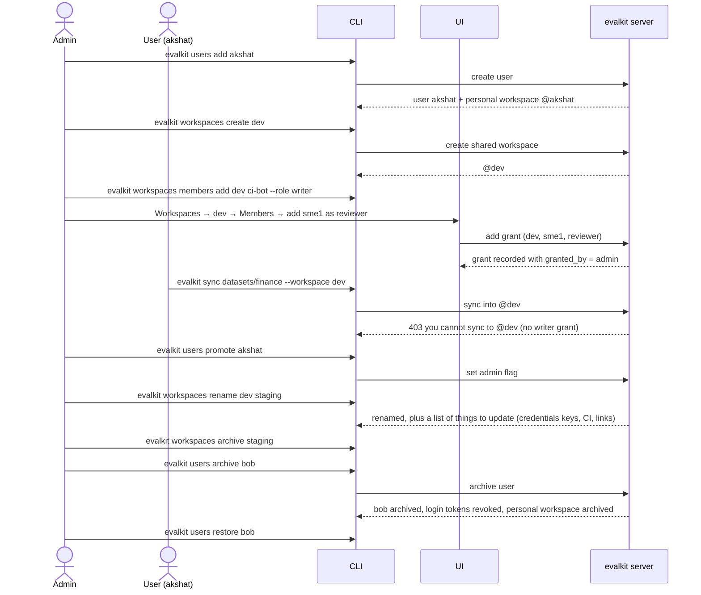

# 16. Workspace and member admin

An admin manages users, shared workspaces, and who may write or review in each
shared workspace.

## Actors

- **Admin**: a user with the admin flag.
- **User**: any logged-in user.
- **CLI**: `evalkit users …`, `evalkit workspaces …`.
- **UI**: the Users page, and workspace pages with a Members tab.
- **evalkit server**: stores users, workspaces and grants, and enforces access.

## Terms

- **Personal workspace:** a workspace owned by one user. Each user gets one
  named after them (`@akshat`), created together with the user.
- **Shared workspace:** a workspace with no owner, managed by admins, e.g.
  `@dev`, `@prod`. A deployment may have any number. No workspace is special.
- **Workspace type:** personal or shared, worked out from whether the workspace
  has an owner. It's not stored separately.
- **Grant:** a role a user holds on one shared workspace, `writer` or
  `reviewer`. Each grant records who granted it.

## Access rules

| | Personal (own) | Personal (someone else's) | Shared |
| -- | -- | -- | -- |
| User | read + write | read | read, write with `writer`, review with `reviewer` |
| Admin | read + write | read only | read + write |

- **Grants are per workspace.** There's no per-agent grant. Rules about an
  agent look at the agent's workspace.
- **Endpoints in shared workspaces:** only admins set an agent's `harness_url`
  or a remote evaluator's endpoint there. Writers can change other settings.
- **Reviewing:** only `reviewer` grant holders review, and only datasets in
  shared workspaces. Admins have no implicit review right.
- **Starting an experiment (and a harness check) against an agent:**
  - an agent in a shared workspace: any user
  - an agent in a personal workspace: only its owner
- **Where an experiment lives:** in the dataset's workspace when the dataset
  and agent are both shared. Otherwise, in the personal workspace of the user
  who starts it. An experiment that lands in a shared workspace also needs
  `writer`, `reviewer` or admin there.
- **Changing an experiment** (resume, re-evaluate, status): users who may write
  the experiment's workspace, plus its creator. So admins can't change another
  user's personal experiments.

## Sequence

## Expected outcomes

- **Users:**
  - **`users add NAME`:** prompts for a password, then creates the user and a
    personal workspace `@NAME` in one step.
  - **`users list`:** shows the admin and archived flags.
  - **`users promote|demote NAME`:** sets or clears admin.
  - **`users set-password NAME`:** sets the password and signs the user out
    everywhere.
  - **`users archive NAME`:**
    - Blocks login and revokes the user's login tokens. Agent tokens they
      minted keep working: they belong to the agent.
    - Archives their personal workspace and keeps all their data.
    - Users are never deleted. The username stays reserved.
  - **`users restore NAME`:** allows login again, and restores the personal
    workspace if it was archived with the user. Old login tokens stay revoked.
- **Workspaces:**
  - **`workspaces create NAME`:** creates a shared workspace. Workspace names
    and usernames share one namespace.
  - **`workspaces list`:** shows name, type (personal or shared), owner and
    archived state. `--archived` includes archived ones.
  - **`workspaces rename OLD NEW`:** shared workspaces only. References follow
    the new name, e.g. `finance@staging`, and data stays attached. The command
    prints what to update by hand: `credentials` keys ending in `@OLD` in server
    config and `evalkit.yaml`, CI and scripts, bookmarked UI links.
  - **`workspaces archive|restore NAME`:** archive hides it from default lists
    and blocks writes. Its data stays readable. Admins archive shared
    workspaces; a user may archive their own. A workspace's archived state is
    its own, separate from its owner's.
  - **`workspaces promote-to SOURCE TARGET`** (and `--none`): links a promotion
    source to its target (see case review, flow 05).
- **Members:**
  - **`workspaces members add|remove WS USER --role writer|reviewer`:** manages
    grants on a shared workspace (admin only).
  - **`workspaces members list WS [--role …]`:** shows each member, role and
    who granted it.
- **UI:**
  - The Users page shows the admin flag, promote and demote, and archive and
    restore.
  - Each shared workspace has a Members tab with the same add, remove and list.
  - A missing workspace shows a 404 linking to the workspaces list.
- **Effects of grants:**
  - A user with `writer` on `@dev` can sync datasets and create or edit
    agents, remote evaluators and mappings in `@dev`. They can also resume and
    re-evaluate any `@dev` experiment.
  - A user with `reviewer` on `@dev` can approve or request changes on cases in
    `@dev` datasets, and appears in that workspace's reviewer picker.

## Error cases

- **A non-admin calls user, workspace or member admin:** 403.
- **The name is already taken by a user or a workspace:** 409
  `name '<name>' is already a user or workspace` (`users add`,
  `workspaces create`, `workspaces rename`).
- **Writing to a workspace without permission:** 403 naming the workspace, e.g.
  `you cannot sync to @dev`, `you cannot write to @dev`.
- **Granting a role on a personal workspace:** 400 `roles apply to shared
  workspaces only`.
- **Renaming a personal workspace:** 400 `personal workspaces keep their
  owner's name`.
- **Removing a grant the user doesn't hold:** 404 `<user> is not a <role> of <ws>`.
- **An archived user logging in:** 401 `user is archived`.
- **Writing to an archived workspace:** 409 `workspace <name> is archived`.
- **Archiving or demoting the last admin:** 409 `cannot remove the last admin`.
