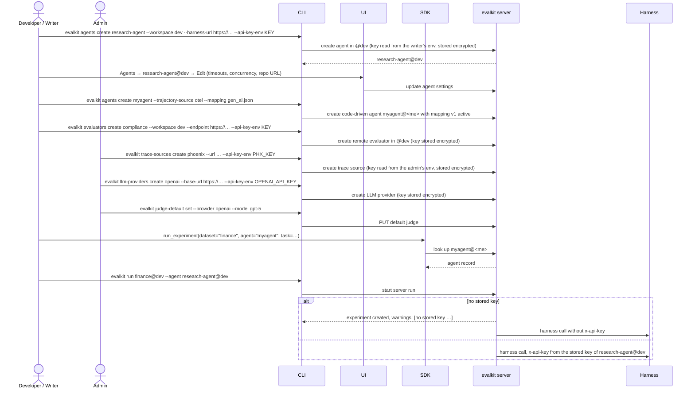

# 17. Agent, evaluator and trace source admin

Users create and edit agents and remote evaluators in workspaces they can write
to. Admins manage trace sources, LLM providers and the default judge. The
server keeps the API keys it uses as stored keys: encrypted in its database
with `encryption_key`, and never returned. Personal agents and evaluators keep
their keys in `evalkit.yaml`.

## Actors

- **Developer**: manages agents and evaluators in their personal workspace.
- **Writer / Admin**: manages agents and evaluators in a shared workspace
  (`writer` grant or admin), including endpoints and API keys.
- **Admin**: manages trace sources, LLM providers and the default judge.
- **CLI**: `evalkit agents …`, `evalkit evaluators …`,
  `evalkit trace-sources …`, `evalkit llm-providers …`,
  `evalkit judge-default …`.
- **UI**: the Agents page (create and edit form, with an API key field in
  shared workspaces), workspace settings (evaluators, with a key field), the
  admin Trace sources and LLM providers pages (the latter with a Default judge
  form).
- **SDK**: `run_experiment(agent="name", …)`.
- **evalkit server**: stores agent, evaluator, trace source and LLM provider
  records, and the default judge.
- **Harness / remote evaluator**: the client's services. The server calls them
  with their stored key; the CLI or SDK with the key from `evalkit.yaml`.

## Terms

- **Agent settings:** the harness URL (none means code-driven), trajectory
  source (`atif` or `otel`) and repo URL, plus these settings:
  - max concurrent runs
  - trajectory wait
  - run timeout
  - poll interval
  - stop grace
  - `provides`
- **Remote evaluator:** a client-hosted HTTP endpoint implementing the Custom
  Evaluator API. Its kind is `score` or `gauge`. Its settings are an endpoint
  and a timeout. On the wire, a `score` evaluator's request carries
  `kind: "evaluator"`.
- **Mapping:** the per-agent document that turns spans into a trajectory,
  including `answer` and `exclude_spans` (flow 13). Every OTel agent has its
  own. `gen_ai.json` and `openinference.json` ship as starting points in the
  `connect-traces` skill.
- **Stored key:** an API key saved in the database, encrypted with the
  server's `encryption_key`. Shared agents, shared remote evaluators, LLM
  providers and trace sources have one. It is write-only: reads show
  `has_api_key`.
- **LLM provider:** an OpenAI-compatible endpoint evalkit may call: a name, a
  base URL and a stored key. Today only judges use providers.
- **Default judge:** the judge (provider, model, effort, limits) an experiment
  uses when it does not set its own. Set by an admin.
- **Credentials map:** a `credentials:` section in `evalkit.yaml`, used by local
  runs and SDK runs. It maps a reference (or, for `llm_providers`, a base URL)
  to `env:NAME`, and the CLI's credential registry looks keys up in it.
  - In `evalkit.yaml` a bare name means your personal workspace.
  - `evalkit.yaml` also loads a `.env` file next to it. Real env vars win over
    `.env`.

```yaml
credentials:
  agents: {myagent: env:MYAGENT_KEY}
  evaluators: {citation_check: env:CITATION_KEY}
  llm_providers: {https://api.openai.com/v1: env:OPENAI_API_KEY}
```

## Sequence



## Expected outcomes

- **Agents:**
  - **`agents create NAME [--workspace WS]`:** creates the agent in WS, or in
    your personal workspace by default.
    - `--harness-url` makes it harness-driven. Without it, the agent is
      code-driven (SDK runs only).
    - `--trajectory-source otel` requires `--mapping file.json`, which becomes
      the agent's first active mapping (v1).
    - Optional: repo URL and the agent settings above (`--provides key=true|false`
      is repeatable).
    - `--api-key-env NAME` reads the key from an env var and stores it. Shared
      workspaces only: the API refuses a key for a personal agent, whose key
      lives in `evalkit.yaml`.
  - **`agents edit|show|list|archive|restore`:** edit settings
    (`--api-key-env NAME` or `--clear-api-key` on edit), show one agent (a
    shared one prints `api key  set|not set`),
    list agents (`--workspace`, `--archived`), archive, restore. Archived
    agents don't run; their runs and trajectories stay browsable.
  - Switching an agent to `otel` needs a mapping, passed with `--mapping` or
    already active.
- **Remote evaluators:**
  - **`evaluators create|edit|show|list|archive|restore`:** the same pattern,
    with kind `score` or `gauge`, endpoint, timeout (default 120 s), and
    `--api-key-env NAME` (`--clear-api-key` on edit) for shared evaluators.
  - Cases name evaluators by name.
  - At run time evalkit uses the evaluators of the **agent's** workspace. A
    server run of `research-agent@dev` uses `@dev`'s evaluators. A local run of
    `myagent@akshat` uses `@akshat`'s, whose endpoints may be on localhost.
  - Each experiment records the remote evaluators' settings at start, so old
    results still show what scored them after an evaluator changes or is
    archived.
- **Trace sources:**
  - **`trace-sources create|edit|list|archive`:** admin only. The provider
    defaults to `phoenix`. `--api-key-env NAME` reads the key from an env var on
    the admin's machine.
  - The key is stored encrypted and never returned. `list` shows name, provider
    and URL.
  - Flow 14 uses them via `--source`.
- **LLM providers and the default judge:** admin only.
  - **`llm-providers create <name> --base-url URL [--api-key-env NAME]`**,
    **`edit <name> [--base-url URL] [--api-key-env NAME | --clear-api-key]`**,
    **`list|show|archive|restore`**.
  - **`judge-default show`** and **`judge-default set --provider <name> --model M
    [--effort E] [--max-tokens N] [--concurrency N]`**. `GET /api/judge-default`
    returns 404 until one is set.
  - A server run may only use a judge whose base URL is an active LLM provider.
- **URLs:** writers and admins set every URL the server calls. Changing a URL
  clears the stored key unless the same request sets a new one. Every URL field
  and flag shows: "Check this URL before saving. The server at this address
  receives the API key you enter here and the data evalkit sends it: cases,
  answers and trajectories." The server refuses an endpoint that resolves to a
  loopback, private, link-local or other non-public address (or does not
  resolve) with 400, unless its config sets `allow_private_endpoints: true`.
- **`db rekey --config … --old-key-env … --new-key-env …`:** re-encrypts every
  stored key (agents, evaluators, LLM providers, trace sources) after the
  server's `encryption_key` changes. It talks to the database directly and
  needs the `evalkit[server]` extra.
- **The UI** offers the same create and edit forms. Reads are open to every
  user. A missing agent shows a 404 linking to the agents list.
- **Who drives a run:**
  - A shared agent with a harness URL is driven by the server.
  - Your own agent with a harness URL is driven by your CLI.
  - A code-driven agent is driven by the SDK.
- **Who may start a run or a harness check:** any user may use a shared agent
  and only the owner a personal one. An experiment that lands in a shared
  workspace also needs a `writer` or `reviewer` role there, or admin.
- **The SDK** names agents by string. `run_experiment(agent="myagent")` uses
  `myagent@<you>`, and the agent must already exist.
- **Keys:**
  - Server runs use stored keys. Local and SDK runs look keys up in
    `evalkit.yaml` + `.env`.
  - There's no shared fallback key.
  - **No stored key (server run):** the run goes ahead without the key header.
    The create, resume or evaluate response carries `warnings: […]`, also
    logged. A harness or evaluator that needs a key then answers 401.
  - **No `credentials` entry (local run):** the CLI prints one line per agent or
    evaluator, e.g. `no credentials.agents entry for <ref> in evalkit.yaml;
    calling the harness without x-api-key`, and sends no key header.
  - **No `credentials.llm_providers` entry for a local run's judge:** the run
    stops before it starts: `no credentials.llm_providers entry for <base_url>`.
- **Nothing creates an agent implicitly:** not experiment creation,
  `tokens create --agent`, or an OTel export.

## Error cases

- **No write permission on the target workspace:** 403 `you cannot write to
  @<ws>`. That's `writer` or admin for shared workspaces, the owner for
  personal ones.
- **An API key for a personal agent or evaluator:** 400 `personal agents and
  evaluators read their key from evalkit.yaml`.
- **An endpoint on a private or unresolvable address:** 400 `<url> resolves to
  a private address; the operator can allow it with allow_private_endpoints:
  true`.
- **A server run's judge is not a registered LLM provider:** 400 `<url> is not a
  registered LLM provider; registered: …`. No judge and no default: 400
  `no default judge; …`.
- **Agent or evaluator name already exists in that workspace:** 409.
- **Unknown agent in `run`, `harness check`, `tokens create`, an OTel export or
  the SDK:** 404 `unknown agent: <ref> — create it with evalkit agents create`.
  Unknown evaluators say `create it with evalkit evaluators create`.
- **`--trajectory-source otel` without `--mapping`:** 400 `otel agents need a
  mapping`. A mapping on an `atif` agent: 400 `only otel agents take a mapping`.
- **Invalid settings** (e.g. `provides` on a harness agent without OTel
  traces): 400 naming the field.
- **Trace source, LLM provider or `judge-default set` commands by a non-admin:**
  403.
- **Running an archived agent:** 409 `agent <ref> is archived`.
- **A stored key with no `encryption_key` configured:** 400
  `encryption_key is not configured`. If stored keys exist and the key is
  unset, the server refuses to start.
