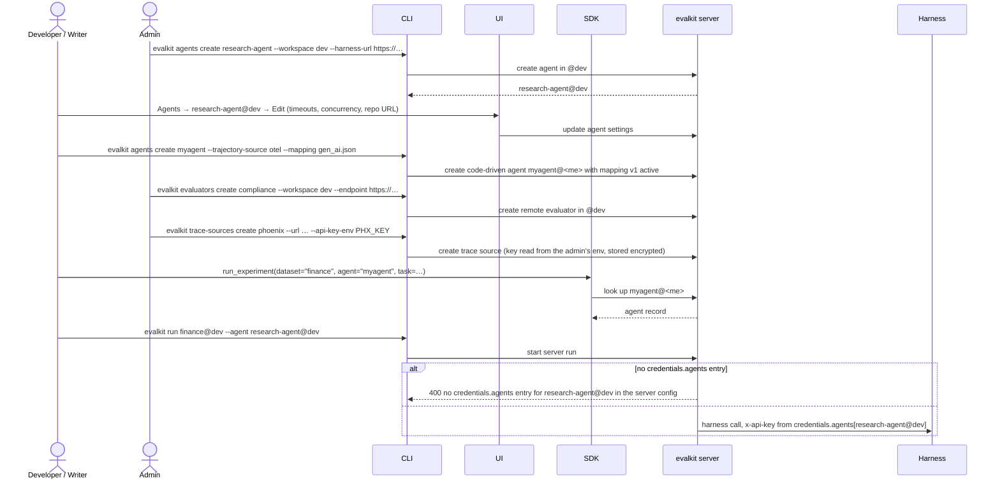

# 17. Agent, evaluator and trace source admin

Users create and edit agents and remote evaluators in workspaces they can write
to. Admins manage trace sources. Secrets never go to evalkit's database, with
one exception: trace source keys, which are stored encrypted.

## Actors

- **Developer**: manages agents and evaluators in their personal workspace.
- **Writer / Admin**: manages agents and evaluators in a shared workspace
  (`writer` grant or admin). Only admins set endpoints there.
- **Admin**: manages trace sources.
- **CLI**: `evalkit agents …`, `evalkit evaluators …`,
  `evalkit trace-sources …`.
- **UI**: the Agents page (create and edit form), workspace settings
  (evaluators), the admin Trace sources page.
- **SDK**: `run_experiment(agent="name", …)`.
- **evalkit server**: stores agent, evaluator and trace source records.
- **Harness / remote evaluator**: the client's services, called with a key from
  the driver's credentials.

## Terms

- **Agent settings:** the harness URL (none means code-driven), trajectory
  source (`atif` or `otel`) and repo URL, plus these settings:
  - max concurrent runs
  - trajectory wait
  - run timeout
  - poll interval
  - stop grace
  - `provides`
- **Remote evaluator:** a client-hosted HTTP endpoint implementing the Custom
  Evaluator API. Its kind is `score` or `gauge`. Its settings are an endpoint
  and a timeout. On the wire, a `score` evaluator's request carries
  `kind: "evaluator"`.
- **Mapping:** the per-agent document that turns spans into a trajectory,
  including `answer` and `exclude_spans` (flow 13). Every OTel agent has its
  own. `gen_ai.json` and `openinference.json` ship as starting points in the
  `connect-traces` skill.
- **Credentials map:** a `credentials:` section in server config (used for
  server runs) and in `evalkit.yaml` (used for local runs). It maps a reference
  to `env:NAME`, and the driver's credential registry looks keys up in it.
  - In `evalkit.yaml` a bare name means your personal workspace.
  - `evalkit.yaml` also loads a `.env` file next to it. Real env vars win over
    `.env`.

```yaml
credentials:
  agents: {research-agent@dev: env:RESEARCH_AGENT_DEV_KEY, myagent: env:MYAGENT_KEY}
  evaluators: {compliance@dev: env:COMPLIANCE_KEY}
  judges: {https://api.openai.com/v1: env:OPENAI_API_KEY}
```

## Sequence



## Expected outcomes

- **Agents:**
  - **`agents create NAME [--workspace WS]`:** creates the agent in WS, or in
    your personal workspace by default.
    - `--harness-url` makes it harness-driven. Without it, the agent is
      code-driven (SDK runs only).
    - `--trajectory-source otel` requires `--mapping file.json`, which becomes
      the agent's first active mapping (v1).
    - Optional: repo URL and the agent settings above (`--provides key=true|false`
      is repeatable).
  - **`agents edit|show|list|archive|restore`:** edit settings, show one agent,
    list agents (`--workspace`, `--archived`), archive, restore. Archived
    agents don't run; their runs and trajectories stay browsable.
  - Switching an agent to `otel` needs a mapping, passed with `--mapping` or
    already active.
- **Remote evaluators:**
  - **`evaluators create|edit|list|archive`:** the same pattern, with kind
    `score` or `gauge`, endpoint and timeout (default 120 s).
  - Cases name evaluators by name.
  - At run time evalkit uses the evaluators of the **agent's** workspace. A
    server run of `research-agent@dev` uses `@dev`'s evaluators. A local run of
    `myagent@akshat` uses `@akshat`'s, whose endpoints may be on localhost.
  - Each experiment records the remote evaluators' settings at start, so old
    results still show what scored them after an evaluator changes or is
    archived.
- **Trace sources:**
  - **`trace-sources create|edit|list|archive`:** admin only. The provider
    defaults to `phoenix`. `--api-key-env NAME` reads the key from an env var on
    the admin's machine.
  - The key is stored encrypted and never returned. `list` shows name, provider
    and URL.
  - **`trace-sources rekey --config … --old-key-env … --new-key-env …`:**
    re-encrypts stored keys after the server's `encryption_key` changes. It
    talks to the database directly and needs the `evalkit[server]` extra.
  - Flow 14 uses them via `--source`.
- **The UI** offers the same create and edit forms. Reads are open to every
  user. A missing agent shows a 404 linking to the agents list.
- **Who drives a run:**
  - A shared agent with a harness URL is driven by the server.
  - Your own agent with a harness URL is driven by your CLI.
  - A code-driven agent is driven by the SDK.
- **Who may start a run or a harness check:** any user may use a shared agent
  and only the owner a personal one. An experiment that lands in a shared
  workspace also needs a `writer` or `reviewer` role there, or admin.
- **The SDK** names agents by string. `run_experiment(agent="myagent")` uses
  `myagent@<you>`, and the agent must already exist.
- **Credentials:**
  - Looked up by reference in the driver's `credentials` map (server config for
    server runs, `evalkit.yaml` + `.env` for local runs).
  - There's no shared fallback key.
  - **Missing agent entry:** a server run is refused with 400 `no credentials.agents
    entry for <ref> in the server config`. In a local run no key header is sent,
    and a harness that needs a key answers 401, which surfaces as a run error.
  - **Missing evaluator entry:** no key header is sent, and an evaluator that needs
    a key answers 401, which surfaces as an evaluator error.
  - **Missing judge entry for the experiment's judge `base_url`:** starting the
    experiment is refused (400 for a server run): `no credentials.judges entry
    for <base_url>`.
- **Nothing creates an agent implicitly:** not experiment creation,
  `tokens create --agent`, or an OTel export.

## Error cases

- **No write permission on the target workspace:** 403 `you cannot write to
  @<ws>`. That's `writer` or admin for shared workspaces, the owner for
  personal ones.
- **A writer sets an endpoint in a shared workspace:** 403 `only an admin may
  set an agent's harness_url in the shared workspace @<ws>` (or `an
  evaluator's endpoint`).
- **Agent or evaluator name already exists in that workspace:** 409.
- **Unknown agent in `run`, `harness check`, `tokens create`, an OTel export or
  the SDK:** 404 `unknown agent: <ref> — create it with evalkit agents create`.
  Unknown evaluators say `create it with evalkit evaluators create`.
- **`--trajectory-source otel` without `--mapping`:** 400 `otel agents need a
  mapping`. A mapping on an `atif` agent: 400 `only otel agents take a mapping`.
- **Invalid settings** (e.g. `provides` on a harness agent without OTel
  traces): 400 naming the field.
- **Trace source commands by a non-admin:** 403.
- **Running an archived agent:** 409 `agent <ref> is archived`.
- **A trace source key with no `encryption_key` configured:** 400
  `encryption_key is not configured`. If trace sources exist and the key is
  unset, the server refuses to start.
