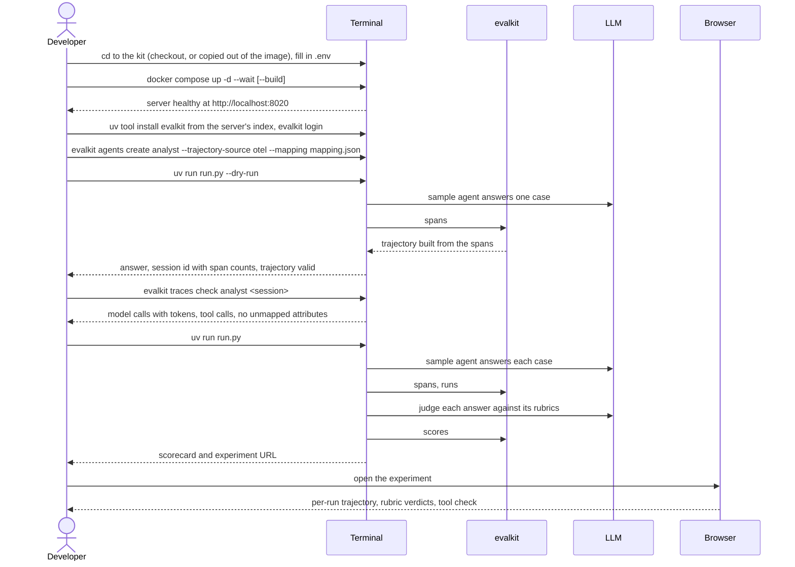

# 18. Try-it stack

A developer tries evalkit on their own machine. They start the stack, run
the kit's sample agent through an SDK run with traces, read the scorecard,
and then connect their own agent the same way. Walkthrough:
[`docs/user/try-locally.md`](../user/try-locally.md).

## Actors

- **Developer**: has Docker, `uv`, an evalkit checkout or the server image (`EVALKIT_IMAGE`) and an OpenAI-compatible LLM (base URL, key, model).
- **Terminal**: `docker compose`, the evalkit CLI and the kit's `run.py`.
- **Browser**: the evalkit web UI.
- **evalkit**: the server the stack runs on `localhost:8020`.
- **LLM**: the developer's endpoint. The sample agent and the judge both call it.

## Sequence

## Expected outcomes

- `docker compose up -d --wait` needs the four variables in `.env`, plus `--build` in a checkout or `EVALKIT_IMAGE` outside one.
- `up --wait` returns once the server is healthy. Running it again changes nothing.
- `agents create` makes `analyst` in admin's workspace with `trajectory_source: otel` and `mapping.json` as its active mapping (v1).
- `traces check` on the dry-run session has a ✓ on every line: `llm` and `tool` spans, non-zero tokens, and no unmapped attributes (`session.id`, which the SDK sets itself, is not reported).
- The dry run prints an answer and a trajectory with at least one `lookup_financials` call and its result.
- The full run prints the scorecard and the experiment URL, and creates an experiment on `acme@admin` with five runs, each with answer rubric scores and, for the four cases that ask for it, `required_tools_called`.
- The UI shows the experiment under the `acme` dataset. Each run opens its trajectory and the verdict on each rubric.

## Error cases

- A `.env` variable unset: compose stops and names it. No `EVALKIT_IMAGE` and no `--build`: compose cannot find `evalkit:try`.
- `.env` missing: compose names the first unset variable; `cp -n .env.example .env` fixes it.
- The LLM endpoint has no structured output: every judge call fails, and the scores show as evaluator errors.
- `evalkit login` to the try-it server replaces the saved login; logging in to another server later points the CLI and `run.py` there instead.
