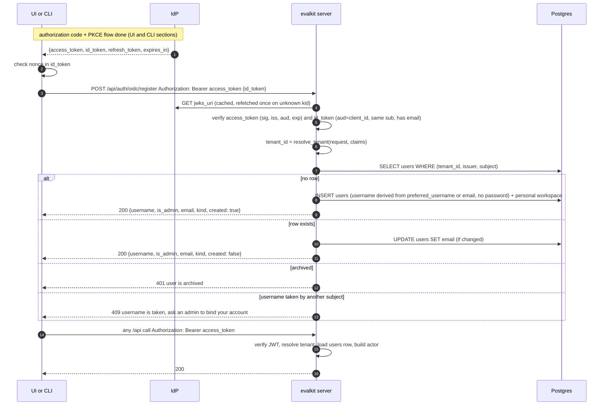
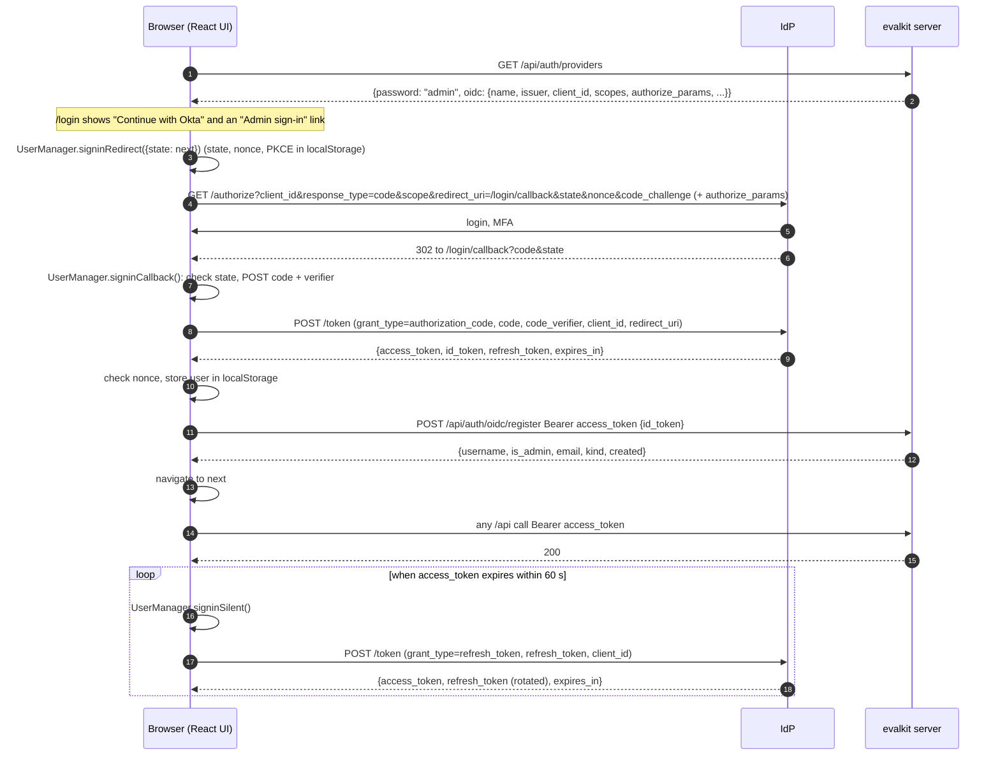
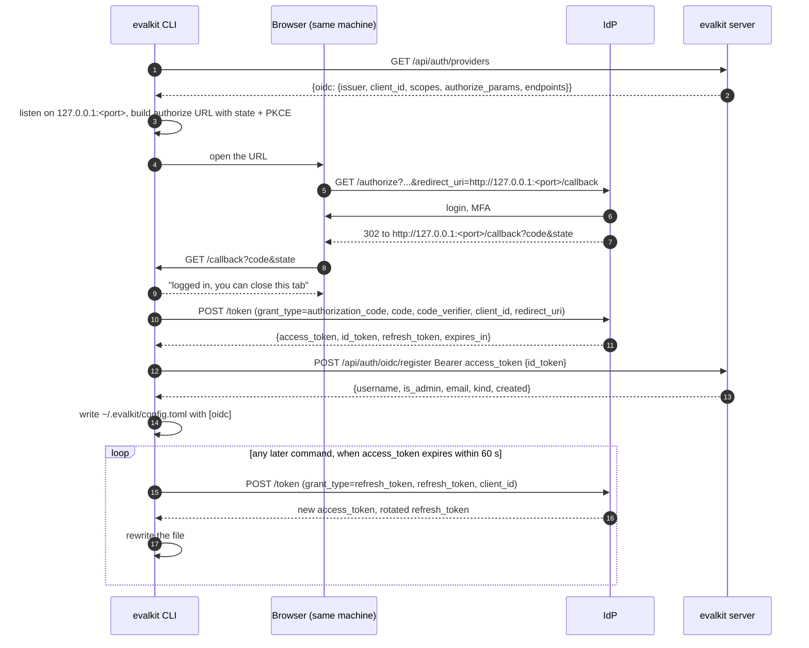
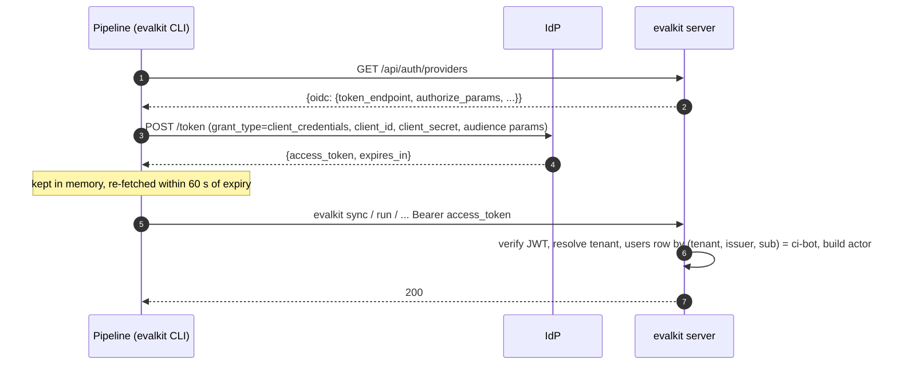

# OIDC single sign-on and tenant-ready data models

Status: draft, complete, 2026-11-03. Under review in PR #66.

## Problem

Evalkit has one way to identify a person: a username and password stored in
its own `users` table, exchanged at `POST /api/auth/login` for an evalkit
bearer token. Enterprises run an identity provider (IdP) and expect single
sign-on: a person signs in with the IdP, and evalkit trusts that sign-in. Today
that is impossible, and every person, including CI pipelines, needs an
evalkit password.

The second problem is tenancy. Every table assumes one installation: usernames,
workspace names and case ids are unique across the whole database. A private
wrapper around evalkit wants to host several organisations in one database and
must not need schema changes of its own.

Goals:

- A person signs in to the web UI and the CLI through any standards-following
  OIDC identity provider, and evalkit creates their user on first sign-in.
- CI pipelines authenticate as a machine identity at the IdP, not with an
  admin password.
- With no IdP configured, everything works exactly as today.
- The public schema carries a tenant concept with one default tenant, so a
  wrapper can host several tenants without a migration of its own.

Not goals:

- Designing the multi-tenant wrapper: how it resolves a tenant from a
  request, bills it, or administers it. This spec only makes the public
  schema and the tenant lookup overridable.
- Workload identity federation for CI. One machine path is supported, the
  client credentials grant.
- Ending the IdP session on logout.

## Terms

| Term | Meaning |
| --- | --- |
| IdP | The identity provider: the OAuth 2.0 authorization server and OpenID provider an organisation runs (Okta, Entra ID, Keycloak, Auth0, ...). |
| Access token | The IdP-issued JWT a client presents to evalkit as a bearer token. Its `aud` names evalkit. |
| ID token | The IdP-issued JWT that describes the signed-in person (`sub`, `email`, `preferred_username`). Sent to evalkit once, at registration. |
| Refresh token | The IdP-issued credential a client uses to obtain a new access token without a new sign-in. |
| Public client | An OAuth client that holds no secret: the evalkit web UI and the evalkit CLI. |
| Machine client | An OAuth client with a client id and secret that a pipeline uses with the client credentials grant. |
| Subject | The pair `(issuer, sub)` that identifies one identity at one IdP. `sub` is an opaque, stable id the IdP assigns (an Okta `00u...` id, an Entra GUID); it never changes for a person and is unique only within an issuer. |
| `preferred_username` | A standard OIDC claim: the short name the person signs in with. Keycloak sends `akshat`; Okta and Entra send the login, which is usually email-shaped, `akshat@example.com`. |
| Username | Evalkit's own handle for a user: lowercase, matches `^[a-z0-9][a-z0-9._-]*$`, names the personal workspace, unique per tenant. Derived once at registration and never changed by the IdP afterwards. |
| Tenant | One organisation's slice of the database. The public repo has exactly one, `default`, with id 1. |
| Membership | One person inside one tenant. In evalkit this is a `users` row: a human in two tenants is two rows that share a subject. |
| Machine user | A `users` row bound to a machine client's subject. It has no password and no email, and never signs in through a browser. |
| Evalkit token | A bearer token evalkit itself issues and stores hashed in `auth_tokens`: a password login token, an agent token, or a download ticket. |
| Agent token | An evalkit token bound to one agent and accepted only by the trace collector. Unchanged by this spec. |

## Decisions already made

These were settled before the sections below were drafted and the sections
assume them.

1. The UI and the CLI are public OAuth clients. Each runs the authorization
   code flow with PKCE against the IdP directly and holds the IdP's access
   and refresh tokens. The evalkit server is a resource server: it verifies
   the access token on every request with the IdP's published keys. It
   issues no login token of its own for SSO users.
2. The IdP must issue JWT access tokens that name evalkit in `aud`, and
   must rotate refresh tokens for public clients. IdPs that issue opaque
   access tokens are not supported. Both are documented requirements.
3. Evalkit registers at the IdP as one public client. There is no client
   secret anywhere in evalkit's own flows.
4. A person's `users` row is created on their first registration call. Admin
   is granted in evalkit, never from an IdP claim.
5. Password login stays, governed by one setting, `auth.password_login`:
   `admin` (the default when an IdP is configured) or `all`. With no IdP
   configured password login works for everyone, unchanged.
6. CI uses the client credentials grant with a machine client registered at
   the IdP. An admin binds that client's subject to a machine user ahead of
   time.
7. Agent tokens and download tickets stay as they are. Trace exporters always
   use an agent token; the fallback to a person's login token is removed.
8. Tenant scoping is enforced in code. The tenant is a property of the
   acting user and is passed down explicitly.
9. A separate membership table is not needed: a `users` row already is one
   person in one tenant.

## Data model

### Entity relationship diagram

Only tables this spec changes or adds are shown, plus the ones needed to read
them. Every other table reaches its tenant through a foreign key chain to
`workspaces`, `users` or `cases` and gains no column.

```mermaid
erDiagram
    tenants ||--o{ users : "has"
    tenants ||--o{ workspaces : "has"
    tenants ||--o{ cases : "has"
    tenants ||--o{ llm_providers : "has"
    tenants ||--o{ trace_sources : "has"
    tenants ||--o{ fixture_blobs : "has"
    fixture_blobs ||--o{ case_version_files : "backs"
    users ||--o{ auth_tokens : "owns"
    users ||--o{ workspace_members : "is granted"
    users |o--o{ workspaces : "owns personal"
    workspaces ||--o{ workspace_members : "grants"
    workspaces ||--o{ datasets : "holds"
    workspaces ||--o{ agents : "holds"
    agents ||--o{ auth_tokens : "agent token"

    tenants {
        int id PK
        string name
        jsonb default_judge "nullable; was server_settings.default_judge"
        timestamptz created_at
        timestamptz updated_at
    }
    users {
        int id PK
        int tenant_id FK "not null, no default"
        string username "unique per tenant"
        string password_hash "nullable; null never verifies"
        string issuer "nullable"
        string subject "nullable; unique per (tenant, issuer) when set"
        string email "nullable"
        bool is_admin
        timestamptz archived_at "nullable"
    }
    workspaces {
        int id PK
        int tenant_id FK "not null, no default"
        string name "unique per tenant"
        int owner_user_id FK "nullable; null means shared"
        timestamptz archived_at "nullable"
    }
    cases {
        int id PK
        int tenant_id FK "not null, no default"
        string case_id "unique per tenant"
    }
    llm_providers {
        int id PK
        int tenant_id FK "not null, no default"
        string name "unique per tenant"
        string base_url "unique per tenant"
        bytes api_key_encrypted "nullable"
        timestamptz archived_at "nullable"
    }
    trace_sources {
        int id PK
        int tenant_id FK "not null, no default"
        string name "unique per tenant"
        string provider
        jsonb config
        bytes api_key_encrypted "nullable"
        timestamptz archived_at "nullable"
    }
    fixture_blobs {
        int tenant_id PK_FK "not null, no default"
        string sha256 PK
        bigint size
        int uploaded_by FK "nullable"
    }
    case_version_files {
        int case_ref PK_FK
        string content_hash PK_FK
        string key PK
        int tenant_id FK "with sha256, to fixture_blobs"
        string sha256 FK
    }
    auth_tokens {
        int id PK
        int user_id FK
        string token_hash "unique"
        string kind "user | agent | ticket; unchanged"
        int agent_id FK "nullable"
        timestamptz expires_at "nullable"
    }
    workspace_members {
        int workspace_id PK_FK
        int user_id PK_FK
        string role PK "writer | reviewer"
        int granted_by FK
    }
```

### Tables

**`tenants`**, new. One row per organisation. The public repo creates row 1,
named `default`, in the migration and never creates another. It carries
`default_judge`, the JSONB document that lived in `server_settings`, so the
default judge is per tenant without a one-to-one join.

**`server_settings`**, dropped. It was a single row holding `default_judge`.
The migration copies that value onto tenant 1 before dropping the table. The
judge-default store reads and writes the tenant row instead.

**`tenant_id`** on `users`, `workspaces`, `cases`, `llm_providers`,
`trace_sources` and `fixture_blobs`: not null, foreign key to `tenants.id`,
and no database default. Every insert in code passes the tenant explicitly;
a forgotten one fails at the database rather than silently landing in
tenant 1. These six are the root tables: the ones whose names or identities
were unique across the installation. Every other table reaches its tenant
through a foreign key chain: agents, datasets and remote evaluators through
their workspace, experiments through their dataset, runs through their
agent, tokens through their user.

**`fixture_blobs`** is a root table because it is keyed by content hash
alone. Today `HEAD` and `GET /api/fixtures/sha256/{sha}` answer for any
hash any user knows, and an upload of a known hash is skipped, so across
tenants a hash would reveal that a file exists and allow reading it. Its
primary key becomes `(tenant_id, sha256)`; each tenant declares and reads
its own rows and its own bytes, under its own prefix in the blob store
(below). `case_version_files` gains `tenant_id` so its foreign key can be the
composite `(tenant_id, sha256)`; the column is backfilled to 1 and
otherwise reachable through `cases`.

**Unique keys** widen from installation-wide to per tenant:

| Table | Old key | New key |
| --- | --- | --- |
| `users` | `username` | `(tenant_id, username)` |
| `users` | none | `(tenant_id, issuer, subject)` where `subject` is not null |
| `workspaces` | `name` | `(tenant_id, name)` |
| `cases` | `case_id` | `(tenant_id, case_id)` |
| `llm_providers` | `name`; `base_url` | `(tenant_id, name)`; `(tenant_id, base_url)` |
| `trace_sources` | `name` | `(tenant_id, name)` |
| `fixture_blobs` | primary key `sha256` | primary key `(tenant_id, sha256)` |

**`users`** gains the identity columns. Subject, email and username are three
different things: the subject is the key that never changes, the email is
contact and display data that a person can change at the IdP, and the
username is evalkit's handle that names workspaces and references. Email is
not a key because IdPs do not promise it is unique or stable.

- `issuer` and `subject`, nullable text. Set on registration for SSO users
  and by `evalkit users add --subject` for machine users. Null for password
  accounts. The partial unique index on `(tenant_id, issuer, subject)` lets
  the same human hold a row in two tenants and stops two rows claiming one
  identity inside a tenant. `issuer` is part of the key because the OIDC
  specification makes `sub` unique only within one issuer; an installation
  that switches IdP must not merge an old `sub` with a new one.
- `email`, nullable text. Set on registration, which requires an `email`
  claim in the ID token and refuses with 400 when it is missing. Never set
  for machine users. Shown in `users list` and the UI. Not a key.
- `password_hash` becomes nullable. SSO users and machine users have none. A
  null hash never verifies, and `verify_password` is never reached for a row
  whose hash is null.

`username` stays the handle and still names the personal workspace. An SSO
user's username is derived once, at registration:

```
source   = claims.preferred_username or claims.email
local    = source.split("@")[0]          # whole string when there is no "@"
username = local.lower()
if not NAME_PATTERN.fullmatch(username): 400 "cannot derive a username from <source>"
if a row with (tenant_id, username) exists and its subject differs: 409 "username <x> is taken; ask an admin"
```

The local part is taken because Okta and Entra send an email-shaped
`preferred_username`. On 409 the person asks an admin, who binds a name of
their choosing with `users add <name> --subject`. No automatic suffixing.

The same username in two tenants is two unrelated rows. Usernames and
workspace names are unique per tenant, every lookup runs inside the acting
user's tenant, and a reference like `cases@akshat` resolves within that
tenant, so no clash is possible across tenants.

No column records whether a row is a person or a machine. The model derives
it:

```
User.kind = "machine" if subject is not None and email is None and password_hash is None
            else "human"
```

A machine user is the only row with a subject and neither an email nor a
password: registration always stores an email, a password account always
has a hash, and `users add --subject` sets neither. So a password user
bound to a subject with `users bind` keeps reading as human through the
hash, and an SSO user reads as human through the email. `kind` is a hybrid
property so it works in Python and in a query filter; there is no separate
`is_machine`.

The one case the rule gets wrong: a person pre-created by an admin with
`users add --subject`, which is the machine path, reads as machine until
their first sign-in stores an email. `users promote` would refuse them
until then. Admins create people through sign-in, not `add --subject`, and
the `add` help text says so. If this ever bites, an explicit column is the
fix; it was left out to keep one source of truth per fact.

**`auth_tokens`** is unchanged. Its kinds stay `user` (admin password login),
`agent` and `ticket`. SSO sessions do not create rows here: the bearer on an
SSO request is the IdP's access token, verified without a database lookup of
the token itself.

Machine users are ordinary `users` rows with a subject, no password and no
email. They get a personal workspace, can be granted writer or
reviewer, and can be archived, exactly like a person. No new table.

### Blob storage

Every object key starts with the tenant, so a tenant is one prefix in the
bucket and bucket policies, lifecycle rules, export and deletion can work
per tenant:

| Family | Key today | Key after |
| --- | --- | --- |
| Fixtures | `fixtures/sha256/<sha>` | `tenants/<tenant_id>/fixtures/sha256/<sha>` |
| Trajectories | `trajectories/<agent_id>/<run>.json` | `tenants/<tenant_id>/trajectories/<agent_id>/<run>.json` |
| Artifacts | `artifacts/<agent_id>/<run>/<path>` | `tenants/<tenant_id>/artifacts/<agent_id>/<run>/<path>` |
| Run workspaces | `workspaces/<agent_id>/<run>.json` | `tenants/<tenant_id>/workspaces/<agent_id>/<run>.json` |

The four key functions in `core/blob.py` take `tenant_id` as their first
argument. Callers already hold a scoped store or a `WorkspaceRef`, which
carry it. Identical fixture bytes in two tenants are stored twice; that is
the cost of separation and is accepted. The `Blob` protocol and
`store/blob.py` do not change.

Existing objects move once. A new server command, `evalkit blobs relocate
--config config.yaml`, lists every object under the four old prefixes,
copies it to its tenant 1 key with the store's server-side copy, verifies
the copy exists, and deletes the old key. It is idempotent: an object
already at its new key is skipped, an old key with no object is skipped.
It runs after `evalkit db upgrade` and before the new server starts
serving; the server refuses to start while any object remains under an old
prefix, with a message naming the command, so a missed step cannot
silently 404 every trajectory. The check does not list the bucket: the
`Blob` protocol gains `has_any(prefix) -> bool`, which returns on the first
object found, so on a relocated or fresh store it is four empty listings
and on an unrelocated one it stops at the first object. The upgrade therefore has downtime between
the migration and the relocation, which is accepted. The release notes and
the deployment skill carry the step. The try-it stack and `init-server`
need nothing: a fresh store has no old objects.

The command, the start-up check and the old-prefix constants are
transitional. Each carries the repo's usual removal note,
`# TODO: remove in 0.6.0, two minor versions after 0.4.0 moved blobs under tenants/`,
with the versions filled in at release time, following the pattern the
`credentials` config error uses today.

```
relocate(blob, tenant_id=1):
    for old_prefix in ["fixtures/", "trajectories/", "artifacts/", "workspaces/"]:
        for key, size in blob.list_objects(old_prefix):
            new_key = f"tenants/{tenant_id}/{key}"
            if not blob.exists(new_key):
                blob.copy_object(key, new_key)
            assert blob.exists(new_key)
            blob.delete(key)
```

### Migration

One alembic revision, `0016`, after `0015_span_scope`. It is produced with
Alembic's autogenerate against the updated models, then edited by hand for
the parts autogenerate cannot write: the tenant 1 insert, the `default_judge`
copy, the backfill before `set not null`, and the partial unique index. The
result, in order:

```
create table tenants (id, name, default_judge, created_at, updated_at)
insert tenants (id=1, name='default',
                default_judge = (select default_judge from server_settings where id = 1))
drop table server_settings

for table in [users, workspaces, cases, llm_providers, trace_sources, fixture_blobs]:
    add column tenant_id int null references tenants(id)
    update table set tenant_id = 1
    alter column tenant_id set not null        # no server default
    drop the old installation-wide unique constraint(s)
    add the per-tenant unique constraint(s) from the table above

# fixture_blobs: the primary key becomes (tenant_id, sha256), and
# case_version_files follows with a composite foreign key
alter case_version_files add column tenant_id int null
update case_version_files set tenant_id = 1
alter case_version_files alter column tenant_id set not null
drop the foreign key case_version_files(sha256) -> fixture_blobs(sha256)
alter fixture_blobs drop primary key; add primary key (tenant_id, sha256)
add foreign key case_version_files(tenant_id, sha256) -> fixture_blobs(tenant_id, sha256)

alter users add column issuer text null
alter users add column subject text null
alter users add column email text null
alter users alter column password_hash drop not null
create unique index uq_users_tenant_subject
    on users (tenant_id, issuer, subject) where subject is not null
```

The downgrade reverses each step; rows outside tenant 1 cannot be downgraded
and the downgrade refuses if any exist.

## Tenant threading and access checks

### Principle

The tenant is a property of the acting user, resolved once per request and
passed down explicitly. No query reads "all tenants"; no code path guesses a
tenant. A request from a user in tenant 2 can neither name nor number its way
to a row in tenant 1. Lookups by the keys that are unique per tenant, a
username, a workspace name, a case id, an LLM provider name or base URL, a
trace source name, filter by `tenant_id`. Lookups by integer id of a row
without a `tenant_id` column join to the root table that carries one and
filter there.

Today an experiment, dataset or run is authorised by resolving the name of its
owning workspace and asking `can_read` or `can_write`. With two tenants that
is a hole: tenant 1's experiment 5 lives in a workspace named `dev`, and a
tenant 2 user fetching experiment 5 would resolve `dev` inside tenant 2 and
pass the check against the wrong workspace. So id lookups are scoped at the
store, and the access rules keep a tenant equality check as a second line.

### Where the tenant comes from

| Entry point | Tenant source |
| --- | --- |
| Any `/api` route, evalkit token | The token hash is globally unique: an `ALL_TENANTS` lookup of `auth_tokens` joined to `users` yields the user and its `tenant_id`; everything after runs in a session scoped to it |
| Any `/api` route, IdP access token | `resolve_tenant(request, claims)` first, then the user row by `(tenant, issuer, sub)`; the same subject may exist in two tenants, so the tenant must be known before the lookup |
| `/mcp` tools | Same as `/api`: the verifier yields the user, the user carries the tenant |
| Collector, agent token | The token hash is globally unique: an `ALL_TENANTS` lookup of `auth_tokens` joined to `agents` and `workspaces` yields the agent and its `tenant_id` |
| Collector, user credential | As for `/api` |
| Registration (`POST /api/auth/oidc/register`) | `resolve_tenant(request, claims)`; there is no user yet |
| Password login | `resolve_tenant(request, claims=None)` |
| `bootstrap_admin`, `init-server` | Tenant 1, passed explicitly; the "does any admin exist" check runs `ALL_TENANTS` |
| Server runner (`prepare_experiment`, lease, reaper) | The experiment id is globally unique: an `ALL_TENANTS` lookup of the experiment joined to `datasets` and `workspaces` yields its `tenant_id`; the runner then builds its scoped `PgStore` |
| Trace import job (`TraceImportStore.job`, its lease, `interrupt_imports` at startup) | The import id is globally unique: an `ALL_TENANTS` lookup of the import joined to `agents` and `workspaces` yields its `tenant_id`; the job then runs scoped |
| Migrations | None; migrations are installation-wide |

`resolve_tenant` is the one function a wrapper replaces. The public repo
ships:

```
def resolve_tenant(request, claims) -> int:
    return 1
```

and `create_app(cfg, resolve_tenant=resolve_tenant)` takes it as a parameter,
so a wrapper passes its own without patching. It runs on every request that
carries an IdP access token, before the user lookup, and at password login
and registration. It is a constant in the public repo and must stay cheap in
a wrapper: a header read or a claim read, never a query.

### The two objects that carry it

`Actor` and `WorkspaceRef` in `core/access.py` each gain `tenant_id: int`.
`Actor` is built in exactly one place, `load_actor` in `api/access.py`, from
the user row. `WorkspaceRef` is built by `to_ref` in `db/workspaces.py` from
the workspace row, and the workspace API payload includes `tenant_id` so the
client's copy of the ref carries it too.

Every access rule refuses a cross-tenant pair before it looks at anything
else:

```
def same_tenant(actor, ws) -> bool:
    return ws.tenant_id == actor.tenant_id

can_read(actor, ws)             = same_tenant and True
can_write(actor, ws)            = same_tenant and (owner match | admin | writer)
can_review(actor, ws)           = same_tenant and ws.is_shared and reviewer
can_use_agent(actor, agent_ws)  = same_tenant and (shared | owner match)
can_create_experiment(...)      = same_tenant and (existing rule)
can_change_experiment(...)      = same_tenant and (existing rule)
```

This never fires in the public repo, where every row is tenant 1. It is the
safety net for a wrapper, and it costs one integer comparison.

### Scoped stores

Stores are bound to a tenant when constructed, not told the tenant on every
call. A route gets its stores from a dependency that reads the actor:

```
async def tenant_stores(actor: ActorDep, request) -> TenantStores:
    sf = request.app.state.session_factory
    t  = actor.tenant_id
    return TenantStores(
        workspaces = WorkspaceStore(sf, t),
        agents     = AgentStore(sf, t, box),
        evaluators = RemoteEvaluatorStore(sf, t, box),
        providers  = LlmProviderStore(sf, t),
        sources    = TraceSourceStore(sf, t, box),
        users      = UserStore(sf, t),
        store      = PgStore(sf, t),          # the runner's Store
    )
```

Inside a scoped store:

- A lookup by a per-tenant key (username, workspace name, case id, provider
  name or base URL, trace source name) adds `tenant_id == t` to the query.
  This replaces the fifteen places where agent, case, evaluator and workspace
  stores resolve a workspace name themselves and the nine places that resolve
  a username.
- A lookup by id of a row that has no `tenant_id` column joins to the root
  that has one and filters there. The joins are short and fixed:

  | Row | Path to `tenant_id` |
  | --- | --- |
  | agent, dataset, remote evaluator | `workspaces` |
  | experiment, experiment run, evaluation | `datasets` to `workspaces` |
  | agent run, span, span mapping, trace import | `agents` to `workspaces` |
  | overlay | `datasets` to `workspaces` (the source dataset) |
  | case version, case event, case comment | `cases` |
  | auth token, workspace member | `users` |

  A row in another tenant is simply not found, and the route returns 404 as
  it does for any unknown id.
- A create passes `t` as `tenant_id` on the root rows it inserts: a user, a
  workspace, a case, an LLM provider, a trace source, a fixture blob. Child
  rows get no tenant column and need nothing.
- Rows that link two other rows check both sides are in `t` before
  inserting, as a stated rule rather than an accident of scoping:
  a promotion link (`workspace_promotions`) requires source and target
  workspaces in `t`, added to `_check_link`; a trace import requires its
  agent's workspace and its trace source in `t`; a workspace member grant
  requires the user and the workspace in `t`. Each is one comparison of
  `tenant_id` values already loaded, and each has a test.

The runner's `Store` protocol in `store/base.py` does not change: the tenant
is a constructor argument of `PgStore`, invisible to `drive_experiment` and
`evaluate_experiment`, and the client's `HttpStore` has no tenant at all
because the server scopes for it. The server runner builds its `PgStore`
from the experiment's tenant when it picks an experiment up.

### The session guard

Passing the tenant explicitly is the design; a guard catches the call site
that forgets. Every session a scoped store opens is a tenant session: the
store stamps `session.info["tenant_id"] = t` and the session factory
registers one SQLAlchemy event.

It is SQLAlchemy's own global-criteria recipe, documented under "Adding
global WHERE / ON criteria" with multi-tenancy as a named use. On
`do_orm_execute` it attaches `with_loader_criteria` for each of the six
root models, so every ORM `SELECT`, and every ORM-enabled `UPDATE` and
`DELETE`, that mentions `users`, `workspaces`, `cases`, `llm_providers`,
`trace_sources` or `fixture_blobs` gets `tenant_id = t` added, including
relationship loads:

```
ALL_TENANTS = object()      # the sentinel installation-wide code sets on purpose

@event.listens_for(Session, "do_orm_execute")
def scope_to_tenant(state):
    info = state.session.info
    if "tenant_id" not in info:
        raise RuntimeError("session has no tenant")      # an unscoped session is a bug
    t = info["tenant_id"]
    if t is ALL_TENANTS:
        return
    for model in (User, Workspace, Case, LlmProvider, TraceSource, FixtureBlob):
        state.statement = state.statement.options(
            with_loader_criteria(model, lambda cls: cls.tenant_id == t, include_aliases=True)
        )
```

A session whose `info` never had the key is the bug the guard catches. A
session that set `ALL_TENANTS` opted out on purpose, and only the
installation-wide paths listed later do that.

Inserts need no listener: a missing `tenant_id` fails at the database
because the column has no default, and every create passes the store's
tenant. Together the two checks mean a store that forgets the filter still
cannot read or change a root row outside its tenant, cannot create one
without naming a tenant, and a session opened without a tenant fails on its
first query.

Cost: the listener runs in process and touches no database. It attaches
six options to the statement, and SQLAlchemy's statement cache treats the
lambda's closed-over `t` as a bound parameter, so the compiled SQL is cached
once per statement shape, not once per tenant. The added predicate is
`tenant_id = ?` on tables whose unique indexes now lead with `tenant_id`, so
it is index-covered. No locks are taken; nothing serialises across requests.

In the public repo the listener never refuses anything, since every row is
tenant 1. It is kept because it is the one part of this design that makes a
wrapper safe by construction rather than by review, and one test, an
unscoped session failing its first query, proves it is wired.

What the criteria do not cover: a query on a child table alone. If a store
runs `select(Experiment).where(Experiment.id == 5)` with no join to a root
model, no criteria apply and the row comes back whatever its tenant. The
guard catches a child query only when it joins or loads a root entity, which
the scoped-store rule above requires for every by-id lookup. So child
coverage rests on that rule and on the cross-tenant tests, not on the
listener. The complete alternative is a criteria entry per child model, an
`EXISTS` subquery up its join path (for example
`Experiment.dataset_id IN (SELECT id FROM datasets JOIN workspaces ... WHERE tenant_id = t)`),
about twenty entries, each adding a subquery to every query on that table.
This spec does not add them; the public repo has one tenant and the join
rule is cheap to review. A wrapper that wants the complete guard can add
them in its own session factory without a schema change.

Two kinds of code open sessions with `session.info["tenant_id"] = ALL_TENANTS`
and nothing else may:

- The installation-wide paths listed below.
- The pre-tenant lookups: the five places that must find the tenant before
  any scoped work can start, each by a key that is unique across the whole
  database. They are listed in the "Where the tenant comes from" table:
  an evalkit token by hash, an agent token by hash, an experiment by id for
  the runner and reaper, a trace import by id for its job, lease and the
  startup `interrupt_imports`, and the "any admin exists" check in
  `bootstrap_admin`. Each does one select, reads the tenant off the row,
  and opens a scoped session for everything after. They are small, named
  functions in `db/auth.py`, `db/experiments.py` and `db/trace_imports.py`,
  and a test asserts the list of `ALL_TENANTS` openers is exactly these
  plus the installation-wide paths.

### Name resolution in one place

`workspace_ref` in `api/access.py` becomes
`workspace_ref(stores, name) -> WorkspaceRef` and is the only place a
workspace name turns into a ref for a route. The agent, case and evaluator
stores stop accepting workspace names and take the workspace id the route
already resolved. Likewise `resolve_user(stores, username) -> User` is the
only place a username is resolved for a route; stores that took usernames
take user ids.

Case find-or-create during sync takes the tenant from the dataset's
`WorkspaceRef`:

```
case_refs_for(session, tenant_id, case_ids):
    insert cases (tenant_id, case_id) ... on conflict (tenant_id, case_id) do nothing
    select case_id, id from cases where tenant_id = t and case_id in (...)
```

Every other case lookup is already scoped through a dataset and needs nothing.

### What stays installation-wide

- The `tenants` table itself. The public repo never lists or creates tenants
  from a route; the migration makes row 1 and that is all.
- Migrations, the schema check at startup, the cost map, the reaper's scan
  for expired leases (it reaps by experiment id and never reads tenant data).
- Config: one IdP, one `encryption_key`, one `server.base_url`. Per-tenant
  IdPs are a wrapper concern and out of scope.

There is no cross-tenant admin. An admin is a `users` row in one tenant and
administers that tenant only.

### The deployment operator

The person who runs the server is not a database role. Everything that is
installation-wide is done without a user: `evalkit db upgrade`,
`init-server`, editing `config.yaml`, setting `EVALKIT_ADMIN_PASSWORD` for
the bootstrap admin. The bootstrap admin is an ordinary admin of tenant 1.
In the public repo tenant 1 is the whole installation, so the operator and
the tenant admin are the same person, as today.

`EVALKIT_ADMIN_PASSWORD` stays. With an IdP configured, the first person to
register is a plain user, and someone must already be admin to promote them,
create shared workspaces and bind machine users. The bootstrap admin is that
someone, and the break-glass account when the IdP is down. Password login
staying open to admins under every `password_login` setting is what keeps
this account usable under SSO.

Creating a second tenant and its first admin is a wrapper feature that
works through the stores, not through a route, and this spec adds no
superadmin flag, no nullable `tenant_id` and no cross-tenant route to
anticipate it.

### Tests

Existing tests construct stores and users directly; they pass tenant 1. Two
new tests cover the hole described above: a user in tenant 2 fetching a
tenant 1 experiment by id gets 404, and fetching a tenant 1 workspace by
name gets 404 even when tenant 2 has a workspace of the same name. They
create tenant 2 by inserting a row, since no route can.

## Server configuration, startup and the request verifier

### Config

One new block, `auth.oidc`. Its absence means no SSO and nothing else
changes.

```yaml
auth:
  token_ttl_hours: 720          # password tokens, unchanged
  password_login: admin         # admin | all; who may use POST /api/auth/login when oidc is set
  oidc:
    issuer: https://id.example.com          # OIDC issuer; discovery is <issuer>/.well-known/openid-configuration
    client_id: 0oa1b2c3d4e5f6g7h8            # the one public client, shared by the UI and the CLI
    audience: https://evalkit.example.com   # the value the IdP puts in the access token's aud
    name: Okta                              # the login button's label
    scopes: [openid, profile, email, offline_access]   # default shown
    authorize_params: {}                    # extra authorize-request parameters, see below
    algorithms: [RS256]                     # default shown
```

- `issuer`, `client_id`, `audience` and `name` are required when the block is
  present. `scopes` must contain `openid`.
- `password_login` applies only when `oidc` is set; without an IdP every
  user may use password login and the value is ignored. `admin` is the
  default so that SSO is the normal path and the bootstrap admin keeps a
  break-glass login. `all` runs both paths side by side, for an
  installation that is moving to SSO gradually or keeps local accounts for
  some people.
- `authorize_params` is how evalkit stays generic across the ways IdPs select
  an audience. Auth0 wants `audience: <api identifier>`; IdPs that follow
  RFC 8707 want `resource: <audience>`; Entra wants nothing here and a scope
  of the form `api://<app id>/<scope>` in `scopes` instead. The server does
  not interpret the map; the UI and CLI append it to the authorize request
  and the device authorization request verbatim.
- `mcp.oauth` is removed. A config that still has it fails to load with a
  message naming `auth.oidc`, the way `credentials` and `judge_default` fail
  today. The MCP server verifies tokens with the same verifier as `/api`
  (below), so it needs no block of its own.
- Secrets: none. The block holds no client secret, and the CI machine
  client's secret lives in the pipeline's environment, never in server
  config.

`pyjwt[crypto]` is added to the `server` extra as a direct dependency. It is
already present transitively through fastmcp; naming it pins the API the
verifier uses.

### Startup

On startup, with `auth.oidc` set, the server fetches the discovery document
and loads the key set from its `jwks_uri` into a small cache
(`jwt.PyJWKSet` behind an httpx fetch): keys by `kid`, refetched once when
a token names an unknown `kid` and at most once a minute, so key rotation
at the IdP needs no restart. PyJWT's own `PyJWKClient` is not used because
it fetches with `urllib` and cannot be given an httpx transport, which the
tests need to fake the IdP.

If the IdP is unreachable at startup the server still starts: it logs the
failure, retries discovery every 30 seconds in the background, and until it
succeeds every request with an IdP access token and every call to
`/api/auth/providers` answers 503 `identity provider unreachable`. Admin
password login works throughout, which is the break-glass path. A server
that refused to start would turn an IdP outage into an evalkit outage for
the admin too.

Discovery gives the server `jwks_uri`, `authorization_endpoint`,
`token_endpoint` and, when present, `device_authorization_endpoint`. The
server keeps them to hand to clients; it never calls the authorize or token
endpoints itself.

### `GET /api/auth/providers`

Public, no bearer. The one route a client reads before it has a token.

```json
{
  "password": "all" | "admin",
  "oidc": null | {
    "name": "Okta",
    "issuer": "https://id.example.com",
    "client_id": "0oa1b2c3d4e5f6g7h8",
    "audience": "https://evalkit.example.com",
    "scopes": ["openid", "profile", "email", "offline_access"],
    "authorize_params": {},
    "authorization_endpoint": "https://id.example.com/oauth2/v1/authorize",
    "token_endpoint": "https://id.example.com/oauth2/v1/token",
    "device_authorization_endpoint": "https://id.example.com/oauth2/v1/device/authorize" | null
  }
}
```

`password` is `auth.password_login` when `auth.oidc` is set and `all`
otherwise. Nothing in this payload is secret: it is what any OAuth client
needs and what the IdP publishes anyway.

### The request verifier

`current_user` in `api/auth.py` stays the single dependency every
authenticated route uses. It grows one branch:

```
async def current_user(request, session) -> User:
    if download ticket in query string and method is GET and no Authorization header:
        unchanged
    token = bearer(request)
    if is_jwt(token):                       # three base64url parts joined by two dots
        user = await sso_user(request, session, token)
    else:
        row, user = await bearer_login(session, token)      # evalkit token, unchanged
        request.state.token_expires_at = token_expiry(row)
    return user

def is_jwt(token) -> bool:
    return token.count(".") == 2

async def sso_user(request, session, token) -> User:
    oidc = request.app.state.oidc
    if oidc is None:               401 "SSO is not configured on this server"
    if oidc.keys is None:          503 "identity provider unreachable"
    claims = verify_access_token(oidc, token)                     # 401 with the reason on failure
    tenant_id = resolve_tenant(request, claims)
    user = await session.scalar(select(User).where(
        User.tenant_id == tenant_id, User.issuer == claims["iss"], User.subject == claims["sub"]))
    if user is None:               401 f"not registered: subject {claims['sub']} has no user"   # a person signs in again; a machine's admin binds it
    if user.archived_at:           401 "user is archived"
    request.state.token_expires_at = datetime.fromtimestamp(claims["exp"], UTC)
    return user

def verify_access_token(oidc, token, audience: list[str]) -> dict:
    key = oidc.keys.signing_key(token)                  # cached by kid; refetches once on unknown kid
    return jwt.decode(
        token, key.key,
        algorithms=oidc.cfg.algorithms,
        issuer=oidc.cfg.issuer,
        audience=audience,                               # /api: [cfg.audience]; /mcp: [cfg.audience, mcp_resource_url]
        options={"require": ["exp", "iat", "sub"]},
        leeway=30,
    )
```

What each 401 means to a client: `not registered` means no row exists for
the subject. A client never sees it after a fresh sign-in, because it
registers (next section) before its first other request; seeing it later
means signing in again, or, for a machine, an admin binding the subject.
Every other 401 is a sign-in problem: expired, wrong audience, wrong
issuer, bad signature, archived.

Each endpoint accepts only the audiences meant for it. `/api` accepts the
configured `audience` and nothing else. `/mcp` accepts that and also the
MCP server's own URL (`<server.base_url>/mcp`), because MCP clients follow
the MCP specification and request a token for the resource they connect
to (RFC 8707). The asymmetry is deliberate: a token an MCP client obtained
for the read-only `/mcp` must not become a read-write `/api` credential,
while a person's own `/api` token may read `/mcp`, as an evalkit login
token can today. `iss` is checked against the configured issuer and `sub`
is required, so the pair that keys the `users` row is always present.

The user row lookup is by the partial unique index on
`(tenant_id, issuer, subject)`. No `auth_tokens` row is read or written for
an SSO request; the signature check replaces the hash lookup, and the cost
per request is one indexed select, as today.

`/api/auth/me` adds `email` and `kind` to its answer. `token_expires_at`
comes from the access token's `exp` for SSO users and from the row for
evalkit tokens, so `evalkit whoami` keeps working for both.

### Password login

`POST /api/auth/login` is unchanged when `auth.oidc` is absent or
`auth.password_login` is `all`. With `admin`:

```
user = row by (resolve_tenant(request, None), username)
if user is None or user.password_hash is None:
    verify_password(password, dummy hash)       # constant time, as today
    401 "invalid username or password"
verify the password; 401 on mismatch; archived check   # unchanged
if not user.is_admin:
    403 "password login is for admins on this server; sign in with Okta"
issue evalkit token: unchanged
```

The 403 is answered after the password check, not before, so the route does
not reveal which usernames exist. A user with no password hash, which every
SSO user is, gets the same 401 as a wrong password under either setting.

### Collector and MCP

The collector's `collector_principal` keeps accepting agent tokens as
today. For a person's credential it calls the same `bearer_login` and
`sso_user` pair as `/api`, so a JWT works there too, but the documented
exporter credential is an agent token and nothing in this spec changes
that.

The MCP server's `build_auth` in `api/mcp/auth.py` shrinks to one
`TokenVerifier` whose `verify_token` calls the same `current_user` logic
and returns an `AccessToken` carrying the evalkit read scope, exactly what
`EvalkitTokenVerifier` does today for evalkit tokens. With `auth.oidc` set
it is wrapped in fastmcp's `RemoteAuthProvider` so `/mcp` keeps publishing
protected-resource metadata (RFC 9728) with the configured issuer as its
authorization server, which is how an MCP client connects with the URL
alone. `ProviderScopeVerifier`, the `mcp.oauth.scope` mapping and
`MultiAuth` are deleted: a verified token is an evalkit user, and an
evalkit user has read scope on MCP. Archiving a user now cuts off MCP
access too, which closes the gap the MCP docs describe today.

## Registration and user lifecycle

### `POST /api/auth/oidc/register`

The one call that turns an IdP identity into a `users` row. Every client
makes it once, right after obtaining tokens and before any other request.
It is idempotent. Neither client keeps the ID token after that, so a
`not registered` answer later cannot be retried in place: the UI sends the
person to `/login` and the CLI's answer is `evalkit login` again. In
practice it cannot happen after a successful register, since rows are
archived, never deleted.

Request: the access token as bearer, `{"id_token": "..."}` as the body. The
ID token is required because many IdPs put only `sub` in the access token;
the profile claims live in the ID token.

Where it sits in a sign-in, for either client. The authorize and token
steps are the client's own and are drawn in full in the UI and CLI sections;
this picture starts where the client holds tokens.



```
async def register(request, session, body):
    oidc    = request.app.state.oidc                         # 401 / 503 as in the verifier
    access  = verify_access_token(oidc, bearer(request), [oidc.cfg.audience])   # same function as every /api request
    key     = oidc.keys.signing_key(body.id_token)           # its own lookup: the ID token may carry a different kid
    idtok   = jwt.decode(body.id_token, key.key, algorithms=oidc.cfg.algorithms,
                         issuer=oidc.cfg.issuer, audience=oidc.cfg.client_id,
                         options={"require": ["exp", "iat", "sub"]}, leeway=30)
    # jwt.decode has checked iss against the configured issuer, so `issuer` below is always that value
    if idtok["sub"] != access["sub"]:        400 "id_token and access token name different subjects"
    if "email" not in idtok:                 400 "the ID token has no email claim; ask the IdP admin to grant the email scope"

    tenant_id = resolve_tenant(request, access)
    issuer, subject, email = idtok["iss"], idtok["sub"], idtok["email"]

    await lock_names(session)                                # the existing users-and-workspaces advisory lock, held to commit
    user = row by (tenant_id, issuer, subject)
    if user is not None:
        if user.archived_at:                 401 "user is archived"
        if user.email != email: user.email = email           # the IdP is the source of truth for email
        return {"username": user.username, "is_admin": user.is_admin, "email": email,
                "kind": "human", "created": False}

    username = derive_username(idtok)                        # the rule in the data model section
    if await name_taken(session, tenant_id, username):       # users and workspaces, as UserStore.create checks
        409 f"username {username} is taken by a user or workspace; ask an admin to bind subject {subject} to an account"
    user = User(tenant_id=tenant_id, username=username, password_hash=None,
                issuer=issuer, subject=subject, email=email, is_admin=False)
    add user; flush
    add Workspace(tenant_id=tenant_id, name=username, owner_user_id=user.id)
    commit
    return {..., "created": True}
```

Notes on the choices:

- The route runs under the existing `users-and-workspaces` advisory lock, so
  two first sign-ins racing for one username cannot both win.
- A row that already exists is never renamed. The IdP may change a person's
  `preferred_username` or email; the username is evalkit's and stays. Email
  is refreshed on every register call because it is display data and the
  IdP owns it.
- A taken username is never linked automatically, even when the existing
  row has no subject. The IdP's username namespace is not evalkit's: an IdP
  user whose `preferred_username` is `admin` must not claim the bootstrap
  admin row. Linking is an admin action, below.
- Machine tokens cannot register: they have no ID token. Their rows are
  bound ahead of time by an admin, below.
- The ID token's `nonce` is the client's to check, since only the client
  knows the nonce it sent. The server does not see it.
- `created` in the answer lets the UI greet a first sign-in; nothing else
  reads it.

### Binding an existing user to an identity

Two admin commands, both thin calls to one new route,
`POST /api/users/{username}/identity`, admin only:

- `evalkit users bind <username> --subject <sub>` sets `issuer` to the
  configured issuer and `subject` to the value given. For a person this is
  how an admin resolves a 409 at registration, or links a password account
  that predates SSO. For a machine client it binds the client's subject.
  Refused with 409 if that `(issuer, subject)` already belongs to another
  row in the tenant.
- `evalkit users add <username> --subject <sub>` creates the row and binds
  it in one step, with no password prompt. This is the machine-user path.
  The row has no email, so `kind` reads `machine`.

The subject to bind comes from the error that asks for the binding: a
machine's first request answers 401 `not registered: subject <sub> has no
user`, and a person's failed registration answers 409 naming the subject.
Run once, read the subject, bind it, run again. No IdP console is needed.

A bound machine user never registers. Its requests carry a client
credentials access token, the verifier finds the row by
`(tenant, issuer, sub)` on every request as it does for a person, and the
register route is never called because the token has no ID token to offer.

### What changes in `UserStore` and the users commands

`UserStore.create(username, password, *, is_admin)` becomes
`create(username, *, password=None, subject=None, email=None, is_admin=False)`
with the tenant bound at store construction. Exactly one of `password` and
`subject` must be given. `password_hash` is stored only when a password is.

`evalkit users add <username>`: prompts for a password as today unless
`--subject` is given. With an IdP configured and no `--subject`, the help
text says the account will only be able to sign in if it is made admin.

`evalkit users list`: adds `kind` and `email` columns and a `subject`
column showing `yes` or empty, never the value, since an admin reading a
list does not need it and it would be noise.

`evalkit users set-password`, `demote`, `archive`, `restore`: unchanged in
behaviour. `promote` refuses a machine user (see the CI section). `set-password` on an SSO user gives them a password
hash, which only matters if they are admin or `password_login` is `all`. Archiving an SSO user blocks their next request at the
verifier, which is the revocation path on evalkit's side; the IdP's own
revocation takes effect within one access token lifetime.

`/api/auth/me` answers `email` and `kind` as well, and the UI shows the
email next to the username in the account menu.

### What is not supported

- Changing a user's username, or a workspace's name, after registration.
  Neither is supported today either.
- Merging two rows, or moving a subject from one row to another. An admin
  archives one row and binds the other.
- Deleting users. Archive remains the only removal.

## Web UI

### Library

The UI uses `oidc-client-ts`, the maintained standard library for browser
OAuth clients. It implements the authorization code flow with PKCE, `state`
and `nonce` generation and checking, discovery from the issuer, refresh
with rotation, and token storage. Writing those by hand is about two
hundred lines of security-sensitive code with no upside. One `UserManager`
is built from `/api/auth/providers`:

```
new UserManager({
  authority: oidc.issuer,                     # the library runs discovery itself
  client_id: oidc.client_id,
  redirect_uri: `${origin}/login/callback`,
  scope: oidc.scopes.join(" "),
  extraQueryParams: oidc.authorize_params,    # audience / resource, verbatim
  response_type: "code",
  userStore: new WebStorageStateStore({ store: localStorage }),   # survives reload and tabs; see the risk note below
  automaticSilentRenew: false,                # refresh happens on demand, below
})
```

### Sequence



### The refresh token in local storage

The refresh token lives in `localStorage`, readable by any script running
on evalkit's origin. This is accepted, in writing: the evalkit login token
has lived in the same place with a thirty-day life since the UI was built,
and the UI loads no third-party scripts. What this spec adds to limit the
blast radius: the IdP requirements make refresh token rotation for public
clients mandatory, so a stolen refresh token is good for one use and its
use invalidates the session the moment the real client refreshes; and the
access token's life is the IdP's, minutes to an hour. Moving the tokens to
a cookie-backed session would reintroduce a server-side session store, the
thing Model A removes, and is not done.

### Routes and pages

- `/login`. Reads `/api/auth/providers` once. With `oidc` present and
  `password` equal to `admin` it shows a single "Continue with <name>"
  button and, below it, a small "Admin sign-in" link that reveals today's
  username and password form. With `password` equal to `all` it shows the
  button above the form, both open. With `oidc` null it shows the form as
  today. The `next` query parameter is
  carried through the IdP round trip in the OAuth `state`, which
  `oidc-client-ts` stores and returns.
- `/login/callback`, new. Calls `signinCallback()`, then the register route,
  then navigates to `next`. A 409 from register is shown on the page with
  its message, which names the subject the admin must bind. A 401
  `archived` likewise. Both leave the person signed out.
- The server already serves `index.html` for unknown paths under the UI, so
  `/login/callback` needs no server change, and the Vite dev server does
  the same.
- Logout in the account menu: for an SSO session, `removeUser()`, which
  clears local storage; for an admin password session, `POST /api/auth/logout`
  as today. The IdP session is not ended (a non-goal).
- The account menu shows the email under the username for SSO users, from
  `/api/auth/me`.

### The token in `lib/api.ts`

Today `api.ts` holds one string. It becomes one function that answers the
bearer for the next request, and `apiFetch` calls it:

```
async function bearer(): Promise<string | null> {
    if (passwordToken !== null) return passwordToken          # admin password login, as today
    user = await userManager.getUser()
    if (user === null) return null
    if (user.expires_in < 60) user = await userManager.signinSilent()   # refresh; null when the refresh token is gone
    return user?.access_token ?? null
}

async function apiFetch(path, init):
    headers.Authorization = "Bearer " + await bearer()
    resp = await fetch(...)
    if (resp.status === 401):
        clear both credentials
        navigate(`/login?next=${current path}`)
    return resp
```

A 401 after a successful sign-in can only mean the session is over:
archived at evalkit, revoked at the IdP, or the refresh token expired. The
one 401 that is not terminal, `not registered`, is handled on the callback
page, where the ID token is at hand; it never reaches `apiFetch`, because
the callback registers before navigating anywhere.

Download tickets are unchanged: `POST /api/auth/download-ticket` carries
the bearer like any call, the server mints a ticket for the SSO user, and
the browser streams the file as today.

### Tests

- `LoginPage`: renders the SSO button and hidden admin form when the
  providers answer has `oidc`, the plain form when it does not.
- `LoginCallbackPage`: on a mocked `signinCallback`, calls register with the
  ID token and navigates to `next`; shows the 409 message; shows the
  archived message.
- `api.ts`: `bearer()` prefers the password token, refreshes when the
  access token is within 60 s of expiry, and sends the person to `/login`
  on 401.
- Browser pass against the fake IdP in `tests/e2e/services.py` (added in
  the tests section), with screenshots in the PR as the UI rule requires.

## CLI

### Library and placement

The CLI uses `authlib`'s httpx `OAuth2Client` for the three grants it
needs: authorization code with PKCE, refresh, and client credentials, plus
the device authorization grant, which is a `fetch_token` call with the
device grant type. Authlib builds the authorize URL, generates and checks
`state`, derives the PKCE challenge, and posts the token requests. It
becomes a base dependency of `evalkit-py`, which brings `cryptography`
with it; the base package did not have that before and the wheel grows by
a few megabytes. The alternative, four hand-written form posts and a PKCE
helper, is small but is exactly the code a library should own.

All of it lives in `client/oidc.py`, next to `client/connection.py`,
because the CLI and the SDK both need it and `sdk` may not import `cli`.

### The stored login

`~/.evalkit/config.toml` keeps `url` and `username` and gains an `[oidc]`
table for an SSO login. An admin password login keeps `token` as today. A
file has one or the other, never both.

```toml
url = "https://evalkit.example.com"
username = "akshat"

[oidc]
issuer = "https://id.example.com"
client_id = "0oa1b2c3d4e5f6g7h8"
token_endpoint = "https://id.example.com/oauth2/v1/token"
access_token = "eyJ..."
refresh_token = "..."
expires_at = "2026-11-03T12:45:00+00:00"
```

Written atomically with the existing `mkstemp` and `os.replace`, mode
0600, directory 0700, as today. The refresh token is the long-lived secret
here, as the evalkit token was before; the file's protections are the same.

### How a request gets its bearer

`SyncApi` and `AsyncApi` take a token string today and set one header for
the life of the client. They take an `httpx.Auth` instead, which httpx
calls on every request:

```
class EvalkitAuth(httpx.Auth):
    def __init__(self, source: TokenSource): ...
    def auth_flow(self, request):
        request.headers["Authorization"] = f"Bearer {self.source.bearer()}"
        yield request

class TokenSource(Protocol):
    def bearer(self) -> str: ...

StaticToken(token)                      # EVALKIT_TOKEN, or `token =` in the file
StoredOidcLogin(path)                   # the [oidc] table; refreshes and rewrites the file
ClientCredentials(client_id, secret)    # EVALKIT_OIDC_CLIENT_ID / _SECRET; fetches and caches in memory
```

```
StoredOidcLogin.bearer():
    with self.lock:                                     # one refresh at a time inside a process
        if expires_at - now < 60 s:
            tokens = authlib.refresh_token(token_endpoint, refresh_token, client_id)
            save access_token, rotated refresh_token, expires_at back to the file
        return access_token
    # refresh refused: another process may have rotated the refresh token and saved
    # the result since this process read the file, so re-read before giving up
    #   fresh = load(path)
    #   if fresh.access_token != self.access_token and fresh.expires_at - now > 60 s:
    #       adopt fresh; return fresh.access_token
    #   raise ApiError("your login has expired; run `evalkit login --url <url>`")

ClientCredentials.bearer():
    with self.lock:
        if token is None or expires_at - now < 60 s:
            tokens = authlib.fetch_token(token_endpoint, grant_type="client_credentials",
                                         client_id, client_secret, **authorize_params)
            keep access_token and expires_at in memory only
        return access_token
```

`connection.active()` decides the source, in this order:

| Environment | Source |
| --- | --- |
| `EVALKIT_SERVER_URL` + `EVALKIT_OIDC_CLIENT_ID` + `EVALKIT_OIDC_CLIENT_SECRET` | `ClientCredentials`; the token endpoint and `authorize_params` come from `/api/auth/providers` |
| `EVALKIT_SERVER_URL` + `EVALKIT_TOKEN` | `StaticToken`, as today |
| neither | the file: `StoredOidcLogin` when it has `[oidc]`, else `StaticToken(token)` |

Two CLI processes on one machine refreshing at once is ordinary: a shell
loop over `evalkit runs pull`, or an SDK run beside a CLI command. With
rotation the second refresh is refused. The re-read above resolves it
without a lock: the first process has already written the rotated tokens,
so the second adopts them. Only when the file holds nothing newer is the
login really over. No file locking.

### `evalkit login`

```
login(url, username=None, password=None, no_browser=False):
    providers = GET {url}/api/auth/providers
    if providers.oidc is None or username is not None:
        password flow as today                   # the server enforces auth.password_login
        return
    oidc = providers.oidc
    if no_browser:
        tokens = device_flow(oidc)               # below
    else:
        tokens = loopback_flow(oidc)             # below
    me = POST {url}/api/auth/oidc/register  Bearer tokens.access_token  {id_token: tokens.id_token}
    save file with [oidc] = tokens + endpoints, username = me.username
    echo "logged in as {me.username} on {url}; saved to {path}"
```

Loopback flow, the default:

```
loopback_flow(oidc):
    port   = bind 127.0.0.1 to a free port
    client = OAuth2Client(client_id, scope=oidc.scopes, redirect_uri=f"http://127.0.0.1:{port}/callback",
                          code_challenge_method="S256")
    url, state = client.create_authorization_url(oidc.authorization_endpoint, **oidc.authorize_params)
    open the browser at url; also print it, for a browser on another display
    wait up to 5 minutes for one GET /callback?code&state on the listener
    check state; answer the browser with a one-line "logged in, you can close this tab" page
    return client.fetch_token(oidc.token_endpoint, code=code)      # PKCE verifier sent by authlib
```

Device flow, `--no-browser`:

```
device_flow(oidc):
    if oidc.device_authorization_endpoint is None:
        raise ApiError("this identity provider has no device authorization endpoint; log in from a machine with a browser")
    resp = POST device_authorization_endpoint (client_id, scope, **authorize_params)
    echo f"open {resp.verification_uri} and enter {resp.user_code}"
    loop every resp.interval seconds until resp.expires_in:
        try: return client.fetch_token(token_endpoint, grant_type=device grant, device_code=resp.device_code)
        except authorization_pending, slow_down: continue
    raise ApiError("login timed out")
```



### Other commands

- `evalkit whoami` prints, as today, who the login is and when it expires,
  plus the login's kind: `password`, `sso (refresh token stored)` or
  `client credentials`. For an SSO login "expires" is the access token's
  expiry, which is minutes away and renews itself; the line says so, so
  nobody reads it as a reason to log in again.
- `evalkit users add` and `users bind` are in the registration section.
- Every other command is untouched: they build their client through
  `connection.active()` and never see which source answered.
- There is no `evalkit logout`. Deleting `~/.evalkit/config.toml` is the
  way to forget a login, as today.

### Compatibility

- A stored password token keeps working until it expires, up to 30 days,
  whatever `auth.password_login` says, since the setting applies at login,
  not to tokens already issued. After that `evalkit login` takes a
  non-admin through SSO when the setting is `admin`.
- A CLI older than this change has no `[oidc]` reader and no SSO flow. The
  server bumps MINOR, and on `0.x` a MINOR difference already makes the CLI
  refuse every command except `evalkit update`, so an old CLI cannot
  half-work against a new server.

### Tests

- `StoredOidcLogin.bearer()` refreshes inside the last minute, rewrites the
  file with the rotated refresh token, and raises the expired-login error
  when the IdP refuses the refresh. Uses an httpx `MockTransport` as the
  IdP.
- `ClientCredentials.bearer()` fetches once and reuses until expiry.
  This source is the CI path only (client credentials grant, no PKCE, no
  browser); its token is never written to the file because a pipeline is
  short-lived and holds the client secret already.
- `connection.active()` picks the source in the documented order.
- `login` with a mocked providers answer runs the loopback flow against a
  fake authorize endpoint that redirects straight back, then calls
  register and writes the file. The device flow test fakes
  `authorization_pending` once, then success.

## CI and machine users

A pipeline authenticates as a machine identity at the IdP with the client
credentials grant (RFC 6749 section 4.4), the one machine path evalkit
supports. No admin password, no stored evalkit token, no browser.

### Setup, once

1. The IdP admin registers a machine client for the pipeline: a client id
   and secret, allowed the client credentials grant, with the evalkit
   audience. How the audience is attached is the IdP's convention and is
   the same `authorize_params` or scope the human clients use.
2. The pipeline's secrets get `EVALKIT_SERVER_URL`, `EVALKIT_OIDC_CLIENT_ID`
   and `EVALKIT_OIDC_CLIENT_SECRET`.
3. An evalkit admin binds the machine client's subject:
   `evalkit users add ci-bot --subject <sub>`, then grants it writer on the
   workspaces it syncs: `evalkit workspaces members add dev ci-bot --role writer`
   (today's command, unchanged). The subject is what the IdP puts in `sub`
   for that client's tokens, which the IdP admin knows from the
   registration. If it is wrong, the pipeline's first request answers
   401 `not registered: subject <sub> has no user`, which names the value
   to bind.
4. The pipeline works.

### Every run after that



The register route is never called: the token has no ID token, and the
row exists. The verifier path is the same as for a person, so the machine
user's grants, archive state and tenant apply exactly as a person's would.

### What a machine user is

A `users` row with a subject, no password and no email, so `kind` reads
`machine`. Everything else is as for a person: a personal workspace named
after it, writer or reviewer grants, archive and restore, and it shows in
`users list`. It cannot be made admin by this spec's commands and there
is no reason it should be; `users promote` refuses a machine user with
a message.

### Without an IdP

CI keeps the password path and still does not need admin: an admin runs
`evalkit users add ci-bot` with a password and no admin flag, grants it
writer, and the pipeline runs `evalkit login --url ... --username ci-bot
--password ...` from its secrets, as today, getting an evalkit token. This
is the only change to today's CI setup in that mode: a dedicated non-admin
user instead of `admin`.

### Documentation and skills

CI setup is documented in three places, all updated in the same PR:

- `docs/user/ci-sync.md`, the user page for syncing from CI, gets the
  machine client setup above as its credentials section and drops the
  admin-password example. `docs/user/login.md` links to it from the SSO
  section.
- `skills/evalkit-usage/SKILL.md` tells an agent setting up a pipeline to
  use `EVALKIT_OIDC_CLIENT_ID` and `EVALKIT_OIDC_CLIENT_SECRET` with a
  bound machine user, or a dedicated non-admin password user without an
  IdP, and never the admin account.
- `skills/evalkit-deployment/SKILL.md` and its `config.example.yaml` gain
  the `auth.oidc` block, `auth.password_login`, and the admin's side of CI
  setup: `users add --subject` and the writer grant.

### Not supported

- Workload identity federation (a runner's own OIDC token exchanged at the
  IdP for an evalkit token). It is IdP-specific setup and a second code
  path; the decision is one path only.
- A machine user registering itself. Binding is an admin action so that an
  arbitrary client at the IdP cannot create itself a user in evalkit.

### Tests

- `users add --subject` creates a row with no password and no email, and a
  second `add` with the same subject fails with 409.
- `users promote` on a machine user is refused.
- A request with a client credentials token for a bound subject is served
  as that user; for an unbound subject it answers 401 naming the subject.

## SDK and trace export

### `run_experiment` and `evaluate_experiment`

Nothing visible changes. They build their `AsyncApi` through
`connection.active()`, which now hands them the same `httpx.Auth` the CLI
uses, so an SDK run works with a stored SSO login, a static token, or
client credentials, and refreshes mid-run without the task noticing. The
SDK never imports the CLI; the auth hook lives in `client/oidc.py`.

### Trace export

`tracing.register`, `tracing.exporter` and `tracing.processor` require an
agent token in `EVALKIT_OTEL_TOKEN`. The fallback to the person's login
token is removed:

```
def resolve_destination() -> tuple[str, str]:
    url   = EVALKIT_SERVER_URL or the stored login's url
    token = EVALKIT_OTEL_TOKEN
    if token is None:
        raise MissingCredential("set EVALKIT_OTEL_TOKEN to an agent token (evalkit tokens create <agent>) before exporting traces")
    return url, token
```

The OTLP exporter keeps one static `Authorization` header, which is how
every OpenTelemetry exporter is configured and what `OTEL_EXPORTER_OTLP_HEADERS`
does for non-Python agents. An IdP access token in that header would go
stale within the hour and silently drop every batch after that; an agent
token does not expire. Agent tokens are unchanged by this spec, and the
collector still accepts them alone for a deployed agent.

Cost: the quickstart and the tracing page gain one step before the first
traced run, `evalkit tokens create <agent>` and exporting the result. The
`register` docstring, which is published SDK reference, says the same.

## Docs, changelog, versioning and tests

### User docs (`docs/user/`)

| Page | Change |
| --- | --- |
| `login.md` | SSO sign-in for the UI and CLI, `--no-browser`, what `password_login` means, the `[oidc]` table in the stored login, how to resolve a 409 at registration |
| `config.md` | The `auth.oidc` block and `auth.password_login`; `mcp.oauth` removed with the migration note |
| `ci-sync.md` | Machine client credentials and the bind step; no admin password |
| `mcp.md` | One verifier for `/api` and `/mcp`; the `mcp.oauth` block and scope mapping are gone; an IdP token is now an evalkit user and archiving cuts it off |
| `quickstart.md`, `tracing.md`, `sdk-runs.md` | `EVALKIT_OTEL_TOKEN` is required for export; the agent-token step |
| `concepts.md` | New terms: SSO, subject, machine user, tenant |
| new `sso.md` | The single page an IdP admin and an evalkit admin need to set up SSO; its contents are listed below |

`sso.md` is the IdP requirements document and must be complete enough that
an IdP admin who has never seen evalkit can do the registration from it
alone. It covers, in this order:

1. What evalkit is to the IdP: one public OAuth client (the UI and CLI)
   plus one API or resource (the audience), plus one machine client per
   pipeline. Which OAuth and OIDC standards each flow uses, with RFC
   numbers, so the IdP admin can match them to their product's feature
   names.
2. Hard requirements, each with how to check it: OIDC discovery at the
   issuer; JWT access tokens (not opaque) that carry evalkit's audience in
   `aud`; `sub`, `exp`, `iat` in every access token; `email` and
   `preferred_username` (or `email` alone) in the ID token; PKCE with S256;
   refresh tokens for a public client with rotation on, which is required
   because the UI keeps its refresh token in browser storage; the client
   credentials grant for
   machine clients; optionally the device authorization grant. Which IdPs
   and modes are known not to meet them (opaque access tokens from Google
   and from Okta's default authorization server).
3. Registering the public client: application type, the two redirect URIs
   (`https://<evalkit>/login/callback` and loopback `http://127.0.0.1` with
   any port), the scopes to allow, no secret, refresh tokens on. What to
   copy into `auth.oidc`.
4. Registering the audience: how the IdP represents "an API", how to make
   it the audience of access tokens for the public client, and the
   `authorize_params` or scope form each convention needs (RFC 8707
   `resource`, Auth0 `audience`, Entra `api://.../scope`). What to copy
   into `auth.oidc.audience`.
5. Registering a machine client for CI: client credentials grant on, the
   audience attached, where the client id and secret go, and the
   subject to bind in evalkit.
6. The evalkit side: the `auth.oidc` block field by field,
   `auth.password_login`, restarting, checking `/api/auth/providers`.
7. The admin runbook: bootstrap admin, promote the first SSO user, bind
   machine users, resolve a 409 at registration with `users bind`,
   archive to revoke.
8. Troubleshooting: every 401 and 503 the verifier can answer, what each
   means and what to change; the login page showing no SSO button; refresh
   failing in the CLI.

`AGENTS.md`'s terms table gains Tenant, Subject, Machine user, SSO and
Access token, with the meanings from this spec's terms section.

### Skills (`skills/`)

- `evalkit-usage`: `evalkit login` under SSO, `--no-browser`, the CI
  credentials, `EVALKIT_OTEL_TOKEN` required.
- `evalkit-deployment`: `config.example.yaml` with the `auth.oidc` block
  and `password_login`; the config-load error for `mcp.oauth`; the
  `blobs relocate` step in the upgrade instructions. For the IdP
  registration and the admin runbook it links to `../evalkit-docs/sso.md`
  rather than repeating them, as it does for the other user pages.
- `connect-traces`: `EVALKIT_OTEL_TOKEN` is required, with the
  `tokens create` step.
- `docs/user/` is bundled into the skills by `evalkit skills install`, so
  the pages above reach skill users without a second copy.

### Changelog

Under `## Unreleased`, one entry per change, as the changelog rule in
`AGENTS.md` says:

- SSO through any OIDC provider with JWT access tokens: `auth.oidc` in the
  server config, "Continue with <name>" on the login page, `evalkit login`
  opens the browser, `--no-browser` for the device flow.
- `auth.password_login` (`admin` by default with an IdP) governs password
  login; stored password tokens keep working until they expire.
- CI authenticates with a machine client: `EVALKIT_OIDC_CLIENT_ID` and
  `EVALKIT_OIDC_CLIENT_SECRET`, bound with `evalkit users add --subject`
  or `users bind`.
- `users list` shows kind and email; `users promote` refuses a machine
  user.
- Refused or different: `mcp.oauth` fails config load, replaced by
  `auth.oidc`; `tracing.register` and friends require `EVALKIT_OTEL_TOKEN`;
  `/api/auth/login` answers 403 for non-admins when `password_login` is
  `admin`.
- Schema: migration `0016` adds tenants and per-tenant unique keys; no
  behaviour change for a single installation.
- Blob storage: every object now lives under `tenants/<id>/`. After
  upgrading, run `evalkit blobs relocate --config config.yaml` once; the
  server refuses to start until it has been run.

### Versioning and packaging

- MINOR bump in the release PR, as the rules require for new endpoints and
  fields. On `0.x` that also makes an older CLI refuse every command except
  `evalkit update`, which is wanted here: an old CLI cannot read the
  `[oidc]` login.
- Dependencies: `authlib` in the base package (brings `cryptography`),
  `pyjwt[crypto]` in the `server` extra, `oidc-client-ts` in `ui/`.
- `contracts/` regenerated with `scripts/gen_schemas.py` for the new
  routes (`/api/auth/providers`, `/api/auth/oidc/register`,
  `/api/users/{username}/identity`) and the new fields on `/api/auth/me`
  and the workspace payload; the drift test fails CI otherwise.
- Migration `0016` from Alembic autogenerate plus the hand-written data
  steps, as the data model section says.
- `evalkit blobs relocate` is a one-time operator step after the migration;
  the server refuses to start while old-prefix objects remain.

### Tests

A fake IdP is the one new fixture, used at three levels:

- Unit, `tests/identity.py` grows a `FakeIdp`: generates an RSA key pair
  once per session, serves discovery, JWKS, token (code, refresh, client
  credentials, device) through an httpx `MockTransport`, and mints access
  and ID tokens with chosen claims. Server tests give the app that
  transport; client tests give it to authlib's client.
- End to end, `tests/e2e/services.py` serves the same fake IdP on port
  19100 next to the harness, evaluator and judge, with an authorize
  endpoint that redirects straight back with a code, so the Docker e2e
  and the browser pass sign in without a real IdP.
- UI, vitest mocks `oidc-client-ts` as the UI section lists.

What the server tests cover, beyond the per-section lists above:

- Verifier: valid token served; wrong issuer, wrong audience, expired,
  unknown `kid` after one refetch, bad signature each answer 401 with the
  reason; an evalkit token still takes the hash path; a JWT with no IdP
  configured answers 401; discovery down answers 503 for SSO and 200 for
  admin password login.
- Registration: the four outcomes in the sequence diagram; email refresh;
  the username derivation cases (`preferred_username` plain, email-shaped,
  missing; invalid characters); a second register call is a no-op.
- Tenancy: the two cross-tenant tests from the tenant section, the
  unscoped-session test for the guard, and a migration test that
  `server_settings.default_judge` lands on tenant 1.
- MCP: an IdP token with the MCP audience is served as its evalkit user;
  an archived user's token is refused.
- Config: `mcp.oauth` fails to load with the pointer; `auth.oidc` without
  `openid` in scopes fails; `password_login` outside `admin|all` fails.

The e2e run adds one flow: CLI login through the fake IdP's auto-approving
authorize endpoint, a sync as that user, and a run with client credentials
as a bound machine user.
