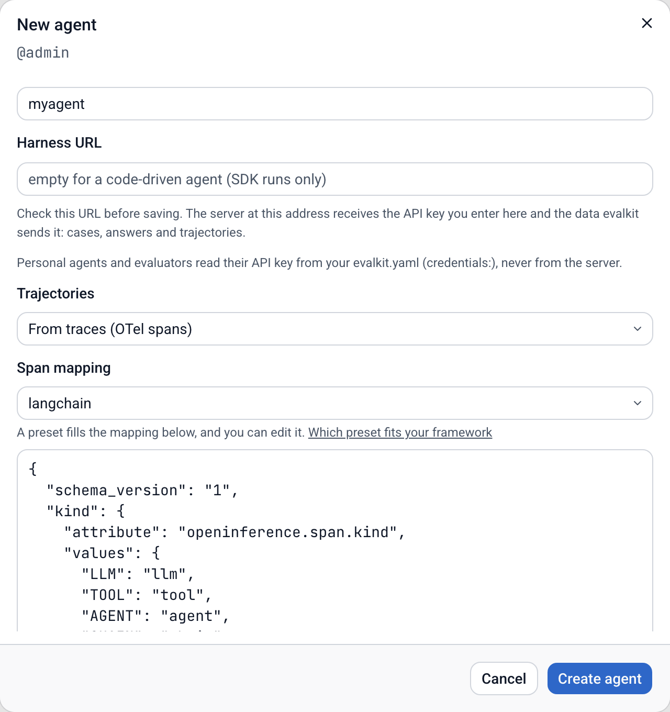
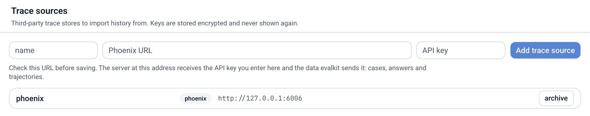
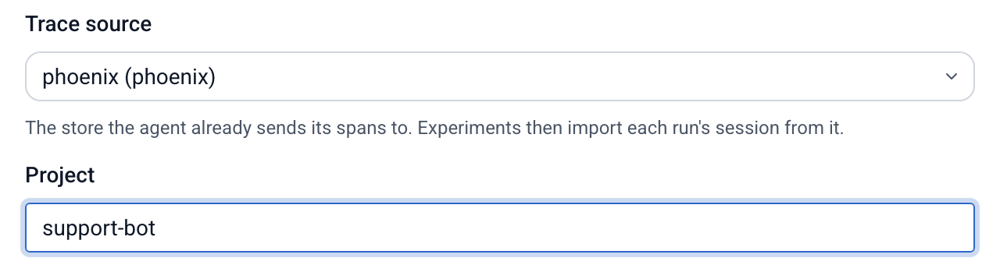
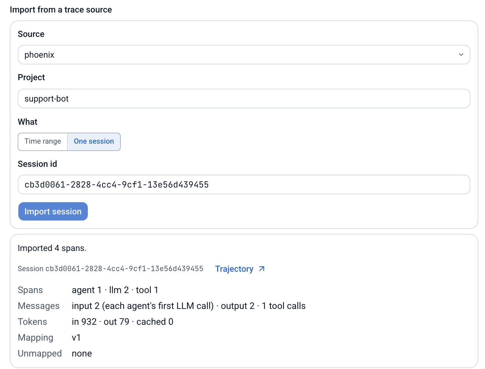
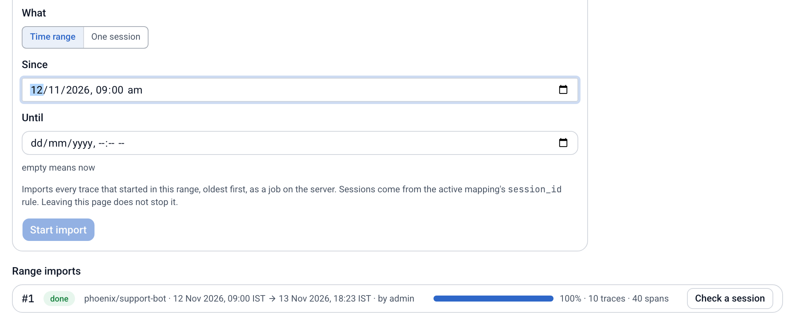
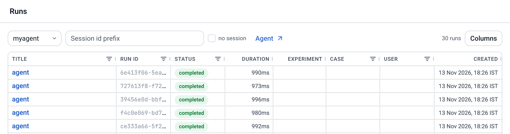
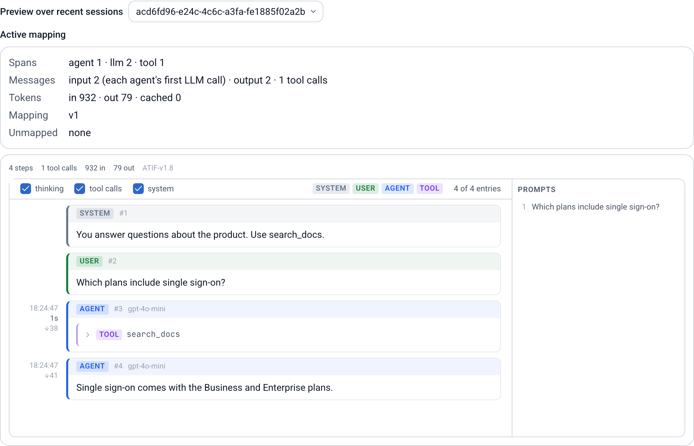
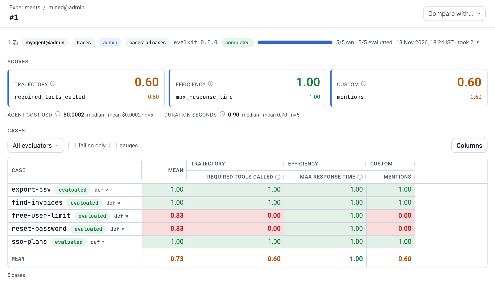
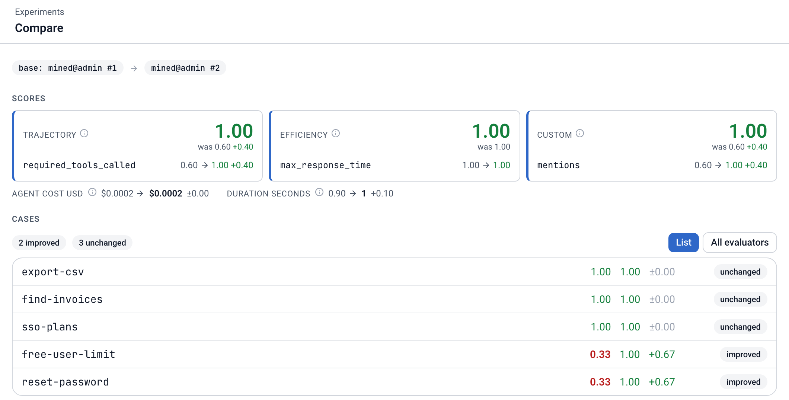

# Quickstart

Connect your agent, turn its real runs into eval cases, and ship a measured improvement. Your coding agent does most of the work. Plan for about half an hour; mining cases takes the longest.

You need:

- An agent.
- Python 3.12 or newer in your agent's project.
- A coding agent, such as Claude Code or Codex.

Stuck at a step? Read the page that step links to, or [open an issue on GitHub](https://github.com/inferedge-ai/evalkit/issues).

There are two paths. They differ only in step 3, which has a tab for each:

- **My agent sends traces to Phoenix.** evalkit imports your trace history.
- **No traces yet.** Your agent sends its traces straight to evalkit, and you use it a few times.

This quickstart assumes a Python agent. Is yours in another language, or does it run in another process? evalkit still works:

- Write a small Python [task](concepts.md#task) that calls your agent over HTTP or as a subprocess.
- Have your agent send its traces with its own OpenTelemetry SDK, as in [From any OpenTelemetry SDK](tracing.md#from-any-opentelemetry-sdk).
- Link each run to its spans. Either the task takes `metadata` and passes `metadata["session_id"]` to your agent as its session id, or your agent returns the session id it set on its spans and the task returns it in `RunResult(session_id=...)`. See [An agent in another process](sdk-runs.md#an-agent-in-another-process).

## Let your coding agent drive

Open your coding agent in your agent's project folder and tell it:

```text
Install evalkit-py=={{version}} into this project, run `evalkit skills install`, then use the getting-started skill to set up evalkit for this agent.
```

On a server you run yourself, add: `Log in to {{origin}}.`

It runs every step below. It stops only when it needs you: how fast to go, which path you take, the sign-in in your browser, your trace store's URL and project and the name of the environment variable that holds its API key, and your OK on the plan for the cases.

Prefer to do it by hand? The steps are the same.

## 1. Install and log in

Install `evalkit-py` into your agent's own project, at the version of the evalkit server you use: runs refuse to start when the two differ. evalkit needs Python 3.12 or newer.

<!-- tabs -->
#### pip

In the virtualenv your agent uses:

```bash
pip install "evalkit-py=={{version}}"
```

#### uv

```bash
uv add "evalkit-py=={{version}}"
```

#### poetry

```bash
poetry add "evalkit-py=={{version}}"
```
<!-- /tabs -->

Run every `evalkit` command below in that environment: with the virtualenv active, or as `uv run evalkit ...` or `poetry run evalkit ...`.

```bash
evalkit login
```

Your browser opens. Sign up or sign in to [hosted evalkit](https://evalkit.inferedge.com).

On a server you run yourself:

```bash
evalkit login --url {{origin}}
```

## 2. Create your agent

Pick the [preset](concepts.md#preset) for your framework. A preset is a ready-made [mapping](concepts.md#mapping): it tells evalkit how to read your agent's spans. [Framework mappings](framework-mappings.md) says which preset fits which framework. List them:

```bash
evalkit traces mapping presets
```

Create your [agent](concepts.md#agent) with it:

```bash
evalkit agents create myagent --trajectory-source otel --mapping langchain
```

In the UI: Agents › New agent, set Trajectories to "From traces (OTel spans)" and pick the preset under Span mapping.



## 3. Get real runs onto evalkit

Each [session](concepts.md#trace-span-session) of your agent becomes an [app run](concepts.md#app-run). Pick your path:

<!-- tabs -->
#### My agent sends traces to Phoenix

Tell evalkit where your traces live. This makes a [trace source](concepts.md#trace-source), and it needs an admin:

```bash
evalkit trace-sources create phoenix --url <your Phoenix URL> --api-key-env PHOENIX_API_KEY
```

In the UI: Settings › Organization › Trace sources.



Point your agent at its project there:

```bash
evalkit agents edit myagent --trace-source phoenix --project <project>
```

In the UI: Agents › myagent › Edit, then set Trace source and Project.



Check that evalkit reads your traces. Import one session from the project:

```bash
evalkit traces import myagent <session id>
```

The command prints one line per check. `session`, `root`, `mapping`, `llm` and `trajectory` must have a ✓, and so must `tools` when your agent called a tool. A `!` on `unmapped` is fine: it lists span attributes evalkit did not need. A `!` or ✗ on a required line means your spans differ from the preset: the connect-traces skill fixes the mapping. See [Mappings](mappings.md).

In the UI: Agents › myagent › Import, pick One session and enter its id.



Bring in your recent history:

```bash
evalkit traces import myagent --since <date>
```

In the UI: Agents › myagent › Import, pick Time range and set Since.



Does your agent start its own trace? Read [An agent with its own trace store](sdk-runs.md#an-agent-with-its-own-trace-store) before step 5.

#### No traces yet

Make your agent a token for sending traces:

```bash
evalkit tokens create --agent myagent
```

On hosted evalkit you can also make it in the UI: Settings › API keys.

Export it in every shell that runs your agent:

```bash
export EVALKIT_OTEL_TOKEN=<token>
```

Add the OpenTelemetry instrumentor for your framework. The Instrumentation column of [Framework mappings](framework-mappings.md) names it.

Turn tracing on where your agent starts, in code that also runs when `run_evals.py` imports your agent:

```python
from evalkit.sdk import tracing
from openinference.instrumentation.langchain import LangChainInstrumentor

tracing.register(agent="myagent")
LangChainInstrumentor().instrument()
```

`register` only adds evalkit as a destination; the instrumentor makes the spans.

Give each run its own session. Wrap each question your agent answers:

```python
from uuid import uuid4

from openinference.instrumentation import using_session

with using_session(str(uuid4())):
    answer = agent.ask(question)
```

Other instrumentors: see [a session id on each turn](framework-mappings.md#every-framework-a-session-id-on-each-turn).

Now use your agent the way you normally do: ask it 5 to 10 real questions.

Check one session. List the runs, then check one by its id:

```bash
evalkit runs list myagent --source app
```

In the UI: Runs, then pick myagent.



```bash
evalkit traces check myagent <session id>
```

The command prints one line per check. `session`, `root`, `mapping`, `llm` and `trajectory` must have a ✓, and so must `tools` when your agent called a tool. A `!` on `unmapped` is fine: it lists span attributes evalkit did not need. A `!` or ✗ on a required line means your spans differ from the preset: the connect-traces skill fixes the mapping. See [Mappings](mappings.md).

In the UI: Agents › myagent › Mappings, under Preview over recent sessions.


<!-- /tabs -->

[Tracing](tracing.md) has the details for both paths.

## 4. Mine cases from real runs

Tell your coding agent:

```text
Use the eval-driven-development skill to mine cases from myagent's app runs since <date> into a dataset named mined. Keep the first batch to 30 runs or fewer.
```

It reads each run, groups the ones that failed or ran slow, shows you a plan, and writes the [cases](concepts.md#case) to `evalkit/cases/mined/`. That folder is your first [dataset](concepts.md#dataset), built from real questions. [Case schema](case-schema.md) has the format.

## 5. Run the baseline

Write `run_evals.py` in your project's root. The [task](concepts.md#task) calls your agent once per case:

```python
from evalkit.sdk import run_experiment

from myagent import ask  # however your code calls your agent


def task(input: dict) -> str:
    return ask(input["question"])


if __name__ == "__main__":
    run_experiment(dataset="mined", agent="myagent", task=task)
```

Is your agent async? Write `async def task` and `await` it. Do not wrap it in `asyncio.run`. See [The task](sdk-runs.md#the-task).

`run_experiment(dataset="mined")` syncs `evalkit/cases/mined/` before it runs. You need no `evalkit.yaml`.

Each case runs once here, to keep the demo fast. Real comparisons pass `repetitions` (for example `repetitions=3`), because one run can flip by chance.

Run it from your project's root (with uv, `uv run python run_evals.py`; with poetry, `poetry run python run_evals.py`):

```bash
python run_evals.py
```

evalkit picks up each run's [trajectory](concepts.md#trajectory), scores it, and prints the [scorecard](concepts.md#scorecard) and a link to the [experiment](concepts.md#experiment).

Some cases fail. Good: they came from runs that went wrong.



## 6. Improve

Tell your coding agent:

```text
Use the eval-driven-development skill with --apply to fix the failing cases of my latest experiment on the mined dataset, then run the whole dataset again.
```

It pulls the failed [runs](concepts.md#run), finds the cause of each, fixes your agent and runs the dataset again. Does your agent run as a service? Restart it after each fix, before the next run.

Then compare the two experiments:

```bash
evalkit experiments list --dataset mined
```

```bash
evalkit summary <new id> --baseline <old id>
```

You see which cases it fixed, and how response time, cost and tokens moved.

In the UI: open the new experiment and pick the old one under Compare with.



## What you just did

- Set up evalkit in your agent repo.
- Mapped your agent's spans.
- Built a dataset from your agent's real runs.
- Ran an experiment and got a scorecard.
- Found what went wrong, fixed it, and measured the gain.

## Where next

- [Beyond the quickstart](beyond-quickstart.md): write a case by hand, attach files, drive your agent through the Harness API, share cases with your team.
- [Concepts](concepts.md): every term on this page.
- [Try locally](try-locally.md): run evalkit on your own machine with a sample agent.
- [GitHub issues](https://github.com/inferedge-ai/evalkit/issues): report a problem or ask a question.
