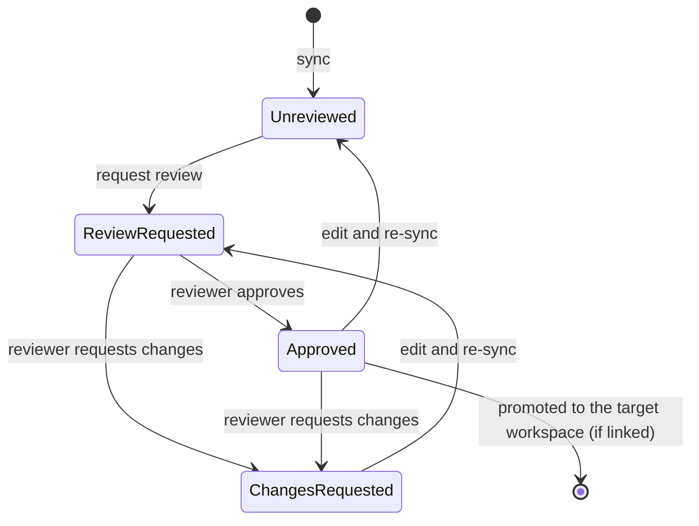

# Authoring eval cases

A case is a contract: a realistic input plus what any observer could check
about a correct response. Cases are **blackbox** — no tool names, skill names,
or any harness vocabulary anywhere in the case; that is what keeps a case
portable across harnesses, and `evalkit lint` enforces it as an error on the
question and every rubric. Checks that do know the harness's internals go in
evaluator config, never in that text:

- The built-in tool checks (`required_tools_called`, `tool_trajectory_match`)
  go straight in the case when it lives in the client's own harness-specific
  dataset, or in an overlay on a portable case. See
  [`references/tool-checks.md`](references/tool-checks.md).
- Checks scored by the client's own Custom Evaluator API endpoints go in an
  overlay. See [`references/overlays.md`](references/overlays.md).

## Terms

| Term | Meaning |
|---|---|
| Case | One eval question: input, expected behaviour, evaluator config. One YAML document. |
| Dataset | A named set of cases in the evalkit store; a YAML file or directory syncs into one. |
| Split | A selectable subset of a dataset, built from case tags. |
| Rubric | One typed sentence in `answer_rubrics` asserting something a correct answer contains. |
| Rubric type | `factual_retrieval`, `derived_computation`, or `analysis_interpretation`; drives the per-type rates. |
| Source | The attribution a `factual_retrieval` rubric requires; graded on its own citation axis, never in the content score. |
| Trajectory rubric | One sentence in `trajectory_rubrics.rubrics`: a checkpoint — an intermediate value or a process step — the recorded trajectory or final answer must show. |
| Overlay | A client extension of a case by id, attaching custom-evaluator config or the built-in tool checks — see `references/overlays.md`. |
| Tool check | A built-in evaluator over the recorded tool calls: `required_tools_called` or `tool_trajectory_match` — see `references/tool-checks.md`. |
| Judge | The LLM an evaluator uses to grade; configured on the deployment, never in the case. |
| Red / green case | Red: the case fails against the current agent; green: it passes. For a capability gap red is the expected starting state — ship it red. |

## Interviewing the case author

Route here when the case originates from a stakeholder description or a
high-level intent — the author knows the domain and the correct behaviour, not
the agent's internals. The same protocol serves a developer authoring
in-session and a relayed exchange (e.g. a chat thread via a bot): every
clarifying round is a plain message, so the flow works headlessly.

Fill every slot below before writing YAML. Ask clarifying questions in batches
of at most 3 per round, in plain domain language — never mention tools,
skills, or agent internals to the author (a rule of this protocol, not a
general conversational rule). Stop asking when the slots are full, not before.

| Slot | Becomes | Notes |
|---|---|---|
| The scenario, in the author's words | — | The raw material for everything below. |
| A realistic user phrasing | `input.question` | Derive it FROM the scenario and play it back for confirmation — authors are not expected to produce verbatim input. |
| A date anchor in the input | part of `input.question` | Whenever the answer is time-sensitive, anchor the question itself ("as of 30 September 2025") so pinned ground truth cannot drift under the case. |
| What a correct answer contains | `answer_rubrics` | Concrete values (or the correct honest negative), dated — see the rubric sections below. |
| The intermediate values and visible steps the work should show | `trajectory_rubrics` | Checkpoint sentences — see below. |
| Presentation requirements, if any | `presentation_judge` | Units shown, columns present, an artifact relayed rather than restated. |
| A latency bound, if the case has one | `max_response_time` | Seconds; settable file-wide via `defaults.max_response_time`. |

For agents that return a structured `output` (classifiers, taggers,
extractors) instead of prose: `answer_rubrics` still works, since the judge
reads the output as JSON text, so a rubric like "The label is EVENT" can be
graded. Skip `presentation_judge`, because layout and units mean nothing for
JSON. Exact field checks belong in a custom evaluator that reads
`run.output`.

## Ground-truth verification

Do not accept vague expectations. Verify the values yourself from whatever
verified data source is available in the session (the client's data tools,
primary documents):

1. Query the relevant data for the case's anchored date.
2. Show the author the concrete values ("I see revenue of X and margin of Y
   for that quarter — is that what the agent should show?").
3. Pin the confirmed values as rubrics with the as-of date.

When no verified source in the session can produce the values, ask the author
for the exact numbers — a number the author supplies and stands behind is
verified ground truth; a model-asserted one never is. If neither you nor the
author can produce the values, tag the case `needs-ground-truth`, keep the
expectation as written, and keep the case out of the main runs — never soften
a case to make it passable.

## Writing answer rubrics

`answer_rubrics` is the output evaluator: everything the answer must contain,
one flat list of typed sentences. Field shapes are validated by `evalkit lint`;
the sections below are about judgement — what to assert, which type it is, and
how to phrase it.

```yaml
evaluators:
  output:
    answer_rubrics:
      rubrics:
        - rubric: "States that the company's actual Q3 FY2024 non-GAAP gross margin was 28.1%."
          type: factual_retrieval
          source: "Q3 FY2024 results"
        - rubric: "Calculates that the company beat its guidance midpoint by 160 bps (±10 bps),
            measuring against the 26.5% midpoint rather than the endpoints of the range."
          type: derived_computation
```

`source` is optional and only valid on `factual_retrieval`. `type` is required.
There is no `points`, no `tolerance` field, and no judge model override — the
judge comes from the deployment config.

### Assert only what the question asks

A rubric holds the answer to the question as asked, not to the author's
unstated wishes. An expectation the question never expressed belongs in a
rubric only when it is an obvious implication of the ask or carries strong
convention (a "compare YoY" question implies both years' figures). Anything
else is the rubric unfairly penalizing a reasonable answer — if the
expectation matters, put it in the question.

### Answer rubric types

| `type` | The assertion is about |
|---|---|
| `factual_retrieval` | anything stated in a source: a value, entity, date, category, classification, or a statement attributed to someone |
| `derived_computation` | a figure the answer works out rather than looks up, and the method or scope behind it |
| `analysis_interpretation` | what the figures show — a trend, a ranking, a cause, a driver, a comparison |

Apply in order and stop at the first that fits:

1. Is the assertion **quoted from a source** — some document, filing,
   transcript or feed states it, and the work is retrieval plus faithful
   reproduction? → `factual_retrieval`
2. Otherwise the answer **produced** it, and no source contains this sentence:
   - a figure it computed, or the method or scope behind one →
     `derived_computation`
   - a statement about what the figures show → `analysis_interpretation`

This split is the one that tells you where to look when a case fails: it
separates "the data never arrived" from "the reasoning was wrong". An
assertion about **how the answer displays** something — a table, an ordering,
a unit label — is not an answer rubric at all; it goes under
`presentation_judge` (see below).

### An `analysis_interpretation` rubric is a reading of the facts, not an opinion

Every rubric of this type has one right answer, worked out from facts the
answer already has: given four quarterly beats, exactly one is the largest.
Where a question has more than one reasonable answer, **no rubric says which
answer to reach.** A rubric asks that a point be weighed — "Weighs the FY27
refinancing wall against the current cash position" — not that the answer
conclude the bond is overvalued. If grading a rubric would mean the judge
picking a side in a real disagreement, don't write that rubric, in this type
or any other.

### Numeric matching is lenient by default

A figure matches after unit conversion, and normal rounding of the rubric's
figure is accepted: against "3,172.6 million", an answer saying "3,173
million" or "3.17 billion" satisfies the rubric, while "3,180 million" is a
different figure, not a rounding. Write the plain correct value and let the
default do its work.

State an acceptance criterion in the sentence only when the case wants
something the default doesn't give — tighter ("exactly 3,172.6 million"),
wider ("±1 million"), or alternative ("either the standalone or the
consolidated figure", "any figure between X and Y"). A stated criterion
replaces the default, and stating it in the sentence keeps it visible to a
dataset reader.

### How specific to make a `source`

`source` asserts that the answer credits the fact to that source. It is graded
on its own citation axis and never counted in the content score, because
getting a fact right says nothing about citing it.

Write it at the granularity the case cares about. An over-specific source
string creates failures that are not real: a rubric naming the "earnings
release" against an answer citing the "earnings call" is a different document,
so it scores `incorrect` even when the figure appears in both. Where several
disclosures are acceptable, name the set loosely — "any Q3 FY2024 disclosure".
Attach a `source` to every `factual_retrieval` rubric whose provenance the
case actually cares about, not to a token handful.

### Methodology goes in the rubric text

A `derived_computation` rubric states its own method inline — the method
determines the value, so the figure already tests it. Where a case wants the
method stated explicitly (transparency the answer owes the reader, or two
methods give the same figure), that is its own `derived_computation` rubric.
A statement about what a source does or does not report ("X does not report
segment revenue") is itself a fact, so it is `factual_retrieval`.

### One rubric, one assertion

Split anything a reader could grade two ways into two rubrics. A rubric may
pair two periods where the comparison is the point — that is one comparison,
not two facts. A rubric bundling a figure with an explanation of it is two
rubrics.

### Honest negatives are ordinary rubrics

Where the correct answer *is* a negative the answer should state, write it as
a positive rubric: "States that the company does not report free cash flow."
That grades all three outcomes: claiming a reported figure is `incorrect`,
saying there is none is `satisfied`, ducking it is `absent`.

### No harness vocabulary

The corpus is published independently of any agent, so a rubric never names a
tool, skill, server, data provider or any other implementation concept. Assert
what a correct answer contains, not how it was obtained.

### What you get back

| Score | Meaning |
|---|---|
| `answer_rubric_score` | share of the case's rubrics satisfied — the case's published score, and what `collect --threshold` compares against |
| `answer_rubric_coverage` | share of rubrics the answer engaged at all |
| `answer_rubric_accuracy` | of the rubrics it engaged, the share it got right |
| `answer_rubric_<type>` × 3 | the same recall within one type; skips where the case has no rubrics of that type |
| `answer_rubric_citation` | of the facts the answer stated, the share correctly attributed |

Each rubric gets one of three verdicts — `satisfied`, `incorrect`, `absent` —
and so does each `source`. The explanation JSON carries the counts, the
per-type breakdown, the citation block and the full verdict list, which is
what makes a failure diagnosable: which rubrics were wrong versus silent, what
the answer said instead, and whether a stated fact was misattributed or merely
uncited.

Every corpus-level number is pooled over rubrics, not averaged over cases, so
a 16-rubric case carries 16 times the weight of a 1-rubric case. That is also
why there are no points: a weight only means something next to its siblings,
and pooling would add a "3" in one case to a "3" in another as though they
meant the same thing.

## Presentation checks

How the answer displays its content — a table with named columns, an ordering,
units shown, an artifact relayed rather than restated — goes under
`presentation_judge`, never into `answer_rubrics`. Each entry is a property
the answer must have, phrased as the property rather than a description of
the answer having it ("A store count for each fiscal year FY2021–FY2025, as a
table or a labelled list"); `forbid` entries name properties the answer must
not have. Correctness of the figures stays in `answer_rubrics` — asserting
the same thing in both places reweights it rather than making the case
stricter.

## Writing trajectory rubrics

`trajectory_rubrics.rubrics` is a flat list of sentences. Each is a checkpoint
the recorded trajectory or the final answer must show. The judge sees the
question, the rubrics, the full ATIF trajectory — tool calls, tool results,
subagents, and the agent's reasoning where the harness records it — and the
final answer, and marks each rubric satisfied or unsatisfied on positive
evidence, citing steps as `main:<step_id>` or `<trajectory_id>:<step_id>`. The
score is satisfied ÷ total. Order is not graded. The whole trajectory goes to
the judge in one call, nothing truncated.

```yaml
evaluators:
  trajectory:
    trajectory_rubrics:
      rubrics:
        - "Retrieves Roku's FY2024 Platform revenue as $3,522,776,000."
        - "Retrieves Roku's FY2023 Platform revenue as $2,994,105,000."
        - "Retrieves the FY2023 restructuring expense inside Platform cost of revenue as $67,032,000."
        - "Calculates FY2023 Platform cost of revenue excluding restructuring as $1,360,514,000."
        - "Calculates FY2023 adjusted Platform gross margin as 45.44% (±0.005pp)."
        - "Calculates FY2024 adjusted Platform gross margin as 46.46% (±0.005pp)."
        - "Computes the margin change from the two adjusted margins, not from the reported ones."
        - "Rounds the final figure to the nearest basis point."
```

Two kinds of rubric share the list:

1. **Checkpoints with a value** — every input the derivation retrieves and
   every intermediate result it computes, each with its figure. The sentence
   carries the subject, period, unit and value, and a band wherever rounding
   is expected, exactly as an answer rubric does. "Retrieves FY2023 capital
   expenditure as $3,100,000" — not "gathers the cash-flow data".
2. **Process steps in plain language** — a step whose evidence is an action
   or a method rather than a figure: "Reads the debt footnote of the 10-Q for
   27 September 2025", "Uses the guidance midpoint rather than the range
   endpoints", "Rounds the final figure to the nearest basis point".

To decompose, work the derivation yourself: one rubric per input retrieved,
one per intermediate result, then the final figure. Ground-truth verification
covers every intermediate value the same way it covers the final ones — a
checkpoint figure you have not verified is a guess dressed as a rubric.

When an input is a series or a list — ten years of yields, forty trades, every
holding in a fund — do not write one rubric per point. Write spot checks: two
or three specific points with their values (the first, the last, and one that
is easy to get wrong), plus one rubric on the shape of the whole ("Retrieves
month-end 10-year G-sec yields for all 120 months from January 2016 to
December 2025"). A run that fetched the series passes the spot checks; a run
that fetched the wrong series or half of it fails them.

Specific-but-portable is the bar: naming *what* data (which company, which
metric, which period, which value) stays harness-agnostic — every harness
fetches data somehow and the recorded steps show it. Only naming *how* (tools,
skills, servers) breaks portability.

The final figure usually appears in both the answer rubrics and the trajectory
rubrics. That is fine: they are different evaluators in different buckets, one
asking what was delivered and the other how it was derived. Do not copy the
rest of the answer list across — the trajectory list is the derivation path.

Red flags: a rubric whose text is a dash-separated list of content ("— market
size, top players, risks, outlook") is several rubrics in disguise; a
checkpoint with no value where the derivation clearly has one; and an expected
answer containing values the user did not supply with no rubric saying where
each comes from.

## Red cases

A red case on first run is a finding, not a mistake — for a capability gap,
red is the expected starting state. Ship it red.

## Attaching files

When the question is about a document the agent must read, attach it as a
fixture rather than pasting its contents:

1. Put the file in the `fixtures` directory named in `evalkit.yaml`, under a
   flat, descriptive filename: the fixture `<key>`
   (`meridian-balance-sheet-fy2025.csv`).
2. Declare it once in the suite's `fixtures.yaml` with its `sha256`
   (`shasum -a 256 <file>`) and a `context`: one or two sentences saying what
   the file is, its period, its units and anything about its layout the agent
   needs. This text is prepended to every question that uses the file, so the
   question itself should not describe the file.
3. Reference it from the case with `fixtures: [<key>]`. Several cases can
   share one key.

Only the registry entry goes into git; the bytes live in the `fixtures`
directory named in `evalkit.yaml`. `evalkit run` and `evalkit sync` upload
them to the server, stored by `sha256`, and fail naming any key whose file is
missing or whose bytes do not match the registry `sha256`. Nobody uploads to
blob storage by hand. To replace a file, change the
bytes under the same key and update the `sha256`; the next run re-versions
every case that uses the key. If the old version matters for comparison, use
a new key instead.

## Before sync

Run `evalkit lint <file-or-dir> --dataset <slug>` and fix every error (warnings
are advisory). `--dataset` is the dataset you will sync into; it lets the
server check case ids and overlay targets against every other dataset.
A jargon-leak error is fixed by rewording the case, never by renaming
internals. Then `evalkit run <dataset> --agent <agent>` syncs the directory
to your workspace and runs it; CI, logged in as `admin`, runs `evalkit sync
<dir> --workspace dev` (the team's shared workspace) on merge (see
`evalkit --help` for exact flags).

## After sync



Review applies to datasets in a shared workspace (e.g. `finance@dev`);
datasets in your personal workspace have no review state. Review never
filters a run: experiments run every case, whatever its state. In a shared
dataset a synced case starts Unreviewed. When the case is right, request review:
`evalkit review request finance@dev --case-id <id> --reviewer <user>`, or
use the case page in the UI. Reviewers are the
workspace's members with the reviewer role. A reviewer approves it or
requests changes with a comment; `evalkit review show <slug> <id>` prints the
state, changelog and comments. Editing an approved case makes it Unreviewed
again.

If an admin has linked the workspace to a promotion target (for example
`dev → prod`), approval is also the release: the approved version lands in
the same-named dataset of the target, already approved, with its overlays.
The target accepts no sync and no review decisions of its own, so a fix
always goes back through the source. The case page shows the twin in the
other workspace; see the evalkit-usage skill, "Promotion between workspaces".

For bugs, feature requests and feedback on evalkit, open an issue at https://github.com/inferedge-ai/evalkit/issues; questions go to https://github.com/inferedge-ai/evalkit/discussions.
