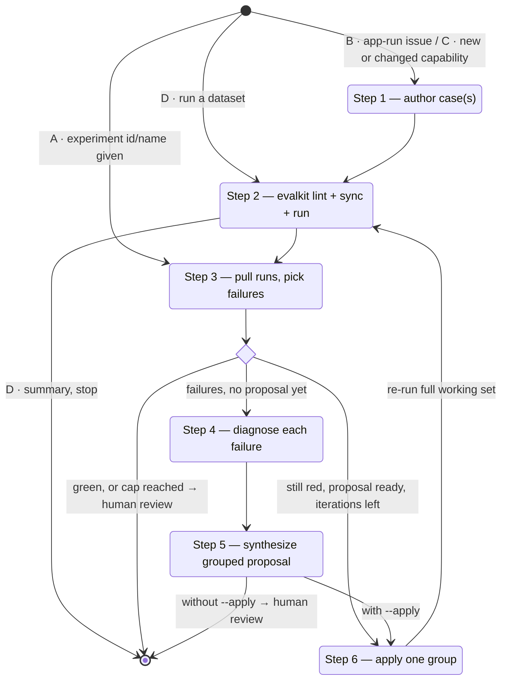
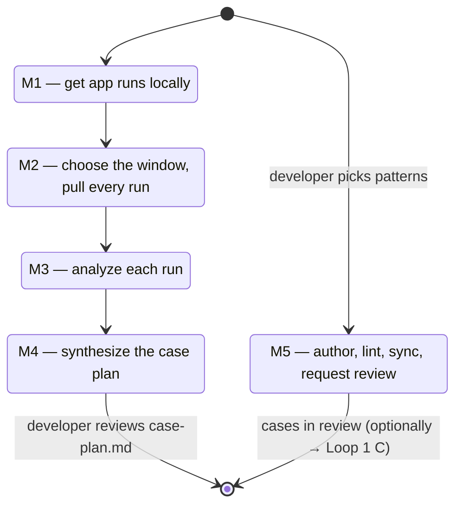

# Eval-Driven Development

Two loops share one toolbox. **Loop 1 — Improve the agent** runs cases and
turns failures into file-cited fixes until nothing scores below threshold.
**Loop 2 — Mine cases** reads a batch of the agent's app runs and turns the
failure patterns it finds into new cases for review. Pick one loop first (see
"Pick a loop") and stay on it; the two meet only at the handoffs in "Where
the loops meet".

All eval operations go through the `evalkit` CLI. Discover exact command
shapes with `evalkit --help` (and `--help` on any subcommand) instead of
guessing. Loop 1 leans on `sync`, `run`, `runs pull --experiment` and
`summary`; Loop 2 on `runs list`, `runs pull`, `lint`, `sync` and
`review request`.

## Terms

| Term | Meaning |
|---|---|
| Loop 1 — Improve the agent | Run cases, diagnose failures, fix the agent's code, prompts, tools or data. Output: a scorecard and agent changes. |
| Loop 2 — Mine cases | Pull app runs, analyze each, cluster failure patterns, author cases. Output: cases sent to review. |
| App run | A run of the agent outside any experiment: production, staging or by hand. |
| Experiment | One run of one dataset (or a case subset) against one agent. Referenced by id or name. |
| Run | One case executed once against the agent, in a fresh session. |
| Case | One eval question: input, expected behaviour, evaluator config. A YAML document. |
| Surface | The place a fix lands: a skill, a tool description, a prompt, or a data source. |
| Working set | The failing case ids plus sibling cases that exercise the same surfaces; what Step 6 re-runs. |
| Run directory | One run pulled by `evalkit runs pull` — `runs/<run_id>/` with `run.json`, `trajectory.json`, `case.json`, `evaluations.json`; `files.json` and `files/` only after `evalkit runs files`. |
| Finding | The one JSON diagnosis Step 4 produces per failing case. |
| Proposal group | One set of related fixes in `proposals.md`; Step 6 applies one group per iteration. |
| Overlay | A client extension of a case by id, attaching custom-evaluator config or the built-in tool checks for the agents it names. |
| Blackbox / whitebox | Blackbox: what any observer could see — the portable case. Whitebox: harness-specific checks — the overlay. |
| Coverage gap | A Loop 1 finding that says no case covers a scenario, or that the case itself is wrong. |
| Observation | The one JSON a Loop 2 analysis writes per app run. |
| Pattern | A group of observations that share a failure; the unit of the case plan. |
| Case plan | `case-plan.md`, Loop 2's ranked list of patterns with proposed cases. |
| EDD-infra note | A one-line nudge from diagnose/synthesize about a gap in the eval setup itself. |

## Case levels

Every case is layered:

- **Blackbox case** — asserts only what any observer could see: the answer and
  the trajectory in natural language (`answer_rubrics`, `trajectory_rubrics`,
  `presentation_judge`, `max_response_time`). No tool/skill vocabulary —
  portable across harnesses. Authoring doctrine lives in the
  `authoring-eval-cases` skill.
- **Whitebox enrichment** — additive harness-specific assertions, attached as
  an **overlay** on the case and scored by evalkit's built-in tool checks
  (`tool_trajectory_match`, `required_tools_called`) or the client's own
  Custom Evaluator API endpoints. A case in the client's own
  harness-specific dataset may carry the built-in tool checks directly
  instead (see the authoring skill's
  [`references/tool-checks.md`](../authoring-eval-cases/references/tool-checks.md)).
  Enrichment never edits blackbox evaluators; stripping the
  overlay leaves a portable case. See the authoring skill's
  [`references/overlays.md`](../authoring-eval-cases/references/overlays.md).

## Pick a loop

| Developer gives | Wants back | Loop |
|---|---|---|
| A dataset to run, an experiment id or name, an app-run issue, a new capability | A scorecard, or agent changes | 1 |
| An agent and a time window ("look at last week's traffic", "what are users hitting?") | New cases | 2 |

If a request fits neither row, ask which output they want. Once a loop is
picked, follow only its steps. Loop 2's steps are named M1–M5 so they never
mix with Loop 1's Steps 1–6.

## Runs are history

This applies to both loops. Every pulled run shows the agent as it was when
the run happened (`run.json` `started_at`, `index.json` `created_at`), not as
the code is now. Prompts,
skills, tools and data may have changed since, so a failure in a run may
already be fixed. Before diagnosing or proposing a fix, check the git history
of the agent repo for changes made after the run:

```bash
git log --since=<run started_at> --oneline -- <paths of the surfaces involved>
git log --since=<run started_at> --oneline -S '<tool or prompt text from the trajectory>'
```

`--since` compares commit dates, which a rebase or squash merge resets, so
treat it as a first pass: also read the last few commits that touch the
surface (`git log -n 10 -- <path>`) whatever their date. Read any commit that
touches the failing surface. If it already addresses the failure:

- **Loop 1** — the finding says so (`already_addressed`) instead of proposing
  the same fix again; re-run the case to confirm the fix rather than editing
  code. Diagnose against the code at `HEAD`, and cite what changed since the
  run.
- **Loop 2** — the observation says so (`fixed_since`). Still author cases for
  the pattern: they guard the fix against regressions. The case plan marks
  them "expected green" with the commit, so nobody reads them as open
  failures.

## Loop 1 — Improve the agent

**Output is a scorecard and agent changes. New cases come only from Step 1 or
from the coverage-gap handoff; never edit cases to make a run pass.**

Four entry points, one shared loop. Infer the entry point from what the
developer gave you: a dataset to run → D; an experiment id or name → A; a
described app-run issue → B; a feature/behaviour intent → C.

One flag: `--apply` in the invocation runs the autonomous apply → re-run loop
(Step 6). Without it, stop after the proposal for the human to act.



- **A — fix a failing experiment (regression).** An experiment already ran;
  the developer names it (`runs pull --experiment` takes its numeric id). →
  start at Step 3.
- **B — capture an app-run issue as a regression guard.** An app run (one
  outside any experiment: production, staging or by hand) misbehaved. →
  Step 1: author a case (from the run *and* the developer's input) asserting the correct behaviour, then run and loop. The case stays in
  the suite afterwards as a permanent guard. If the developer points at a
  run/session id, pull it with `evalkit runs pull <agent> --run-id <id>` and
  read its `trajectory.json` before authoring.
- **C — build or change a capability, cases-first.** New or changed behaviour,
  code not written yet. → Step 1: author cases for the desired behaviour;
  expect the first run to be red.
- **D — run a dataset.** The developer wants to know how the agent does on a
  dataset (or part of one). → Step 2: `evalkit run`, then `evalkit summary
  <experiment-id>`, and stop there. Continue at Step 3 only if they ask for the
  failures to be fixed.

### Step 1 — author / select cases (B and C)

Use the `authoring-eval-cases` skill. Ground every case in the material at
hand — the request in this conversation, any app run or links shared, files
already open — and ask the developer to fill any gap (the exact input, the
correct output) rather than guessing. The case asserts the **ideal
behaviour** — a time-anchored input and specific expected values — never the
current broken behaviour: don't write rubrics that merely guard against the
failure you just saw, or the case overfits to today's bug instead of stating
what correct output looks like for this input and every sibling like it.

### Step 2 — lint, sync, run (B, C and D)

After authoring or editing any case YAML — in any entry point — run
`evalkit lint <file> --dataset <slug>` first; errors block sync. Then
`evalkit run <dataset> --agent <agent>`: with an `evalkit.yaml` in the repo
this syncs the dataset directory to your workspace and runs your local agent
from this machine. For a tight loop, run only the relevant cases
(`evalkit run <dataset>/<file>.yaml`, `evalkit run <dataset>/<subfolder>`, or
`--case-id`, repeatable) rather than the whole dataset.

`evalkit run` executes every selected case, in personal and shared datasets
alike; review state never filters a run.
When you are confident the case is correct and it has reached a shared
dataset, ask for review:
`evalkit review request <dataset>@dev --case-id <id> --reviewer <user>`. If `dev` is
linked to a promotion target such as `prod`, the reviewer's approval also puts
the case into `<dataset>@prod`, approved; nothing else is needed to release
it. Whether the
agent passes the case has no bearing on review; a red case that asserts the
right behaviour is exactly what a reviewer should approve.

`run` executes two phases: agent runs, then evaluators. If a run crashes or is
killed before evaluation, don't re-run the cases — `evalkit evaluate
<experiment-id>` scores the runs that already persisted, and `evalkit run
--resume <experiment-id>` finishes a partially-run experiment.

### Step 3 — pull runs and pick the failures

`evalkit runs pull --experiment <experiment-id>` downloads every run of the
experiment to `evalkit-runs/experiment-<id>/` (keep that directory out of
git): `index.json` and one `runs/<run_id>/` per run with `run.json` (status,
answer, metrics), `trajectory.json` (ATIF), `case.json` (the case version the
run answered) and `evaluations.json` (every evaluator's score and explanation).

The pull does not fetch files: not the run's workspace files (deliverables)
and not the full outputs of tool results the harness shortened (the
trajectory keeps the shortened one). Fetch them only for the failures you
diagnose, and only when the trajectory is not enough:
`evalkit runs files <dir> <run_id>` prints the run's file tree (also written
to `runs/<run_id>/files.json`); then
`evalkit runs files <dir> <run_id> --path <file or folder>` fetches just those
into `runs/<run_id>/files/<path>`. A tool result's `extra.full_output_path` is
such a path, even when the tree does not list it. The first file that fails
stops the command and names it; rerun with the remaining paths if you still
need them. Never fetch a whole heavy workspace when one file answers the
question.

Pick the failures yourself from `index.json` `runs`: a run fails when its
`status` is not `completed` or any value in `scores` is below 0.8 (use another
threshold if the developer asked, and only their evaluator if they named one).
A row with `pull_error` set could not be fetched in full (its run directory
has no `trajectory.json`); pull it again into the same directory with
`evalkit runs pull <index.json agent> --run-id <run_id> --out <same dir>`, and
if it still fails, list it for the developer instead of diagnosing it. If
`index.json` has a `note`, tell the developer (for example, the harness scan
stopped early).
If none fail, report "no failures below threshold" and STOP (for B/C, an empty
failure set on the first run means the capability already works — confirm and
stop). Diagnose failures only; the passing runs are there for profiling.

### Step 4 — diagnose (fan-out, capped at 5 concurrent)

For each failing case, run the instructions in
[`references/diagnose.md`](references/diagnose.md) against its failing run
directories. On agents with subagent support, dispatch each diagnosis as a
subagent, batched 5 at a time (one message with 5 parallel dispatches, wait,
then the next batch); otherwise run them inline, sequentially. Each diagnosis
produces a single JSON finding — write each one to
`<review-dir>/findings/<case_id>.json` (create `findings/` first).

Trajectory efficiency is in scope for every diagnosis, not just wrong output:
errored, retried, or redundant tool calls and wrong-first-call discovery
overhead are diagnosable defects in their own right. Don't let a
plausibly-correct final answer mask a wasteful trajectory.

### Step 5 — synthesize (once)

Run the instructions in [`references/synthesize.md`](references/synthesize.md)
once (as a subagent where supported), passing: the `findings/` dir, the
`index.json` path, and the proposal output path `<review-dir>/proposals.md`.
It writes the proposal. Print the proposal path and a one-line summary
(`<N> failures diagnosed, proposal at <path>`).

If not `--apply`, STOP here for human review.

### Interpreting Loop 1 outputs

Findings and the proposal carry flags addressed to you, not just to the
proposal's reader. Handle each explicitly instead of skimming past them:

- **`unverified` proposal groups** — the synthesizer could not confirm the
  change against real code, or concluded the case itself may be wrong. Never
  apply one autonomously in Step 6; carry it to the developer with the stated
  reason.
- **Possibly-wrong case** — when the proposal says the expected answer is not
  derivable from the data or domain (a `wrong_case` coverage gap), the fix is
  a dataset fix. Escalate to the developer; do not bake the expected answer
  into any prompt surface.
- **`verdict: borderline` findings** — near-threshold, not clearly broken.
  Deprioritize below `failed` findings; mention them in the exit summary
  rather than spending iterations on them.
- **`already_addressed` findings** — a commit after the run already changed
  the failing surface. Don't apply anything for them; re-run those cases first
  and only diagnose again if they still fail.
- **Case proposals (coverage gaps)** — `proposals.md` lists them apart from
  the fix groups. Never apply them in Step 6. Offer them to the developer at
  the end; accepted ones go through Loop 2's M5 (author, lint, sync, request
  review). See "Where the loops meet".
- **`root_cause: unknown` or low `confidence`** — don't force these into a fix
  group. List them for the developer with whatever evidence the finding has.
- **`EDD-infra note:` lines** — diagnose and synthesize may append one when
  the eval setup itself has a gap. Collect every note and relay them in the
  final summary (see Self-feedback); they are never a reason to edit evalkit
  or the pulled runs yourself mid-loop.

### Step 6 — apply & re-run (only with `--apply`)

The autonomous inner loop, capped at 3 iterations (a global cap on total
iterations across all groups; the developer can raise it in the request). Each iteration applies a single
proposal group, then re-runs the whole working set and pulls it again. One group
per iteration keeps each change attributable; re-running the full working set
catches a fix that regresses a sibling.

Copy this checklist and track progress:

```
EDD loop:
- [ ] Build the working set (failing ids ∪ cases touching the same surfaces)
- [ ] Iteration 1: apply highest-leverage group → run full working set → re-pull
- [ ] Iteration 2 (if still red): apply next group / refine → run full set → re-pull
- [ ] Iteration 3 (if still red): apply next group / refine → run full set → re-pull
- [ ] Summarize (green, or what is still red + groups not reached at the cap) → hand to human
```

**Build the working set (once, before the loop):** seed = the failing
`case_id`s you picked from `index.json`; widen with sibling cases that exercise the same
surfaces the proposal touches (search the case YAML for related scenarios).

**Each iteration:**

1. Apply the chosen proposal group — edit the cited file at the surface the
   proposal names. Create a brand-new surface only when the developer asked
   for one or the proposal shows no existing surface can host the capability.
   Any change to a prompt surface follows the prompt-change guidelines inside
   [`references/synthesize.md`](references/synthesize.md): describe the
   mechanism first, escalate to rule-style wording only when a re-run shows
   the behaviour persisted, prefer deterministic guards, no eval awareness.
2. `evalkit run <dataset> --agent <agent> --case-id <id> [--case-id …]`
   over the working set (the run syncs your edits first).
3. `evalkit runs pull --experiment <id>` for that experiment and pick the
   failures from the new `index.json`.
4. Stop when no failure scores below threshold (**green**) or when the
   iteration cap is reached.

**On exit:** summarize what changed, what is green, and — if the cap was hit —
what is still red. List the case proposals, if any. Hand to the human; do not
keep looping.

## Loop 2 — Mine cases from app runs

**Output is cases sent to review. Never edit the agent in this loop; to fix
the agent for the new cases, hand off to Loop 1 (see "Where the loops
meet").**



Work in one directory for the whole batch, `<dir>` (default
`evalkit-runs/<agent>/<YYYYMMDD-HHMMSS>/`, kept out of git): the pulled runs,
`observations/` and `case-plan.md` all live there.

### M1 — get app runs locally

Check how the agent's runs reach evalkit (`evalkit agents show <agent>` says
OTel or harness), then take one route:

1. **OTel agent that exports app traffic to evalkit** — the runs are already
   on the server. Go to M2.
2. **Traces live in an external tracing tool** — import them first with
   `evalkit traces import` (Phoenix is the only supported source today), wait
   for the import (`evalkit traces imports <agent> <id>`), then go to M2.
3. **Harness agent** — `evalkit runs list` reads the harness's run list (the
   server does it for a shared agent, your CLI for a personal one). Go to M2.

If `evalkit runs list <agent> --source app` returns nothing, stop: tell the
developer the agent sends only eval traffic to evalkit, and point at route 2
or at the connect-traces skill. Never continue with zero runs.

### M2 — choose the window, pull every run

Analyze every app run in the window; don't sample.

1. Ask for the time window (default: the last 7 days). Fix `until` to the
   current time for the whole batch, so new runs don't shift the pages.
2. Count: `evalkit runs list <agent> --source app --since <since> --until
   <until> --json` (one row per line).
3. If the count is 0, stop (see M1). If it is 100 or fewer, go on. Above 100,
   tell the developer the count and the cost — one subagent per run, 5 at a
   time — and offer to narrow the window. Go on with more than 100 only when
   the developer states the number; "all" is not a number.
4. Pull 25 runs per call into the same directory:

   ```bash
   evalkit runs pull <agent> --source app --since <since> --until <until> \
     --limit 25 --offset <0, 25, 50, …> --out <dir>
   ```

   Every call adds to the same `index.json`; `runs/` stays flat. No files
   come with the runs; M3 fetches them per run when it needs them.
5. Rows with `pull_error` could not be fetched in full: list them for the
   developer and skip them in M3. If `index.json` has a `note`, pass it on.

### M3 — analyze each run (fan-out, capped at 5 concurrent)

For every row in `index.json` without a `pull_error`, run the instructions in
[`references/analyze-run.md`](references/analyze-run.md) against
`<dir>/<row.dir>`. On agents with subagent support, dispatch each analysis as
a subagent, 5 at a time; otherwise run them inline, one at a time. Each
writes `<dir>/observations/<run_id>.json` (create `observations/` first; use
the row's `dir` name for the file).

### M4 — synthesize the case plan (once)

Run [`references/synthesize-cases.md`](references/synthesize-cases.md) once
(as a subagent where supported), passing `<dir>/observations/`,
`<dir>/index.json`, the target suite directory (the case YAML the new cases
will join; ask the developer if there is more than one), and the output path
`<dir>/case-plan.md`.

Print the plan path and one line (`<P> patterns from <N> runs, plan at
<path>`), then STOP until the developer picks which patterns to author.

### M5 — author, lint, sync, request review

For each pattern the developer picked:

1. Author its proposed cases with the `authoring-eval-cases` skill. Its
   interview fills every `NEEDS DEVELOPER` ground truth; never guess one.
2. `evalkit lint <file> --dataset <slug>`; errors block sync.
3. `evalkit sync <dataset dir>` (with `--workspace <ws>` for a shared
   workspace you write to).
4. On a shared dataset, `evalkit review request <dataset>@<ws> --case-id <id>
   --reviewer <user>`. The cases start Unreviewed.

Loop 2 ends here. It does not run the new cases; that is Loop 1's job.

### Interpreting Loop 2 outputs

- **`fixed_since` patterns** — author them like any other, as regression
  guards, and keep the "expected green" mark in the summary.
- **`Already covered by`** — a partly covered pattern still gets cases for the
  part no case asserts; a fully covered one is dropped from the plan.
- **Unclear or low-confidence observations** — the plan lists them at the end.
  Mention them to the developer; don't author cases from them.

## Where the loops meet

Two handoffs, nothing else:

1. **Loop 2 → Loop 1.** After M5 the developer may ask to fix the agent for
   the new cases. Enter Loop 1 at **C** (new cases, red expected) with the new
   case ids as the working set.
2. **Loop 1 → authoring.** A diagnosis may find that a failure shows a scenario
   no case covers, or that the case itself is wrong (`coverage_gap` on the
   finding). `synthesize.md` lists these as "Case proposals" in
   `proposals.md`, apart from the fix groups. Loop 1 keeps fixing the agent;
   at the end, offer the case proposals to the developer, and author the
   accepted ones through M5.

## Self-feedback

If you hit a gap in the EDD setup itself while running either loop (data missing
from a run directory, a CLI flag the loop wanted, an evaluator that should exist),
tell the developer in one line at the end. A nudge, not a report.

For bugs, feature requests and feedback on evalkit, open an issue at https://github.com/inferedge-ai/evalkit/issues; questions go to https://github.com/inferedge-ai/evalkit/discussions.
