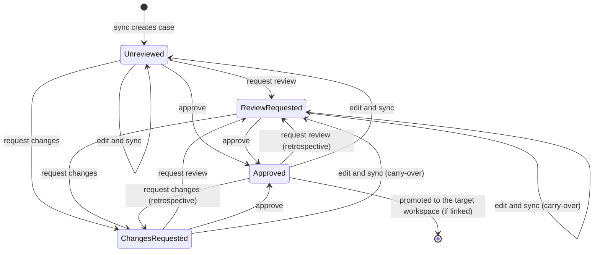

# evalkit usage

For any developer on a team whose evalkit server is already running. You do
not need to know how the server was deployed; you need its URL and a username
from whoever deployed it.

No server yet, or want a sandbox of your own? The try-it stack runs evalkit on
your machine with your LLM as the judge, and walks a sample agent through an
SDK run with traces: the kit is `try/` in the evalkit-deployment skill, and
the walkthrough is [Try locally](../evalkit-docs/try-locally.md).

`evalkit skills install` puts the evalkit user docs in `evalkit-docs/`
beside this skill; links to `../evalkit-docs/` point there. In the evalkit
repository the same pages are in `docs/user/`, and every evalkit server shows
them under `/docs`. In the docs, `{{origin}}` means your evalkit server's URL.

**The CLI is the reference.** `evalkit --help` lists every command and
`evalkit <command> --help` documents arguments, options and an example. Read
those instead of this file for syntax; this file only says which command does
what and explains the two things the help text cannot: how to get connected
and how case review works.

## Install and log in

1. Install the CLI from PyPI at the server's version. evalkit is on PyPI as
   `evalkit-py`; `curl <server url>/api/cli` prints the server's version:

   ```bash
   uv tool install --reinstall "evalkit-py==<version>"
   ```

   With pipx: `pipx install --force "evalkit-py==<version>"`.
   `<server url>/docs/install` in the web UI shows every command with the
   version filled in. `evalkit --version` prints what you have.

   For SDK runs, add evalkit to the project at the same version:
   `uv add "evalkit-py[otel]==<version>"`; `uv.lock` pins it. To keep evalkit
   out of the app's dependencies, run the eval script with
   `uv run --with "evalkit-py[otel]==<version>" python eval/run.py` instead.
   After a server deploy, local and SDK runs refuse to start until the
   versions match: run `evalkit update` from the project root, which
   reinstalls the CLI, moves the `evalkit-py` pin in `pyproject.toml` (and
   runs `uv sync`) and refreshes the skills `evalkit skills install` put in
   your repos, in one step.
2. `evalkit login --url <url>` with your username, e.g. `evalkit login
   --url https://evalkit.internal`. The login is stored in
   `~/.evalkit/config.toml`. The CLI talks to one server at a time; logging
   in again replaces the stored login. Dev and prod are shared workspaces on
   that server (`@dev`, `@prod`), not separate logins. The token expires after
   the TTL the deployer configured (default 30 days) — when commands start
   failing with 401, log in again. `evalkit whoami` shows when the token
   expires; run it before a long run.
3. Scripts and CI have two options. Set `EVALKIT_SERVER_URL` and
   `EVALKIT_TOKEN` in the environment to bypass the file. Or, better, keep a
   password in the secret store and run a non-interactive `evalkit login`
   at the start of every job (see `evalkit login --help`). A stored token
   will expire and break the job; a stored password will not.
   `EVALKIT_TIMEOUT` (seconds, default 120) sets how long the CLI and SDK
   wait for each server call; it does not change the server's limits on
   its own calls to a harness. Every server
   call needs a login, lint included; only `evalkit lint --offline` runs
   without one, and it skips the checks that need server state. The server
   lint covers everything `--offline` does, fixture keys included, so CI
   needs only the server lint. Log in as
   `admin` (the deployer's `EVALKIT_ADMIN_PASSWORD`) in both the lint job
   and the sync job. The sync job targets a shared workspace
   (`--workspace dev`) and passes `--actor <merge author>` so the changelog
   names the real author (`--actor` is admin only). Install
   the CLI at the start of the job so CI always runs the server's build:

   ```bash
   uv tool install --reinstall "evalkit-py==$(curl -fsSL "$EVALKIT_SERVER_URL/api/cli" | jq -r .version)"
   ```

The web UI serves at the server URL with the same credentials.

## Workspaces, references and local runs

Every dataset and agent lives in a workspace:

- Every user owns a **personal workspace** named after their username.
- An admin creates **shared workspaces**, e.g. `dev` and `prod`, and adds
  members as `writer` (may sync and create code-driven agents there) or
  `reviewer` (may approve cases there). Only an admin may point a shared
  agent or remote evaluator at a URL, since the server sends that
  workspace's API keys there. `evalkit workspaces list` and
  `evalkit workspaces members list <ws>` show them.
- CI syncs into the shared workspace the deployer picked (usually `dev`).

References:

- The CLI and SDK accept a bare name (`finance`, `myagent`). It means your
  personal workspace.
- `name@workspace` names any other one: `finance@dev`, `ouragent@prod`.
- API paths and UI URLs always carry `@workspace`.

The agent you pick decides who drives the run:

- An agent without a `harness_url` is code-driven: your own code runs it with
  `run_experiment` (an SDK run), and its trajectories come from its
  OpenTelemetry traces. This is the default way to start, and the try-it
  stack walks through it.
- An agent with a `harness_url` serves the Harness API. Use it for a deployed
  agent: in a shared workspace the server drives it (a server run); in your
  personal workspace your CLI drives it from this machine (a local run).

[Workspaces](../evalkit-docs/workspaces.md) has the
full table, with examples for `dev` and `prod`, and what happens when you run
from several branches.

### Agents and remote evaluators

Agents and remote (HTTP) custom evaluators are rows on the server. You
create them once with the commands below.

```bash
evalkit agents create myagent --trajectory-source otel --mapping mapping.json   # code-driven, your workspace
evalkit agents create ouragent --workspace dev --harness-url https://ouragent.internal/evalkit/v1   # a deployed agent
evalkit evaluators create citation_check --endpoint http://localhost:9000/evaluate
evalkit agents list --workspace dev
```

- `agents create|edit|show|list|archive|restore` and
  `evaluators create|edit|list|archive`. Creating one in a shared workspace
  needs the writer role there.
- An OTel agent (`--trajectory-source otel`) needs `--mapping <file.json>`
  when you create it (see the **connect-traces** skill).
- `agents edit <agent> --trajectory-source otel|atif` switches an existing
  agent. Switching to `otel` takes `--mapping <file.json>`, or reuses the
  agent's last active mapping. It's refused while one of the agent's
  experiments is running; finished experiments keep the source they ran with.
- A run scores with the remote evaluators in the agent's workspace.
- Agents cannot be renamed. Archive one and create another instead.

### evalkit.yaml and credentials

Put an `evalkit.yaml` in your repo. `evalkit run finance --agent myagent`
then syncs `<cases>/finance` to `finance@<you>`, drives `myagent` from this
machine, scores, and writes everything to the server. Run `finance@dev` to
use the shared cases instead (Approved ones only, no sync). Fixture bytes are
read from the `fixtures` directory and uploaded by sha256 on every run or
sync.

```yaml
cases: eval/cases            # optional: directory whose children are datasets
fixtures: eval/fixtures      # optional: fixture bytes, flat, keyed by filename
credentials:                 # env:NAME references only, never the key itself
  agents:
    myagent: env:MYAGENT_API_KEY             # bare name = your workspace
  evaluators:
    citation_check: env:CITATION_API_KEY
  llm_providers:
    https://litellm.example.com: env:LITELLM_API_KEY   # keyed by judge base URL
```

- `credentials.agents` here is only for your personal Harness API agents.
  The server drives shared agents (`ouragent@dev`) with keys stored in its
  database (`evalkit agents create|edit … --api-key-env NAME`, by an admin or
  a writer), so an entry for one here is never read. The same holds for
  shared remote evaluators.
- Keys come from the environment or from a `.env` file next to
  `evalkit.yaml`. A variable set in the environment wins over `.env`.
- An agent or evaluator with no `credentials` entry gets no auth header, and
  the run prints one line saying so.
- A judge with no entry for its base URL fails the run before it starts:
  `no credentials.llm_providers entry for <url>`.
- `credentials.judges` was renamed to `credentials.llm_providers`; the old
  name fails to load.
- `cases` and `fixtures` are only needed to sync your own datasets by name.

### The judge

The judge is chosen per experiment. By default it is the server's
default judge, which an admin sets with `evalkit judge-default set`
(`evalkit judge-default show` prints it); `evalkit run` takes `--judge-model`, `--judge-base-url` and
`--judge-effort` to change it for one experiment. `evalkit evaluate` reuses
the experiment's judge. A server run may only use a judge whose base URL is a
registered LLM provider (`evalkit llm-providers list`).

Inside a dataset directory, subfolders become tags (`finance/statement-analysis/x.yaml`
gets the tag `statement-analysis`), and `evalkit run finance/statement-analysis`
runs that split. Local runs require the CLI and server versions to match.

## SDK runs

An agent that is a library, a notebook, or a service with its own job runner
does not need a Harness API. Install the SDK into the project (the web UI's
Docs → Install page has the exact command for your server; it is
`evalkit-py` with the `otel` extra), create a code-driven agent (no `--harness-url`),
and run the experiment from your own code. A local run uses
your own login for the API calls (the one from `evalkit login`, or
`EVALKIT_SERVER_URL` and `EVALKIT_TOKEN`), and for the exported traces when
the agent runs inside the same Python process. Any exporter outside that
process (a worker, a queue consumer, a service in another language) needs
an agent token from `evalkit tokens create --agent <name>`: it never expires,
while the login token runs out under a long-running worker and the export
fails silently.

```python
# eval/run.py — uv run python eval/run.py
from evalkit.sdk import run_experiment, evaluator, tracing
from myagent import MyAgent, setup_tracing

setup_tracing()  # your own OpenTelemetry provider
tracing.register(agent="myagent")  # add evalkit as an export destination
agent = MyAgent()


def task(input: dict, files: list) -> str:
    return agent.ask(input["question"], attachments=[f.path for f in files])


@evaluator(name="citation_check")
def citation_check(case, run) -> float:
    return 1.0 if run.output and run.output.get("citations") else 0.0


if __name__ == "__main__":
    print(
        run_experiment(
            dataset="finance", agent="myagent", task=task, evaluators=[citation_check]
        ).url
    )
```

```bash
# no --harness-url: a code-driven agent. Trajectories come from its spans.
cp <skills>/connect-traces/references/openinference.json eval/mapping.json
evalkit agents create myagent --trajectory-source otel --mapping eval/mapping.json
```

Rules of the road:

- `run_experiment` is a push model: your process runs the task once per case
  and repetition, exports the agent's OpenTelemetry spans to the server,
  waits for each session to settle, and records runs and scores through the
  API. `dataset`, `case_ids`, `split`, `repetitions`, `model` and `resume` mean
  what they mean on `evalkit run` (see `evalkit --help`).
- The task's parameters bind **by name** from `input`, `files`, `model` and
  `metadata`, in any order; any other required parameter is an error, and
  a task with one parameter of another name (`def task(q)`) gets the input.
  - `input`: the case input, minus `files`.
  - `files`: a list of `Fixture` with `name` (the fixture key), `path` (the
    downloaded file) and `context` (the file's description from the fixture
    registry, the text a Harness API agent gets with the file; show it to
    the agent).
  - `model`: the `model` argument of `run_experiment`, else `None`. It is
    the only way the override reaches the agent; `run_experiment` warns
    when `model` is passed and the task has no `model` parameter.
  - `metadata`: `session_id` (the SDK's session id), `experiment_id`
    (`None` on a dry run), `case_id`, `repetition` (from 1) and `tags`.
- In a notebook use `await arun_experiment(...)`; the sync form refuses to
  run inside an event loop.
- A task may return an ATIF document instead of tracing
  (`RunResult(answer=..., trajectory=...)`).
- An agent in another process joins the run in one of two ways: the task
  injects the W3C trace context (`opentelemetry.propagate.inject(headers)`)
  and the agent continues the trace, or the agent stamps its own session id
  (the attribute its mapping's `session_id` rule names) on its root span and the task returns `RunResult(answer=...,
  session_id=...)`. A queue-backed agent that opens its session in a worker
  returns `RunResult(session_id=...)` with the id its own API returns, or
  the task passes `metadata["session_id"]` along with the job and the agent
  uses it as its session id. The **connect-traces** skill has the details,
  including how a shared worker exports only its eval runs if the developer
  wants that: `tracing.eval_run(metadata)` marks a job, and
  `tracing.processor(agent=..., only=tracing.is_eval_span)` keeps every span
  of a marked trace, bridged spans included. Spans from another process go
  through that process's own exporter, which makes its own choice.
- A pipeline that should not touch the global tracer provider, or code that
  hands spans straight to a processor, uses `tracing.processor(agent=...)`
  or `tracing.exporter(agent=...)` instead of `tracing.register`.
- evalkit records fixed capabilities for a code-driven agent (`thinking`,
  `artifacts` and `workspace` false) and never reads them from spans. Pass
  `--provides thinking=true` to `evalkit agents create` (or `edit`) when its
  spans carry the model's reasoning.
- Python evaluators (`@evaluator`) see the same payload as the HTTP Custom
  Evaluator API and are selected by name under a case's `evaluators.custom`.
  Re-score with `evaluate_experiment(...)` from the same script;
  `evalkit evaluate` refuses those experiments.
- `dry_run=True` runs one case without creating an experiment and prints
  what the server made of the session. Use it while wiring up tracing, then
  follow the **connect-traces** skill if the span kinds or messages look
  wrong. The mapping you created the agent with decides how spans are read.
- `evalkit traces check <agent> <session id>` is the diagnostic; `evalkit
  tokens create --agent <name>` mints a collector-only token for a deployed
  agent that cannot carry your login.
- An agent token is bound to one agent on the server, and the agent must
  exist first (`evalkit agents create`). Neither `tokens create` nor the
  first span export creates an agent. You mint, list and revoke only your
  own tokens.

## Already have a Harness API?

Keep it. Create the agent with `--trajectory-source otel --mapping <file>`
next to its `--harness-url`, and only the trajectory moves to OpenTelemetry: evalkit still drives the agent through the Harness
API (`evalkit run`, server runs, the Workspace tab), and builds the
trajectory from the spans instead of `GET /runs/{id}/trajectory`. The harness
then has to:

- tag the spans of each run with the run id it returned from `POST /runs`, in
  the attribute its mapping's `session_id` rule names (`session.id` in the
  OpenInference reference, `gen_ai.conversation.id` in gen_ai). The root span
  is enough; children inherit.
  A queue-backed harness whose worker opens its own session can return that
  session id as the `run_id` instead;
- export them to the collector (see the **connect-traces** skill). The
  harness learns that a run is an eval run from the `metadata` of
  `POST /runs` (`experiment_id`, `case_id`, `repetition`); a harness that
  exports only eval runs passes that to `tracing.eval_run`, with the
  `run_id` as `session_id`;
- declare `provides.trajectory: false`, or drop the trajectory endpoint.

Move to the SDK (`run_experiment`, no `harness_url`) only to stop hosting
the harness. You lose server-started runs and the Workspace tab, and
`run_experiment` refuses an agent that has a `harness_url`, so it is one or
the other per agent. Do not create a second agent for the same code just to
use `run_experiment`: the two names get separate run histories, tokens and
mappings.

## What evalkit can see of your agent

Each Harness API endpoint lets evalkit do one thing. This table is about
agents that have a Harness API (deployment paths 3b and 3c). On the SDK +
traces path (3a) there is no harness and none of these endpoints exist; those
runs show only what the task returns and the spans it exports.

| Endpoint | Lets evalkit | Capability flag |
| -- | -- | -- |
| `GET /capabilities` | gate evaluators on what the agent supports | part of every Harness API |
| `POST /runs` | invoke the agent on a case | part of every Harness API |
| `GET /runs/{id}` | wait for the run, read its answer and output | part of every Harness API |
| `GET /runs/{id}/trajectory` | read the trajectory (or take it from traces for an `otel` agent) | `provides.trajectory` |
| `GET /runs/{id}/files[/{path}]` | read the workspace: the run's Workspace tab and artifact copies | `provides.workspace` |
| `GET /runs` | list the agent's sessions on the Runs page | `provides.run_listing` |
| `POST /runs/{id}/stop` | cancel a run that hit its time limit | `accepts.stop` |

The Workspace tab needs the files endpoints, so a code-driven agent never has one.
If a developer wants to see the files an agent wrote, the agent needs a
Harness API with at least the files endpoints; its trajectory can still come
from traces (a harness agent with `--trajectory-source otel`). The web UI's Docs →
Harness API page has the full table.

## Which command

| You want to | Command |
|---|---|
| See what datasets exist and their versions | `evalkit datasets list` |
| List a dataset's cases with review state, tags and fixtures (to pick `--case-id`s) | `evalkit datasets list <dataset>` (`--state`, `--tag`) |
| Check case YAML before pushing | `evalkit lint` |
| Check case inputs against an agent's `input_schema` (on demand, not CI) | `evalkit lint <dir> --agent <name>` |
| Publish a dataset directory to your workspace (or `--workspace dev` as a writer there) | `evalkit sync` |
| Run a dataset against an agent (yours from this machine, or a shared one on the server) | `evalkit run` |
| Create or change agents and remote evaluators | `evalkit agents`, `evalkit evaluators` |
| See workspaces and who can write or review in them | `evalkit workspaces` |
| Check which server and user the CLI uses | `evalkit whoami` |
| Check on or summarise an experiment | `evalkit status`, `evalkit summary` |
| List an agent's runs: app runs (outside any experiment) and eval runs | `evalkit runs list` (`--source app\|eval`, `--since`, `--until`) |
| Pull runs to a local directory (ATIF trajectories, case versions, scores) for diagnosis or profiling | `evalkit runs pull <agent>` (same filters, `--limit`, `--offset`) or `evalkit runs pull --experiment <id>` |
| See or fetch a pulled run's workspace files and full tool outputs | `evalkit runs files <pull dir> <run_id>` lists the tree; add `--path <file or folder>` to fetch only those |
| Generate new eval cases from an agent's app runs (production, staging or manual traffic) | the `eval-driven-development` skill, Loop 2 (`runs list` / `runs pull --source app`, then analysis and authoring) |
| Re-score recorded runs after an evaluator change, or retry evaluators that errored | `evalkit evaluate` (`--refetch-trajectories` for runs whose trajectory arrived late) |
| Inspect a traced session, push or list a span mapping | `evalkit traces` (subcommands `check`, `mapping push`, `mapping list`, `import`) |
| Mint, list or revoke a collector token for a deployed agent | `evalkit tokens` |
| Move cases through review | `evalkit review` (subcommands below) |
| Ask about runs, failures, usage or experiments from Claude, Cursor or Codex | the MCP server at `{{origin}}/mcp` (below) |
| Update the CLI and a project's `evalkit-py` pin to the server's version | `evalkit update` |
| Add the SDK to a project | `uv add "evalkit-py[otel]==<server version>"` |
| Vendor these skills into a repo | `evalkit skills install` |

Read `evalkit <command> --help` before you run a command. It is the source of
truth for how the command behaves: for example, `run` executes only Approved
cases on shared datasets (personal datasets run every case) and checks
inputs against the agent's schema, `sync` on a directory prunes, and
`collect` bundles only failures unless `--all`.

Cases that need input files name a fixture key; see
[`references/suite-fixtures.md`](references/suite-fixtures.md) for how to
register the file and upload its bytes before you sync.

## Case review

Review applies to datasets in shared workspaces. Datasets in a personal
workspace have no review state. Review never filters a run: `evalkit run`
executes every case the selection picks, whatever its state. Review decides
what gets promoted (below).

Every case in a shared suite dataset is in exactly one review state, derived from
its current content hash and the latest decisive event recorded at that
hash. Editing a case changes the hash, so an edit resets it to Unreviewed on the
next sync unless carry-over applies (below).



| State | Meaning |
|---|---|
| Unreviewed | No decisive event at the current content. Every new or edited case starts here. |
| Review requested | Someone asked a reviewer to look at this content. |
| Changes requested | A reviewer looked and wants an edit. |
| Approved | A reviewer approved this exact content. In a promotion source, approving promotes it. |

Rules the diagram encodes:

- Any decisive event may be recorded from any state; the latest one wins.
  Requesting review or changes on an Approved case is a retrospective
  re-review.
- An edit is not an event. Re-syncing a case that was in Review requested or
  Changes requested carries the request over to the new content, so a fix
  goes straight back to the reviewer instead of silently becoming Unreviewed.
- Only **reviewers** of that workspace (`evalkit workspaces members list
  <ws> --role reviewer`) may approve or request changes. Everyone can author,
  sync to their own workspace, request review and comment; a comment is
  resolved by its author or a reviewer. Syncing to a shared workspace needs
  the writer role there, which is why CI usually does it as admin.

### Promotion between workspaces

An admin can link two shared workspaces, a **promotion source** and a
**promotion target**: `evalkit workspaces promote-to dev prod`. From then on,
approving a case in `finance@dev` also writes that exact version into
`finance@prod`, already Approved, together with the `dev` overlays that extend
it. Nothing else reaches the target:

- `evalkit sync --workspace prod` and review decisions on `prod` datasets are
  refused with a 409 that names the source. Comments are still allowed; the
  case page on the target links to the same case in the source.
- Removing a case from the source, or requesting changes on a newer version,
  leaves the target untouched. The target keeps the last approved version
  until a newer one is approved.
- Approving the same content again changes nothing in the target except the
  overlays, which are refreshed.
- The target dataset must exist first: `evalkit datasets create finance@prod`
  (a writer of `prod`). Datasets synced into the target *before* the link
  keep their cases; those stay Unreviewed there, and still run, until a
  version is approved in the source.

Both case pages show the twin: on the source, "prod: same version · approved
…" / "ahead of prod" / "not in prod"; on the target, "newer in dev" / "removed
in dev". The `twin` field on `GET /api/datasets/<ref>/cases` carries the same
information. `evalkit workspaces list` shows the link; `promote-to <source>
--none` clears it. One target per source, one source per target, no chains.

Commands, in the order a case usually moves: `evalkit review request` →
reviewer runs `evalkit review queue` → `evalkit review approve` or
`evalkit review request-changes` → author edits, syncs (carry-over) →
reviewer approves. `evalkit review show` prints state, changelog and comments
for a case; `evalkit review comment` and `evalkit review resolve` handle
discussion. The same actions are available on the case page in the web UI.

## From an MCP client

The server is also a read-only MCP server at `{{origin}}/mcp`, for answering
questions from a coding agent or chat client without the CLI: an agent's runs
in a window, why a run failed, usage by day, user or tool, a run's
trajectory and files, and experiments with per-case scores. It cannot change
anything.

Connect with your evalkit login token (the one `evalkit login` stored in
`~/.evalkit/config.toml`):

```bash
claude mcp add --transport http evalkit {{origin}}/mcp --header "Authorization: Bearer $EVALKIT_TOKEN"
```

If your deployer configured `mcp.oauth`, an OAuth client (Claude, Cursor,
Codex) connects with the URL alone and signs in through your identity
provider. Agent tokens are refused. The tools, their limits and the shape of
what they return are in [MCP](../evalkit-docs/mcp.md).

## Deeper work

- Connecting an agent's OpenTelemetry traces, and writing a span mapping
  when its instrumentation is custom: the **connect-traces** skill.
- Writing or editing cases: the **authoring-eval-cases** skill.
- Turning a failing experiment into agent fixes: the
  **eval-driven-development** skill.
- Anything about the server itself — config, credentials, shared
  workspaces, upgrades, user accounts — is the deployer's job and the
  **evalkit-deployment** skill.

For bugs, feature requests and feedback on evalkit, open an issue at https://github.com/inferedge-ai/evalkit/issues; questions go to https://github.com/inferedge-ai/evalkit/discussions.
